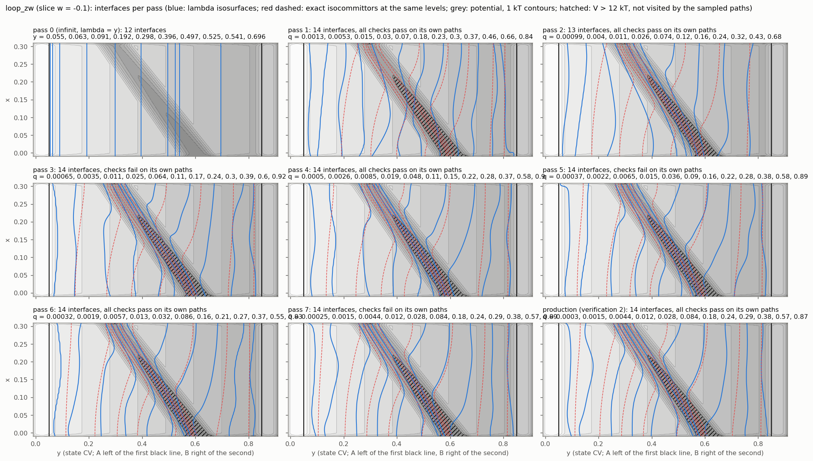
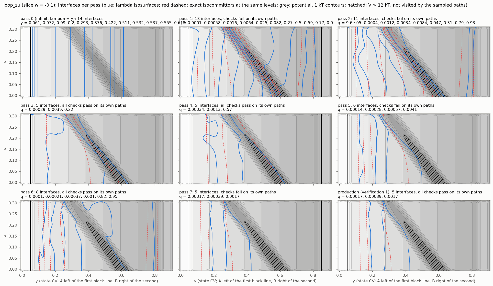
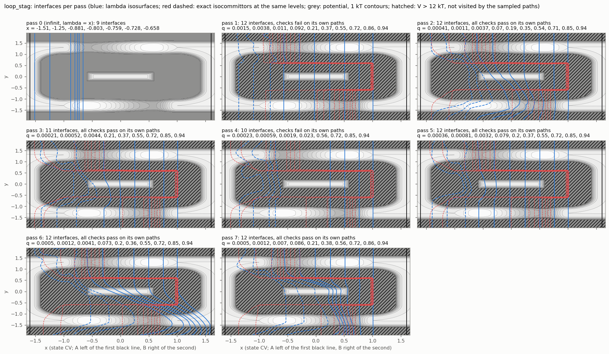

# Order-parameter learning loop for path-sampling initialization

A loop that learns the order parameter lambda(x) over several short sampling passes and hands a frozen lambda,
interfaces that pass a spacing gate, and valid initial paths to a production StapleTIS run. Backend so far:
infretis with the ASE engine (overdamped Langevin, the toy potentials of the toytis runs), with inftools' infinit
as pass 0. Plan and design: [`op_loop_plan.md`](op_loop_plan.md). Code: `examples/param_lambda/loop/`.

## Findings

**StapleTIS weights in infretis (notes section 15): committor pieces need path_f, in every mode including infinite
swap; path_f / path_w stays right for crossing probabilities and rates.** Flat 1D system with its exact committor,
three StapleTIS modes, two seeds of 20 000 cycles each.

Why the two weights answer different questions. The staple extension flips a coin to decide which end of an
LML/RMR core to extend, so one core produces two stored staples (previous turn + core, core + next turn), each
generated with probability 1/2. Shooting therefore samples LML/RMR staples at w = 1/2, consistent with the W matrix
(infretis' own reasoning, confirmed here), and path_f / path_w recovers the natural measure of the stored staple
paths: right for the iSTAR crossing probability and the rate. For the committor, what matters is the measure of the
pieces cut at M, and both stored versions contain the same core. path_f counts each version at 1/2, so the core
counts once, like an LMR core; path_f / path_w counts it twice. Whether a core is LML or LMR is decided after the
M crossing, so doubling LML cores selects on the pieces' future and biases them (as the factor 2 did in toytis,
notes section 9.3). The coin-flipped turn frames enter at 1/2, which is harmless: the coin is independent of the
dynamics.

Test 1, level test: the path-weighted mean of the exact committor at the first frames past M (forward pieces),
two seeds pooled, bootstrap over paths:

| mode | path_f, [1*] / [2*] / [3*] | path_f / path_w, [1*] / [2*] / [3*] |
|---|---|---|
| infinite swap | 0.2567 / 0.4998 / 0.7438 (s.e. 0.0004) | 0.2544 / 0.4998 / 0.7462 |
| nearest-neighbour swaps | 0.2569 / 0.5002 / 0.7437 | 0.2546 / 0.5002 / 0.7460 |
| shooting only | 0.2561 / 0.4994 / 0.7443 | 0.2539 / 0.4993 / 0.7466 |

The three modes agree within one s.e. with path_f; path_f / path_w shifts the two outer ensembles by 0.0023 (about
5 s.e.), toward the side where LML/RMR cores dominate, and leaves the symmetric middle ensemble unchanged.

Test 2, the stopped Z_q of the exact committor on the pieces (forward and mirrored), worst |z| over lags 1-256
(unbiased data stay at about 3 or below, notes section 6.1):

| mode | path_f (seed 1 / seed 2) | path_f / path_w |
|---|---|---|
| infinite swap | 2.9 / 3.6 | 5.6 / 5.1 |
| nearest-neighbour swaps | 1.8 / 2.1 | 4.5 / 4.4 |
| shooting only | 1.8 / 2.2 | 5.9 / 5.5 |

Infinite swap with path_f is slightly above the other modes here, but the level test shows no bias; the likely
cause is stronger correlation between pieces of swapped paths, which the path groups do not fully capture.

Consequence for the loop: training passes and production both run with infinite swap; the training pieces use
path_f (`pool.weighting = "rejections"`); the crossing probability and rate of the production run use path_f /
path_w through inftools' iSTAR analysis. The loader default (`infretis_data.default_weighting`: path_f / path_w
with infinite swap) is unchanged; for committor fits on infretis staple data pass `--weights rejections`.

**Interface thinning on the Z ridge is a sampler-resolution limit, not a lambda defect; placement now refills
wide gaps where the gate allows.** The frozen Z set left one ensemble spanning q = 0.007 -> 0.645 (crossing
probability ratio about 90, the plan caps neighbours at 10). The exact committor on the frames of pass 7 shows why
every planned ridge level was removed:

| exact q | frames | median per-step change of logit q | median per-step change of lambda |
|---|---|---|---|
| 0.001-0.01 (basin side) | 112k | 0.03 | 0.002 |
| 0.01-0.2 (ridge) | 1.5k | 0.4 | 0.015-0.03 |
| 0.2-0.65 (plateau) | 421k | 0.003 | 0.00008 |

The ridge is crossed in about 10 saved frames (subcycles = 1, dt = 0.02 time units). The number of frames between
two committor levels is set by the dynamics, and no monotone relabelling of lambda changes it, so interfaces inside
the ridge fail the gap and shooting-region tests whatever lambda is. A smaller timestep would add ridge frames but
multiply the cost of the plateau paths (8k-13k frames), which dominate the MD budget. The fixable part was the
thinning itself: it removes one planned level at a time and does not put anything back, so a stretch where the
planned levels sat badly ends up empty even when another level in between would pass.

`interfaces.refill` (run at the end of `interfaces.place`) therefore re-inserts, into every interior pair of
neighbours whose crossing-probability ratio exceeds `max_ratio`, the candidate (40, equally spaced in logit h) that
splits the pair best and passes the same margined limits as the thinning; the next pass's re-check on its own
paths, or the freeze's verification rounds, decides whether it survives. A first version refilled against the bare
gate (no margin). It re-added what thinning had just removed (0.8455, "too close to B", in every round), and all
three verification rounds of that set failed on marginal checks: 2 accepted paths with an empty shooting region,
skip_up 2.2% (limit 1%) at 0.7994, gap 0.77 delta between 0.7994 and 0.8142 (`failed_refill_attempts/attempt1_bare_gate_500cycles_freeze.json`,
1.08M MD steps). Where no candidate passes, the pair stays as it
is. For the pairs touching a state, h(lambda_A) = 0 is replaced by the mean h at the first frames past lambda_A
(and likewise at B): with committor-level interfaces P(reach lambda_1 | crossed lambda_A) = E[q at those frames] /
q(lambda_1). The exact committor confirms the identity on Z (1.8e-6 / 1.78e-4 = 0.010; production run 0.0098),
but the exported lambda's ramps hold the model's h near the states too far from 0 and 1, so the model's end-pair
ratios are lower bounds (11 at A and 13 at B, against about 100 and 64): refill adds fewer interfaces there than it
should, never more. On the stored Z paths under the frozen lambda, refill adds lambda = 0.5377 (model q 0.066)
between 0.2925 and 0.7994 (ratio 91 -> 9.7), 0.0614 next to A and 0.8439 next to B: 13 interfaces, all
placement limits pass on the stored paths. Its verification was refused as well (`failed_refill_attempts/attempt2_margined_500cycles_freeze.json`,
3 rounds of 500 cycles): shooting-region q05 of 2 frames (limit 3) in the ensembles (0.5377, 0.7994, 0.8142) and
(0.7994, 0.8142, 0.8219), then gap 0.97 delta between 0.7994 and 0.8142. The failures sit at the closely spaced
plateau-entry interfaces of the original set, not at the refilled ones, and are marginal 5%-quantile and gap
estimates from a few dozen excursions per 500-cycle run. Re-placement on the pooled paths keeps all 13
interfaces every round, so the rounds cannot settle: the pool dilutes the failing run's own paths.

Longer verification (2000 cycles per round, `production.verify_cycles`) did not settle it, so the cause is not only
sample size. The same 13-interface set gave: round 1 (last interface 0.8446) all checks pass; round 2 (0.8449)
`region_frames` fails again in the ensemble (0.5377, 0.7994, 0.8142), q05 = 2 frames (`production_refill2_freeze.json`,
3.0M MD steps for both rounds). In that ensemble each 2000-cycle run holds about 105 excursions from about 85 paths, of
which 1 (round 1) or 4 (round 2) have fewer than 3 frames inside. Infinite-swap path weights are heavy-tailed
(median 9, maximum 56-90), so a single short excursion of weight 76 carries 4.4% of the ensemble's weight, and
the weighted 5% quantile hinges on one or two paths: the short ones hold 2.1% of the weight in round 1 and 5.7%
in round 2, a true value close to the limit. A longer run converges to that value, not away from it. The geometry
behind it: the step size of lambda at 0.7994 (delta 0.0115-0.0153 per saved frame, from the steep part of lambda
that the teacher's plateau overshoot creates) is 7 to 9 times that at 0.8142 (0.0017), and the spacing between
them is 0.0148, i.e. 1.0-1.3 delta at 0.7994 (the gap check's limit is 1). Interface 0.8142 (model q 0.734) is not
needed for the ratio cap: without it, 0.7994 -> 0.8219 has ratio 1.6 and a spacing of 1.5-2 delta.

**Result of the refilled set** (option "thin the verification set on the failed run's own paths"). The second
verification set was thinned on the own paths of the failed 2000-cycle run: 0.8142 removed (gap 1.12 against the
placement limit 1.25), the last interface moved 0.8449 -> 0.8434, giving 12 interfaces
`[0.05, 0.0615, 0.0859, 0.1396, 0.2023, 0.2925, 0.5377, 0.7994, 0.8219, 0.8343, 0.8434, 0.85]`. It passed the gate in one
2000-cycle round, and its 20 000-cycle production (`production_refill3`) gave:

| Z production | interfaces | MD steps | initialization MD steps | rate / exact | rel. error of the rate |
|---|---|---|---|---|---|
| learned lambda, 10 interfaces | 10 | 18.6M | 9.5M | 2.03x | 0.49 |
| learned lambda, refilled and thinned | 12 | 17.8M | 19.2M | 0.97x | 1.79 (inftools P_cross plateau 2.19) |
| seed lambda (control) | 11 | 12.5M | 0 | 3.36x | 3.4 |

The point estimate is on the exact rate, but the error bar is larger than the 10-interface run's (which the convergence
plot shows to be understated), so this does not show an improvement. The refilled interface 0.5377 split the wide gap, yet
the upper half (0.5377 -> 0.7994) now carries 90% of the variance of P_cross: its local crossing probability is 0.026
(block error 1.08). The model's committor predicts 0.10 for this pair (q 0.067 at 0.5377, 0.661 at 0.7994), but the exact
committor at those lambda values is 0.012 and 0.618 (on the training frames, medians within +-0.004 of each lambda), a ratio
of 50, which agrees with the measured 0.026. So the failure is the teacher's overestimate at the low end of the plateau
(model q 5.5x the exact value at 0.5377): refill measured the pair with the model's committor, found it at the cap
(ratio 9.7), and the interface it chose is in exact terms still a factor of 50 from its upper neighbour.
The initialization column includes every verification run of the refill attempts, 9.7M MD steps in all (two refused
sets of three 500-cycle rounds, 2.2M; two 2000-cycle rounds of the 13-interface set, 3.0M; the accepted round, 2.0M, and
the original verification, 0.4M).

**Extending the refilled run to 50 000 cycles exposed an infretis crash, now fixed in the sampler.** At cycle 23 069 a
path with an empty shooting region (`{0: (1, 0)}`) in [1*] was picked for shooting; the staple fallback found no cut path
and the worker died (`AttributeError` on `None`); a plain restart crashed again. Such paths are not rare (7
(path, ensemble) pairs in 13 691 accepted paths; the 2000-cycle verification had none by chance), so the gate's "zero empty
regions" cannot protect a long run. `staple_sh` now rejects the move with the existing status NSG (core change authorized,
`test_no_shooting_point.py`). Effect of the alternative of giving those pairs zero weight, measured on the data up to the
crash (10% burn-in): P_cross 2.764e-6 -> 2.744e-6 (-0.7%), rate 1.652x -> 1.642x exact, a negligible change against the
statistical error. The same data give 1.65x the exact rate at 23k cycles against 0.97x at 20k: the point value moves 70%
within 3000 cycles, inside the error.

Result at 50 000 cycles (45.4M production MD steps, one NSG rejection path active): rate 1.247e-5 per time unit = 1.10x the
exact 1.13e-5, relative error 0.26 (inftools block-error plateau of P_cross 0.37). Estimates against exact over the run:
0.97x at 20k, 1.65x at 23k, 1.10x at 50k; the running estimate has settled within about 10% of the exact rate over the
last 10M steps, and the error band is about a factor 7 narrower than at 20k (1.79 -> 0.26). The 10-interface run (20k
cycles) stays at 2.03x with error 0.49; the seed control (12.5M steps) at 3.36x with error 3.4. The plain-step comparison
at equal MD steps is therefore dominated by the refilled run's 19.2M-step initialization cost (verification rounds),
which has to be amortized over a long production.

Where the production error comes from: the block error of each local crossing probability P(lambda_k+1 |
lambda_k) of the Z production, as a share of the variance of P_cross (`production/ensemble_errors.json`):

| learned lambda, step | local P | rel. error | share |
|---|---|---|---|
| lambda_A -> 0.0859 | 0.0098 | 0.30 | 0.27 |
| 0.0859 -> 0.2925 (3 steps) | 0.30-0.43 | 0.06-0.10 | 0.06 |
| **0.2925 -> 0.7994 (the ridge gap)** | **0.0087** | **0.41** | **0.50** |
| 0.7994 -> 0.8142 | 0.88 | 0.23 | 0.16 |
| 0.8142 -> lambda_B (3 steps) | 0.89-0.97 | 0.02-0.03 | 0.00 |

The two steps with a local crossing probability near 1/100 carry three quarters of the variance; these are exactly
the pairs refill now splits. The seed-lambda control spreads its variance over many steps (largest: the first
step, 0.42). Config keys under `[interfaces]`: `refill` (default true), `refill_candidates` (40). Added and
removed interfaces are recorded in each pass record and freeze round (`refilled`, `removed`).

The production rates below (learned lambda: 2.03x the exact rate, rel. error 0.49, i.e. about one error bar; seed
lambda: 3.36x, rel. error 3.4) were run with the frozen set before refill existed. A second calibration problem is
separate from the thinning: lambda between 0.7 and 0.8 covers exact q from 0.05 to 0.55, from the teacher's
overshoot on the plateau; it shifts where the natural-coordinate levels land but does not cause the removals.

**Convergence of the Z productions** (`figures/pcross_convergence.png` of the loop directory; inftools'
`error_analysis_staple`, run by `python -m loop.pcross_errors loop_z`, drawn by `python -m loop.plots loop_z
--pcross-only`):

- Seed lambda, extended to 50 000 cycles (31.3M MD steps): the rate drifts down over the whole run and ends at
  2.8x exact (relative error 0.45, inftools P_cross plateau 0.72); it has not converged. At equal production MD
  (31M) the refilled learned lambda is within about 10% of exact (it ends at 1.10x, error 0.26, at 45.4M), after
  19.2M MD steps of initialization; the seed lambda needs none.
- Learned lambda: the block-error curve is flat at 0.47, but the running P_cross rises in steps: about 0.65x the
  exact value from 7M to 14M MD steps, then a jump of x3 near 14M to 2x exact. Steps like these come from rare
  heavy paths in the wide ridge ensemble (half of the variance, table above), so 0.47 probably understates the
  error. The inftools rate is defined only from about 14M steps on (a negative MFPT before, rate reported as 0).
- Exact P_cross (dashed) = exact rate x time per frame / the run's flux (flux depends only on lambda_A).

## M3: robustness systems (infretis + ASE)

Three systems, each with the loop of loop_z (1000 cycles per pass, at most 7 passes, gated freeze) and a
20 000-cycle production with lambda frozen (infinite swap). Exact references: the 3D grid committor of the gate
system (`loop/exact_zw.py`, k_AB = 2.115e-5 per time unit, checked against six shooting points and a GPU MD scan)
and the 2D grid committor of the two-channel system (`loop/exact_stag.py`, k_AB = 1.148e-4, half the flux per
channel); the embedding has the committor and rate of Z.

| system | what it tests | CVs | interfaces | initialization MD | production MD | rate / exact | rel. error |
|---|---|---|---|---|---|---|---|
| gate (`loop_zw`, ZChannelsW, dV_w 3 kT) | a slow w that moves the ridge | y, x, w | 14 | 11.1M | 12.8M | **1.14x** | 0.33 |
| embedding (`loop_zu`, uncoupled double well in w) | a slow w the committor does not depend on | y, x, w | 5 | 12.0M | 5.4M | 3.02x | 2.69 |
| two channels (`loop_stag`, staggered channels, overdamped) | a channel missing from the initial data | x, y | 12 | 17.4M | 1.6M | **0.54x** | 0.50 |

Figures (`python -m loop.plots <loop>`; 3D systems: one slice per w well, w = -0.1 and +0.1):

Further figures in each loop's `figures/`: `maps*.png` (model and teacher against the exact committor),
`calibration.png`, `convergence.png`, `tis_pass<k>.png`, `feps_pass<k>.png`.

Findings:
1. **Gate: the loop learns a w-dependent lambda and the rate comes out right** (1.14x, within its error). The
   isosurfaces follow the ridge in each well, which is mirrored between w = -0.1 and +0.1. It
   needed both verification rounds of the freeze (round 1: empty shooting regions in ensemble 1, 1.2% of the paths).
   Pass 1 ran with lambda(y, x) from an early screening attempt; the teacher's RMS against the exact committor went
   from 0.056 (pass 1) to 0.13 (pass 2) and the loop recovered over passes 3-7 (stability 0.79 -> 0.16).
2. **Embedding: an uncoupled slow CV makes the production useless.** In the figure the isosurfaces wander off
   the exact isocommittors from pass 1 on, and the sets shrink to 5 interfaces from pass 3. With w among the inputs,
   lambda moves in large steps along the paths; the spacing gate removed every level between 0.17 and 0.85
   (downward skips of 15% at 0.24 and 0.46) and refill found nothing that passes, so one ensemble spans most of
   the barrier. The teacher's RMS against exact stayed at 0.19-0.20 (gate: 0.056). The CVs a lambda sees therefore
   have to be screened; see 4.
3. **Two channels: the loop does not find a channel that the initial data miss.** State A cuts the strip next to the
   channel mouths, so the RETIS paths of pass 0 stay on the side of infinit's initial path (upper channel: 139551
   frames past x = -0.9 at y > 0, none at y < 0, while plain dynamics from A enters both channels about equally).
   Over 7 passes the lower channel appeared twice (2 and 1895 frames, never past its barrier); the production enters
   it (176k of 856k channel frames) but no path crosses its barrier at x = 0.6, and the rate is half the exact one,
   as expected from one channel. The maps show it: the pass-7 model matches the exact committor in the upper channel
   and is too low before the lower channel's barrier; the interfaces at q 0.2-0.94 are placed for the lower channel
   and lie where q ~ 1 in the upper one (harmless for the estimate, wasted sampling). The relative error (0.50) does not flag the factor 2. Neither the learned lambda nor
   the trust-region blend can create transitions that the sampler does not make.
4. **CV screening is not solved.** Neither the validation SD(Z_q) (insensitive: -1% when leaving out x on the gate)
   nor the held-out Dirichlet energy (single block or 5-fold) separates the coupled w (+41%, 5/5 folds) from the
   uncoupled one (+24%, 4/5 folds): with the path-ensemble weights the energy is not the equilibrium Dirichlet form,
   so the committor need not minimize it. M3 used fixed CV sets (`[screen] enabled = false`); `loop/screen.py` is
   kept for a later test (e.g. the committor conditioned on w bins).
5. **Fixes found on the way** (none could show on Z or cc, which reach B in pass 0 and have small pools): the
   teacher's provisional B now reaches the export (it was always None, so lambda saturated past the data front);
   the blend's seed table ends at the states (it held its last value beyond the data); a pass writes its fit,
   lambda and interfaces to `fit.json` before its run and an interrupted run is resumed to its full length (it was
   taken as finished); the pool view drops whole paths at random above `pool.max_frames` (the 3D pools hold 21-23M
   frames, 5.9 GB as a view); the GPU lock exempts every process that has the lock file open (a deadlock between
   an offline script and loop_stag).
6. **An infretis edge case that is not understood**: `REPEX_state_staple.treat_output` raised `ValueError: Ensemble
   ... has invalid pptype RML` twice (loop_zu pass 1, top ensemble; the gate production at cycle 15 512, ensemble 1).
   It stores a path whose two turns lie at one interface only as LML in ensemble 1 and RMR in the last ensemble.
   A replay of the loop_zu state (2771 cycles) and the resumed gate production with a wrapper that saves the trial
   path did not reproduce it, so the path that triggers it is still unknown; a guard built on a synthetic path was
   reverted (that path cannot be produced: the extender stops at the first turn).

## How to read the numbers

- *teacher RMS vs exact*: path-weighted RMS of q_np against the exact committor over all pooled frames between
  the states (validation only, never used for fitting, selection or stopping).
- *spread vs exact*: the isosurface spread of the exported lambda (variance of logit q_exact in slabs of
  |logit m - logit q_k| < 0.2 at 10 levels from 1e-3 to 0.95); a lambda whose isosurfaces are isocommittors scores
  0.013.
- *SD(Z_q)*: stopped Z_q of the model's committor on the newest pass, maximum SD over q across lags 1-256;
  *previous model*: the same for lambda_{k-1} before the refit (the prospective test).
- *re-check*: every spacing check (skips both ways, gap, distance from A/B, shooting-region occupancy,
  single-step turns, accepted paths with an empty shooting region) on the pass's own paths, at the saved-frame
  resolution at which infretis evaluates lambda.
- Rates and crossing probabilities come only from production runs with lambda frozen.

## Per-system tables (generated by `python -m loop.report`)

### StapleTIS weights in infretis (notes section 15), flat 1D, exact committor

| run | weighting | pieces | exact q: stopped Z_q max abs z at lags 1, 4, 16, 64, 256 | mean exact q at the first frames past M, per ensemble |
|---|---|---|---|---|
| inf | path_f | 19432 | 2.91, 2.38, 2.42, 1.89, 1.14 | 1: 0.0274, 2: 0.2567, 3: 0.5002, 4: 0.7439 |
| inf | path_f / path_w | 19432 | 4.71, 4.89, 4.95, 5.59, 5.20 | 1: 0.0274, 2: 0.2544, 3: 0.5002, 4: 0.7462 |
| inf_s2 | path_f | 19788 | 2.76, 2.58, 3.59, 2.81, 2.70 | 1: 0.0274, 2: 0.2567, 3: 0.4993, 4: 0.7438 |
| inf_s2 | path_f / path_w | 19788 | 4.95, 4.76, 4.72, 5.05, 4.33 | 1: 0.0274, 2: 0.2544, 3: 0.4994, 4: 0.7461 |
| nn | path_f | 16293 | 1.48, 1.44, 1.73, 1.18, 1.76 | 1: 0.0271, 2: 0.2564, 3: 0.5001, 4: 0.7435 |
| nn | path_f / path_w | 16293 | 4.38, 4.51, 4.40, 4.36, 3.94 | 1: 0.0271, 2: 0.2540, 3: 0.5003, 4: 0.7459 |
| nn_s2 | path_f | 16441 | 1.60, 1.50, 2.12, 1.61, 1.33 | 1: 0.0274, 2: 0.2575, 3: 0.5003, 4: 0.7439 |
| nn_s2 | path_f / path_w | 16441 | 4.15, 4.00, 4.24, 4.40, 4.20 | 1: 0.0274, 2: 0.2553, 3: 0.5000, 4: 0.7461 |
| sh | path_f | 16874 | 1.02, 1.14, 1.25, 1.24, 1.78 | 1: 0.0274, 2: 0.2568, 3: 0.4991, 4: 0.7454 |
| sh | path_f / path_w | 16874 | 4.86, 5.06, 5.54, 5.90, 5.88 | 1: 0.0274, 2: 0.2545, 3: 0.4992, 4: 0.7475 |
| sh_s2 | path_f | 16602 | 2.20, 1.99, 1.90, 1.27, 1.01 | 1: 0.0274, 2: 0.2555, 3: 0.4997, 4: 0.7436 |
| sh_s2 | path_f / path_w | 16602 | 4.53, 4.58, 4.56, 5.48, 4.55 | 1: 0.0274, 2: 0.2534, 3: 0.4995, 4: 0.7460 |

### loop_cc

Pass 0 (infinit, seed order parameter): reached B = True; 2 iterations stored. Total MD steps of the initialization: 1,529,275.

| pass | interfaces | teacher RMS vs exact | SD(Z_q) new | SD(Z_q) previous model | stability max | spread vs exact | logit RMSE vs exact | longest / shortest median length [1*]+ | re-check | MD steps | fit s | pass s |
|---|---|---|---|---|---|---|---|---|---|---|---|---|
| 1 | 12 | 0.190 | 7.79 | – | – | 0.0662 | 1.555 | 442 / 172 | OK | 169,387 | 118 | 258 |
| 2 | 12 | 0.085 | 9.23 | 43.16 | 0.167 | 0.0240 | 0.661 | 409 / 232 | OK | 178,363 | 150 | 296 |
| 3 | 12 | 0.067 | 11.31 | 15.05 | 0.040 | 0.0161 | 0.507 | 402 / 224 | OK | 183,407 | 184 | 340 |
| 4 | 12 | 0.044 | 12.14 | 18.78 | 0.040 | 0.0285 | 0.346 | 431 / 250 | OK | 204,918 | 294 | 414 |
| 5 | 12 | 0.033 | 19.29 | 24.86 | 0.145 | 0.0180 | 0.313 | 421 / 249 | OK | 186,295 | 357 | 588 |

Last interfaces: `[0.15, 0.3272, 0.46141, 0.56327, 0.651, 0.72203, 0.77536, 0.81359, 0.83322, 0.84167, 0.84639, 0.85]`
Re-check of the last pass on its own paths: all checks pass.
Accepted paths with an empty shooting region per ensemble: 1: 0/142, 2: 0/118, 3: 0/130, 4: 0/135, 5: 0/137, 6: 0/127, 7: 0/107, 8: 0/96, 9: 0/109, 10: 0/115, 11: 0/74.

| production run | interfaces | cycles | MD steps | MD steps of the initialization | P_cross (rel. error) | rate per time unit (rel. error) | rate / exact |
|---|---|---|---|---|---|---|---|
| learned lambda (frozen) | 12 | 20,000 | 3,845,786 | 1,529,275 | 0.000761 (0.24) | 0.00184 (0.19) | 1.19x |
| seed lambda (control) | 11 | 20,000 | 4,319,110 | 0 | 0.000706 (0.24) | 0.00158 (0.20) | 1.02x |

Exact rate 0.00155 per time unit (toy2d.exact_committor_brownian (TPT on a grid, h = 0.004)).

### loop_z

Pass 0 (infinit, seed order parameter): reached B = True; 3 iterations stored. Total MD steps of the initialization: 19,204,387.

| pass | interfaces | teacher RMS vs exact | SD(Z_q) new | SD(Z_q) previous model | stability max | spread vs exact | logit RMSE vs exact | longest / shortest median length [1*]+ | re-check | MD steps | fit s | pass s |
|---|---|---|---|---|---|---|---|---|---|---|---|---|
| 1 | 12 | 0.126 | 11.23 | – | – | 0.0432 | 1.139 | 17284 / 233 | fails | 356,473 | 452 | 624 |
| 2 | 8 | 0.143 | 32.89 | 58.25 | 0.719 | 0.1612 | 2.044 | 13115 / 370 | OK | 449,949 | 501 | 669 |
| 3 | 11 | 0.094 | 12.76 | 22.73 | 0.176 | 0.1069 | 1.477 | 4374 / 435 | OK | 636,718 | 576 | 800 |
| 4 | 11 | 0.055 | 66.96 | 53.41 | 2.445 | 0.1261 | 0.859 | 10647 / 400 | fails | 1,027,420 | 528 | 863 |
| 5 | 12 | 0.103 | 37.32 | 34.41 | 0.309 | 0.2097 | 0.719 | 8969 / 537 | fails | 750,182 | 528 | 792 |
| 6 | 11 | 0.077 | 36.69 | 70.61 | 0.078 | 0.2171 | 0.671 | 9402 / 366 | fails | 696,832 | 445 | 685 |
| 7 | 11 | 0.064 | 10.56 | 12.49 | 0.109 | 0.1761 | 0.440 | 15208 / 397 | fails | 637,408 | 463 | 689 |

Last interfaces: `[0.05, 0.08594, 0.13956, 0.20231, 0.29253, 0.47275, 0.79936, 0.81418, 0.82187, 0.83431, 0.85]`
Re-check of the last pass on its own paths: [['region_frames', 5, 2.0]].
Accepted paths with an empty shooting region per ensemble: 1: 0/123, 2: 0/58, 3: 0/66, 4: 0/72, 5: 0/60, 6: 0/45, 7: 0/17, 8: 0/21, 9: 0/33, 10: 0/47.

Frozen set (verification 1): `[0.05, 0.0859, 0.1396, 0.2023, 0.2925, 0.7994, 0.8142, 0.8219, 0.8343, 0.85]`.
Verification round 1: removed [(0.4728, 'region_frames 3 (ensemble/interface 5)')]; passes; 398,006 MD steps.

| production run | interfaces | cycles | MD steps | MD steps of the initialization | P_cross (rel. error) | rate per time unit (rel. error) | rate / exact |
|---|---|---|---|---|---|---|---|
| learned lambda (frozen) | 10 | 20,000 | 18,648,151 | 19,204,387 | 3.15e-06 (0.50) | 2.3e-05 (0.49) | 2.03x |
| learned lambda, refilled interfaces | 12 | 50,000 | 45,387,843 | 19,204,387 | 1.8e-06 (0.31) | 1.25e-05 (0.26) | 1.10x |
| seed lambda (control) | 11 | 50,000 | 31,289,761 | 0 | 4.62e-06 (0.50) | 3.17e-05 (0.45) | 2.80x |

Exact rate 1.13e-05 per time unit (toy2d.exact_committor_brownian (TPT on a grid, h = 0.004)).

### loop_zw

Pass 0 (infinit, seed order parameter): reached B = True; 3 iterations stored. Total MD steps of the initialization: 11,100,533.

| pass | interfaces | teacher RMS vs exact | SD(Z_q) new | SD(Z_q) previous model | stability max | spread vs exact | logit RMSE vs exact | longest / shortest median length [1*]+ | re-check | MD steps | fit s | pass s |
|---|---|---|---|---|---|---|---|---|---|---|---|---|
| 1 | 14 | 0.056 | 89.65 | – | – | 0.3528 | 1.745 | 1483 / 220 | OK | 538,471 | 683 | 1388 |
| 2 | 13 | 0.130 | 47.90 | 73.38 | 0.789 | 0.5642 | 1.424 | 1930 / 322 | OK | 656,558 | 604 | 1483 |
| 3 | 14 | 0.097 | 41.90 | 72.42 | 0.393 | 0.4062 | 1.276 | 2113 / 254 | fails | 686,002 | 560 | 1384 |
| 4 | 14 | 0.112 | 24.31 | 36.30 | 0.525 | 0.2677 | 1.116 | 1946 / 223 | OK | 596,151 | 528 | 1114 |
| 5 | 14 | 0.076 | 23.08 | 31.71 | 0.483 | 0.2593 | 0.976 | 2398 / 269 | fails | 702,629 | 544 | 1436 |
| 6 | 14 | 0.096 | 31.39 | 29.27 | 0.272 | 0.2194 | 0.875 | 1844 / 335 | OK | 599,694 | 531 | 60 |
| 7 | 14 | 0.078 | 16.03 | 18.88 | 0.160 | 0.2202 | 0.791 | 2134 / 120 | fails | 671,279 | 511 | 1190 |

Last interfaces: `[0.05, 0.07586, 0.15767, 0.24617, 0.343, 0.4414, 0.56421, 0.65, 0.68276, 0.70673, 0.73897, 0.78551, 0.83694, 0.85]`
Re-check of the last pass on its own paths: [['empty_region', 1, 0.010579633783006932]].
Accepted paths with an empty shooting region per ensemble: 1: 0/112, 2: 0/65, 3: 0/92, 4: 0/100, 5: 0/88, 6: 0/67, 7: 0/56, 8: 0/84, 9: 0/121, 10: 0/123, 11: 0/99, 12: 0/65, 13: 0/48.

Frozen set (verification 2): `[0.05, 0.0807, 0.1577, 0.2462, 0.343, 0.4414, 0.5642, 0.65, 0.6828, 0.7067, 0.739, 0.7855, 0.834, 0.85]`.
Verification round 1: removed none; fails [['empty_region', 1, 0.012419873319826986], ['accepted_paths_with_empty_shooting_region', -1, 1]]; 1,211,645 MD steps.
Verification round 2: removed [(0.0759, 'gap 1.22; dist_a 3.3'), (0.8369, 'last interface too close to B')], refilled [0.0807, 0.834]; passes; 1,207,831 MD steps.

| production run | interfaces | cycles | MD steps | MD steps of the initialization | P_cross (rel. error) | rate per time unit (rel. error) | rate / exact |
|---|---|---|---|---|---|---|---|
| learned lambda (frozen) | 14 | 20,000 | 12,761,422 | 11,100,533 | 3.36e-06 (0.35) | 2.41e-05 (0.33) | 1.14x |

Exact rate 2.12e-05 per time unit (loop/exact_zw.py (3DTPT on a grid, h = 0.004): examples/figures_by_potential/3d_zpot_w/exact/q_tpt_h0.004.npz).

### loop_zu

Pass 0 (infinit, seed order parameter): reached B = True; 4 iterations stored. Total MD steps of the initialization: 12,029,792.

| pass | interfaces | teacher RMS vs exact | SD(Z_q) new | SD(Z_q) previous model | stability max | spread vs exact | logit RMSE vs exact | longest / shortest median length [1*]+ | re-check | MD steps | fit s | pass s |
|---|---|---|---|---|---|---|---|---|---|---|---|---|
| 1 | 13 | 0.200 | 72.42 | – | – | 0.3399 | 1.029 | 7204 / 36 | fails | 1,038,696 | 443 | 1199 |
| 2 | 11 | 0.166 | 49.91 | 50.12 | 1.641 | 0.4352 | 0.767 | 11048 / 132 | fails | 1,028,827 | 514 | 1145 |
| 3 | 5 | 0.028 | 28.64 | 24.16 | 0.824 | 0.9605 | 1.064 | 22676 / 1124 | OK | 468,662 | 562 | 912 |
| 4 | 5 | 0.082 | 0.00 | 0.00 | 0.590 | 1.0978 | 0.985 | 74411 / 1264 | OK | 432,639 | 513 | 1133 |
| 5 | 6 | 0.176 | 0.44 | 0.61 | 0.078 | 0.7646 | 1.179 | 48751 / 488 | fails | 531,382 | 564 | 1336 |
| 6 | 8 | 0.173 | 0.10 | 0.13 | 0.592 | 0.9339 | 1.327 | 9700 / 325 | OK | 639,619 | 452 | 1459 |
| 7 | 5 | 0.137 | 6.25 | 5.21 | 0.231 | 0.5468 | 1.499 | 1154 / 752 | fails | 333,837 | 552 | 1162 |

Last interfaces: `[0.05, 0.06866, 0.08844, 0.1664, 0.85]`
Re-check of the last pass on its own paths: [['skip_dn', 3, 0.024675396721120017]].
Accepted paths with an empty shooting region per ensemble: 1: 0/411, 2: 0/54, 3: 0/54, 4: 0/0.

Frozen set (verification 1): `[0.05, 0.0687, 0.0884, 0.1664, 0.85]`.
Verification round 1: removed none; passes; 638,194 MD steps.

| production run | interfaces | cycles | MD steps | MD steps of the initialization | P_cross (rel. error) | rate per time unit (rel. error) | rate / exact |
|---|---|---|---|---|---|---|---|
| learned lambda (frozen) | 5 | 20,000 | 5,434,211 | 12,029,792 | 4.78e-06 (2.86) | 3.41e-05 (2.69) | 3.02x |

Exact rate 1.13e-05 per time unit (z_br: toy2d.exact_committor_brownian (TPT on a grid, h = 0.004)).

### loop_stag

Pass 0 (infinit, seed order parameter): reached B = True; 11 iterations stored. Total MD steps of the initialization: 17,365,098.

| pass | interfaces | teacher RMS vs exact | SD(Z_q) new | SD(Z_q) previous model | stability max | spread vs exact | logit RMSE vs exact | longest / shortest median length [1*]+ | re-check | MD steps | fit s | pass s |
|---|---|---|---|---|---|---|---|---|---|---|---|---|
| 1 | 12 | 0.025 | 13.42 | – | – | 0.0319 | 1.284 | 192 / 93 | fails | 77,570 | 170 | 1057 |
| 2 | 12 | 0.017 | 50.35 | 177.10 | 0.096 | 0.0167 | 2.846 | 210 / 84 | OK | 73,958 | 173 | 658 |
| 3 | 11 | 0.012 | 29.71 | 39.79 | 0.030 | 0.0145 | 1.530 | 162 / 105 | OK | 76,063 | 190 | 1313 |
| 4 | 10 | 0.011 | 7.12 | 7.32 | 0.040 | 0.0171 | 0.497 | 148 / 99 | fails | 74,887 | 199 | 1191 |
| 5 | 12 | 0.010 | 5.42 | 8.85 | 0.202 | 0.0280 | 0.325 | 198 / 97 | OK | 71,749 | 217 | 735 |
| 6 | 12 | 0.008 | 14.70 | 20.96 | 29.452 | 0.0156 | 0.674 | 197 / 90 | OK | 75,376 | 232 | 768 |
| 7 | 12 | 0.007 | 14.10 | 20.90 | 0.061 | 0.0193 | 0.622 | 192 / 100 | OK | 70,449 | 244 | 332 |

Last interfaces: `[-1.6, -1.41322, -1.24302, -0.63642, 0.46594, 0.87854, 1.14869, 1.33162, 1.45092, 1.52837, 1.57303, 1.6]`
Re-check of the last pass on its own paths: all checks pass.
Accepted paths with an empty shooting region per ensemble: 1: 0/91, 2: 0/86, 3: 0/79, 4: 0/21, 5: 0/40, 6: 0/41, 7: 0/38, 8: 0/86, 9: 0/128, 10: 0/109, 11: 0/49.

Frozen set (pass 7): `[-1.6, -1.4132, -1.243, -0.6364, 0.4659, 0.8785, 1.1487, 1.3316, 1.4509, 1.5284, 1.573, 1.6]`.

| production run | interfaces | cycles | MD steps | MD steps of the initialization | P_cross (rel. error) | rate per time unit (rel. error) | rate / exact |
|---|---|---|---|---|---|---|---|
| learned lambda (frozen) | 12 | 20,000 | 1,591,950 | 17,365,098 | 1.89e-05 (0.48) | 6.23e-05 (0.50) | 0.54x |

Exact rate 0.000115 per time unit (toy2d.exact_committor_brownian (TPT on a grid, h = 0.01): examples/figures_by_potential/2d_staggered_channels/exact/brownian_g1_dt0.005/q_tpt_h0.01.npz).
