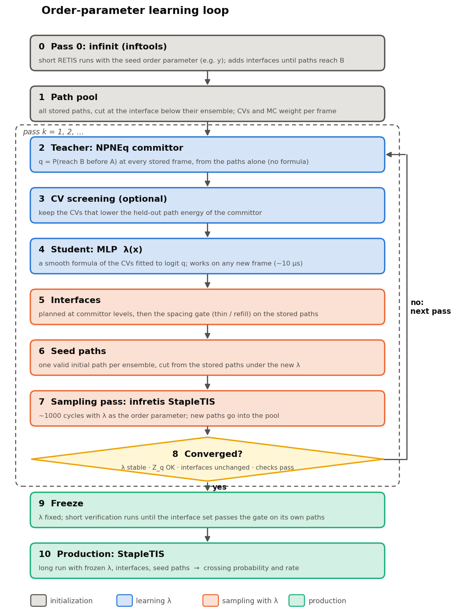
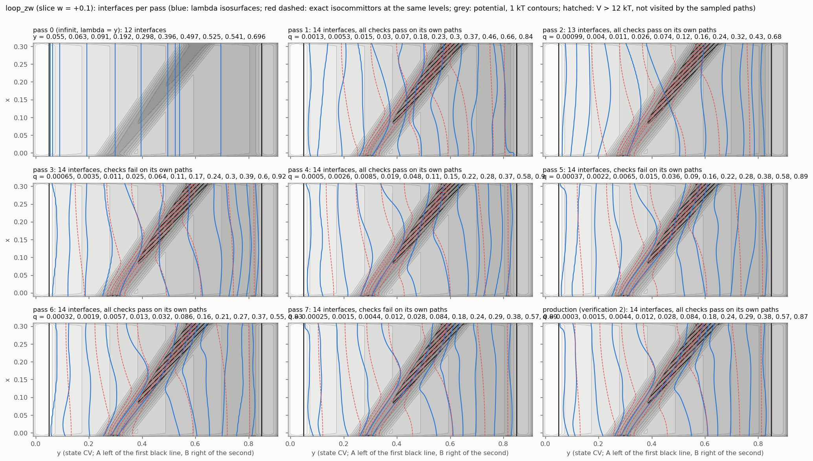
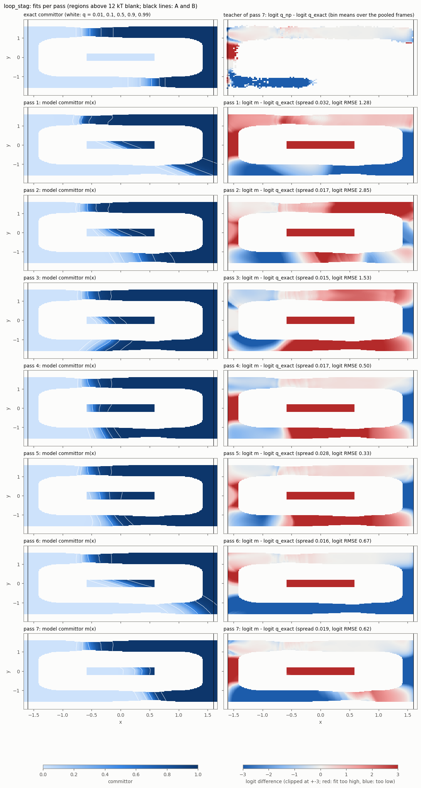

# Order-parameter learning loop for path-sampling initialization

A loop that learns the order parameter lambda(x) over several short sampling passes and hands a frozen lambda,
interfaces that pass a spacing gate, and valid initial paths to a production StapleTIS run. Backend so far:
infretis with the ASE engine (overdamped Langevin, the toy potentials of the toytis runs), with inftools' infinit
as pass 0. Plan and design: [`op_loop_plan.md`](op_loop_plan.md). Code: `examples/param_lambda/loop/`.

## The method

**Goal.** Path sampling needs an order parameter λ(x) that tells how far a configuration has progressed from A
to B, plus interfaces placed along it. The ideal λ is the **committor** q(x): the probability that a trajectory
started at x reaches B before A. The loop learns an approximation of q from short sampling runs, then hands it
to a production run.

Settings are config keys of `examples/param_lambda/configs/loop_*.toml`. The values below are the defaults of
`loop_flat1d.toml`, with Z's own value in brackets (`loop_z.toml`) where it differs.

0. **Pass 0, infinit** (`[pass0]`, `loop/backends/infretis_backend.py`, `pass0_infinit.py`).
   - inftools' infinit runs short RETIS iterations with the seed order parameter (the state CV, e.g. y), 100
     [200] steps each, at most 8 [12] iterations. infinit settings: `pL = 0.3`, `lamres = 0.001`, `skip = 0.1`.
   - It stops when 20 finished paths (`n_b`) have reached B.
   - Every iteration is stored in the pool.
1. **Path pool** (`[pool]`, `loop/pool.py`).
   - Every path of every pass, cut at its first crossing of the interface below its ensemble, with the CVs and the
     weight of each frame.
   - Weight: path_f (`weighting = "rejections"`), which is the unbiased one for committor pieces (Findings).
   - After a λ switch the first 20% of each pass's paths are dropped (`burn_in`).
   - At most 1500 paths per ensemble.
   - MC blocks of 10% of each pass give the validation and test splits.
2. **Teacher, NPNEq** (`[teacher]`, `loop/teacher.py`; method: `optimalrcs-cupy/nonparametrics.py`).
   - **Setup:** a fixed budget of 3000 [6000] iterations per pass, at most 4M frames (whole pieces dropped at
     random beyond that, the rest reweighted), lag 1.
   - **Each iteration:** a correction that is a polynomial of degree `ny = 6` in (current q, one CV drawn at
     random), with ridge regularization `gamma = 0.1`. Z also offers the CVs u, v = (y ± x)/√2 (`features`).
   - **Warm start:** stored frames keep their q from the last pass; new frames start from the current λ's
     committor.
   - **Provisional B:** while fewer than 20 paths reach B, q is fitted with B moved down to the highest interface
     that at least 50 paths reached (`provisional_b`, `n_front`).
3. **CV screening** (`[screen]`, `loop/screen.py`; on by default for systems with more than two CVs).
   - The student is trained on all CVs and once with each CV left out, in 5-fold cross-validation over the MC
     blocks.
   - A CV is kept if leaving it out raises the held-out Dirichlet energy Σ w (q(x_{t+1}) − q(x_t))² by more than
     10% (`tol`) in total and in a majority of the folds.
   - The state CV is always kept.
4. **Student, MLP** (`[student]`, `loop/student.py`; model `models.MLP`).
   - **Architecture:** SiLU network with two hidden layers of 64 (`arch = [64, 64]`), warm-started from the last
     pass.
   - **Loss:** weighted MSE of logit q (×5 for 0.05 < q < 0.95), plus β = 10 × the MSE of the increments at lags
     1, 2, 4, 8 frames along the pieces.
   - **Training:** 24 epochs, batch 4096, AdamW (lr 3e-3, weight decay 1e-4). Of 8 checkpoints, the one with the
     lowest stopped SD(Z_q) on the validation paths is kept.
   - **Export** (`lambda_runtime.LambdaModel`):
     - a monotone calibration of the output to q;
     - λ = the state CV in A and B, so the states do not change;
     - ramps near the states that keep the lowest planned level at least 3 RMS steps from A, and the highest
       one from B;
     - a fallback to a monotone function of the state CV on frames outside the training data (Mahalanobis
       distance).
5. **Interfaces** (`[interfaces]`, `loop/interfaces.py`; background in
   [`param_lambda_interface_spacing.md`](param_lambda_interface_spacing.md)). Two methods:
   - `method = "dp"` (loop_z_dp, loop_z_lgv_dp): dynamic programming towards crossing probability `target_p` per
     pair, then the evening and balance steps for even shooting-region lengths. Every step and criterion is in
     [`op_loop_placement.md`](op_loop_placement.md).
   - `method = "plan"` (default, all earlier loops) is described here. It is also dp's fallback.
   - **Plan** (`plan_natural`):
     - 8 [10] interior levels, equally spaced in the natural coordinate u(h) = ∫ dh / √(2 D(h)). Here h is the
       model's committor and D(h) the diffusion of h per saved frame, so each gap takes about the same
       diffusive time to cross.
     - The crossing-probability ratio of neighbours is capped at 10 (`max_ratio`).
     - Levels are added two at a time while the predicted longest median path length × 1.3 exceeds
       `length_budget` = 5000 [6000] frames.
   - **Gate** (`check`), on the stored paths:
     - **skip:** P(a crossing of λ_k also crosses the next interface in the same step) ≤ 1% (`eps`), both
       directions, where λ_k has ≥ 100 crossings.
     - **gap:** λ_{k+1} − λ_k ≥ 1 × (95% quantile of the per-step change of λ at λ_k) (`c`).
     - **distance from the states:** the 5% quantile of (s − λ_A) on frames crossing the first interface ≥ 3
       RMS steps of s (`n_a`); likewise for the last interface against B.
     - **shooting region:** per ensemble, an excursion through its window must hold frames: P(empty) ≤ 1% and
       the 5% quantile of the number of frames inside ≥ 3 (`n_sh`).
     - **single-step turns:** ≤ 1% of the replayed staple turns.
   - **Thin** (`place`): placement uses limits 1.25× stricter than the gate (`place_margin`), so a set that
     passes on the stored paths also passes on the next pass's own paths.
     - A greedy forward pass drops planned levels that fail skip, gap or distance.
     - Then one interface per round is removed from the windows that fail the ensemble or turn checks.
   - **Refill** (`refill`, default on): every pair of neighbours whose crossing-probability ratio still exceeds
     10 gets the best-splitting of 40 candidates (equally spaced in logit h) that passes the same margined limits.
     At most 10 are added.
6. **Seed paths** (`loop/seed.py`). For each ensemble, a segment of a stored path, newest passes first, that is
   valid under the new λ and interfaces. Staple seeds are extended to the sampler's turn rule and validated with
   infretis' own `StaplePath`.
7. **Sampling pass** (`[run]`, `loop/passes.py: run_and_check`).
   - infretis StapleTIS with infinite swap, 500 [1000] cycles, 2 [4] workers, with λ as the order parameter
     (`infretis_orderp.LearnedLambda`).
   - The new paths go into the pool, and the gate is re-run on the pass's own paths (the "re-check").
8. **Converged?** (`[stop]`, `loop/passes.py: stop_test`). All of these must hold:
   - **stability:** the isosurface spread of the new λ on the old λ's committor slabs, and vice versa, ≤ 3× the
     slab floor (0.013) at every resolved level;
   - **prospective Z_q:** the previous λ, not refitted, scores SD(Z_q) on the newest paths within 20% of the
     refit (`zq_tolerance`);
   - **interfaces:** no interface moved by more than 2% of λ_B − λ_A (`interface_tol`);
   - **re-check:** passes, with no unverified interface;
   - **OOD:** the share of frames outside the training data is ≤ 1% and not rising.

   Otherwise the loop runs another pass, up to 4 [7] passes or 5e7 [4e8] MD steps (`max_passes`,
   `max_md_steps`), and then freezes anyway.
9. **Freeze** (`[production]`, `loop/passes.py: freeze`). λ is fixed.
   - If the last pass's re-check failed: up to 3 [2] verification runs of 500 [2000] cycles (`verify_rounds`,
     `verify_cycles`). Each re-thins the interfaces on the failed run's own paths and is re-checked on its own
     paths.
   - If none passes, the freeze is refused (`freeze.json`).
10. **Production** (`run.py loop <config> --production`, `loop/rates.py`). A StapleTIS run of 10 000 [20 000]
    cycles, infinite swap, with the frozen λ, interfaces and seed paths. Crossing probability and rate come from
    inftools' iSTAR analysis (path_f / path_w weights), with block errors.

Full design and its review decisions: [`op_loop_plan.md`](op_loop_plan.md). Per-pass records:
`<loop dir>/pass_<k>/manifest.json`.

The flowchart is drawn by `python -m loop.flowchart`.

## Findings

**StapleTIS weights in infretis (notes section 15): committor pieces need path_f, in every mode including infinite
swap; path_f / path_w stays right for crossing probabilities and rates.** Flat 1D system with its exact committor,
three StapleTIS modes, two seeds of 20 000 cycles each.

Why the two weights answer different questions. The staple extension flips a coin to decide which end of an
LML/RMR core to extend, so one core produces two stored staples (previous turn + core, core + next turn), each
generated with probability 1/2. Shooting therefore samples LML/RMR staples at w = 1/2, consistent with the W matrix
(infretis' own reasoning, confirmed here), and path_f / path_w recovers the natural measure of the stored staple
paths: right for the iSTAR crossing probability and the rate. For the committor, what matters is the measure of the
pieces cut at M, and both stored versions contain the same core. path_f counts each version at 1/2, so the core
counts once, like an LMR core; path_f / path_w counts it twice. Whether a core is LML or LMR is decided after the
M crossing, so doubling LML cores selects on the pieces' future and biases them (as the factor 2 did in toytis,
notes section 9.3). The coin-flipped turn frames enter at 1/2, which is harmless: the coin is independent of the
dynamics.

Test 1, level test: the path-weighted mean of the exact committor at the first frames past M (forward pieces),
two seeds pooled, bootstrap over paths:

| mode | path_f, [1*] / [2*] / [3*] | path_f / path_w, [1*] / [2*] / [3*] |
|---|---|---|
| infinite swap | 0.2567 / 0.4998 / 0.7438 (s.e. 0.0004) | 0.2544 / 0.4998 / 0.7462 |
| nearest-neighbour swaps | 0.2569 / 0.5002 / 0.7437 | 0.2546 / 0.5002 / 0.7460 |
| shooting only | 0.2561 / 0.4994 / 0.7443 | 0.2539 / 0.4993 / 0.7466 |

The three modes agree within one s.e. with path_f; path_f / path_w shifts the two outer ensembles by 0.0023 (about
5 s.e.), toward the side where LML/RMR cores dominate, and leaves the symmetric middle ensemble unchanged.

Test 2, the stopped Z_q of the exact committor on the pieces (forward and mirrored), worst |z| over lags 1-256
(unbiased data stay at about 3 or below, notes section 6.1):

| mode | path_f (seed 1 / seed 2) | path_f / path_w |
|---|---|---|
| infinite swap | 2.9 / 3.6 | 5.6 / 5.1 |
| nearest-neighbour swaps | 1.8 / 2.1 | 4.5 / 4.4 |
| shooting only | 1.8 / 2.2 | 5.9 / 5.5 |

Infinite swap with path_f is slightly above the other modes here, but the level test shows no bias; the likely
cause is stronger correlation between pieces of swapped paths, which the path groups do not fully capture.

Consequence for the loop: training passes and production both run with infinite swap; the training pieces use
path_f (`pool.weighting = "rejections"`); the crossing probability and rate of the production run use path_f /
path_w through inftools' iSTAR analysis. The loader default (`infretis_data.default_weighting`: path_f / path_w
with infinite swap) is unchanged; for committor fits on infretis staple data pass `--weights rejections`.

**Interface thinning on the Z ridge is a sampler-resolution limit, not a lambda defect; placement now refills
wide gaps where the gate allows.** The frozen Z set left one ensemble spanning q = 0.007 -> 0.645 (crossing
probability ratio about 90, the plan caps neighbours at 10). The exact committor on the frames of pass 7 shows why
every planned ridge level was removed:

| exact q | frames | median per-step change of logit q | median per-step change of lambda |
|---|---|---|---|
| 0.001-0.01 (basin side) | 112k | 0.03 | 0.002 |
| 0.01-0.2 (ridge) | 1.5k | 0.4 | 0.015-0.03 |
| 0.2-0.65 (plateau) | 421k | 0.003 | 0.00008 |

The ridge is crossed in about 10 saved frames (subcycles = 1, dt = 0.02 time units). The number of frames between
two committor levels is set by the dynamics, and no monotone relabelling of lambda changes it, so interfaces inside
the ridge fail the gap and shooting-region tests whatever lambda is. A smaller timestep would add ridge frames but
multiply the cost of the plateau paths (8k-13k frames), which dominate the MD budget. The fixable part was the
thinning itself: it removes one planned level at a time and does not put anything back, so a stretch where the
planned levels sat badly ends up empty even when another level in between would pass.

`interfaces.refill` (run at the end of `interfaces.place`) therefore re-inserts, into every interior pair of
neighbours whose crossing-probability ratio exceeds `max_ratio`, the candidate (40, equally spaced in logit h) that
splits the pair best and passes the same margined limits as the thinning; the next pass's re-check on its own
paths, or the freeze's verification rounds, decides whether it survives. A first version refilled against the bare
gate (no margin). It re-added what thinning had just removed (0.8455, "too close to B", in every round), and all
three verification rounds of that set failed on marginal checks: 2 accepted paths with an empty shooting region,
skip_up 2.2% (limit 1%) at 0.7994, gap 0.77 delta between 0.7994 and 0.8142 (`failed_refill_attempts/attempt1_bare_gate_500cycles_freeze.json`,
1.08M MD steps). Where no candidate passes, the pair stays as it
is. For the pairs touching a state, h(lambda_A) = 0 is replaced by the mean h at the first frames past lambda_A
(and likewise at B): with committor-level interfaces P(reach lambda_1 | crossed lambda_A) = E[q at those frames] /
q(lambda_1). The exact committor confirms the identity on Z (1.8e-6 / 1.78e-4 = 0.010; production run 0.0098),
but the exported lambda's ramps hold the model's h near the states too far from 0 and 1, so the model's end-pair
ratios are lower bounds (11 at A and 13 at B, against about 100 and 64): refill adds fewer interfaces there than it
should, never more. On the stored Z paths under the frozen lambda, refill adds lambda = 0.5377 (model q 0.066)
between 0.2925 and 0.7994 (ratio 91 -> 9.7), 0.0614 next to A and 0.8439 next to B: 13 interfaces, all
placement limits pass on the stored paths. Its verification was refused as well (`failed_refill_attempts/attempt2_margined_500cycles_freeze.json`,
3 rounds of 500 cycles): shooting-region q05 of 2 frames (limit 3) in the ensembles (0.5377, 0.7994, 0.8142) and
(0.7994, 0.8142, 0.8219), then gap 0.97 delta between 0.7994 and 0.8142. The failures sit at the closely spaced
plateau-entry interfaces of the original set, not at the refilled ones, and are marginal 5%-quantile and gap
estimates from a few dozen excursions per 500-cycle run. Re-placement on the pooled paths keeps all 13
interfaces every round, so the rounds cannot settle: the pool dilutes the failing run's own paths.

Longer verification (2000 cycles per round, `production.verify_cycles`) did not settle it, so the cause is not only
sample size. The same 13-interface set gave: round 1 (last interface 0.8446) all checks pass; round 2 (0.8449)
`region_frames` fails again in the ensemble (0.5377, 0.7994, 0.8142), q05 = 2 frames (`production_refill2_freeze.json`,
3.0M MD steps for both rounds). In that ensemble each 2000-cycle run holds about 105 excursions from about 85 paths, of
which 1 (round 1) or 4 (round 2) have fewer than 3 frames inside. Infinite-swap path weights are heavy-tailed
(median 9, maximum 56-90), so a single short excursion of weight 76 carries 4.4% of the ensemble's weight, and
the weighted 5% quantile hinges on one or two paths: the short ones hold 2.1% of the weight in round 1 and 5.7%
in round 2, a true value close to the limit. A longer run converges to that value, not away from it. The geometry
behind it: the step size of lambda at 0.7994 (delta 0.0115-0.0153 per saved frame, from the steep part of lambda
that the teacher's plateau overshoot creates) is 7 to 9 times that at 0.8142 (0.0017), and the spacing between
them is 0.0148, i.e. 1.0-1.3 delta at 0.7994 (the gap check's limit is 1). Interface 0.8142 (model q 0.734) is not
needed for the ratio cap: without it, 0.7994 -> 0.8219 has ratio 1.6 and a spacing of 1.5-2 delta.

**Result of the refilled set** (option "thin the verification set on the failed run's own paths"). The second
verification set was thinned on the own paths of the failed 2000-cycle run: 0.8142 removed (gap 1.12 against the
placement limit 1.25), the last interface moved 0.8449 -> 0.8434, giving 12 interfaces
`[0.05, 0.0615, 0.0859, 0.1396, 0.2023, 0.2925, 0.5377, 0.7994, 0.8219, 0.8343, 0.8434, 0.85]`. It passed the gate in one
2000-cycle round, and its 20 000-cycle production (`production_refill3`) gave:

| Z production | interfaces | MD steps | initialization MD steps | rate / exact | rel. error of the rate |
|---|---|---|---|---|---|
| learned lambda, 10 interfaces | 10 | 18.6M | 9.5M | 2.03x | 0.49 |
| learned lambda, refilled and thinned | 12 | 17.8M | 19.2M | 0.97x | 1.79 (inftools P_cross plateau 2.19) |
| seed lambda (control) | 11 | 12.5M | 0 | 3.36x | 3.4 |

The point estimate is on the exact rate, but the error bar is larger than the 10-interface run's (which the convergence
plot shows to be understated), so this does not show an improvement. The refilled interface 0.5377 split the wide gap, yet
the upper half (0.5377 -> 0.7994) now carries 90% of the variance of P_cross: its local crossing probability is 0.026
(block error 1.08). The model's committor predicts 0.10 for this pair (q 0.067 at 0.5377, 0.661 at 0.7994), but the exact
committor at those lambda values is 0.012 and 0.618 (on the training frames, medians within +-0.004 of each lambda), a ratio
of 50, which agrees with the measured 0.026. So the failure is the teacher's overestimate at the low end of the plateau
(model q 5.5x the exact value at 0.5377): refill measured the pair with the model's committor, found it at the cap
(ratio 9.7), and the interface it chose is in exact terms still a factor of 50 from its upper neighbour.
The initialization column includes every verification run of the refill attempts, 9.7M MD steps in all (two refused
sets of three 500-cycle rounds, 2.2M; two 2000-cycle rounds of the 13-interface set, 3.0M; the accepted round, 2.0M, and
the original verification, 0.4M).

**Extending the refilled run to 50 000 cycles exposed an infretis crash, now fixed in the sampler.** At cycle 23 069 a
path with an empty shooting region (`{0: (1, 0)}`) in [1*] was picked for shooting; the staple fallback found no cut path
and the worker died (`AttributeError` on `None`); a plain restart crashed again. Such paths are not rare (7
(path, ensemble) pairs in 13 691 accepted paths; the 2000-cycle verification had none by chance), so the gate's "zero empty
regions" cannot protect a long run. `staple_sh` now rejects the move with the existing status NSG (core change authorized,
`test_no_shooting_point.py`). Effect of the alternative of giving those pairs zero weight, measured on the data up to the
crash (10% burn-in): P_cross 2.764e-6 -> 2.744e-6 (-0.7%), rate 1.652x -> 1.642x exact, a negligible change against the
statistical error. The same data give 1.65x the exact rate at 23k cycles against 0.97x at 20k: the point value moves 70%
within 3000 cycles, inside the error.

Result at 50 000 cycles (45.4M production MD steps, one NSG rejection path active): rate 1.247e-5 per time unit = 1.10x the
exact 1.13e-5, relative error 0.26 (inftools block-error plateau of P_cross 0.37). Estimates against exact over the run:
0.97x at 20k, 1.65x at 23k, 1.10x at 50k; the running estimate has settled within about 10% of the exact rate over the
last 10M steps, and the error band is about a factor 7 narrower than at 20k (1.79 -> 0.26). The 10-interface run (20k
cycles) stays at 2.03x with error 0.49; the seed control (12.5M steps) at 3.36x with error 3.4. The plain-step comparison
at equal MD steps is therefore dominated by the refilled run's 19.2M-step initialization cost (verification rounds),
which has to be amortized over a long production.

Where the production error comes from: the block error of each local crossing probability P(lambda_k+1 |
lambda_k) of the Z production, as a share of the variance of P_cross (`production/ensemble_errors.json`):

| learned lambda, step | local P | rel. error | share |
|---|---|---|---|
| lambda_A -> 0.0859 | 0.0098 | 0.30 | 0.27 |
| 0.0859 -> 0.2925 (3 steps) | 0.30-0.43 | 0.06-0.10 | 0.06 |
| **0.2925 -> 0.7994 (the ridge gap)** | **0.0087** | **0.41** | **0.50** |
| 0.7994 -> 0.8142 | 0.88 | 0.23 | 0.16 |
| 0.8142 -> lambda_B (3 steps) | 0.89-0.97 | 0.02-0.03 | 0.00 |

The two steps with a local crossing probability near 1/100 carry three quarters of the variance; these are exactly
the pairs refill now splits. The seed-lambda control spreads its variance over many steps (largest: the first
step, 0.42). Config keys under `[interfaces]`: `refill` (default true), `refill_candidates` (40). Added and
removed interfaces are recorded in each pass record and freeze round (`refilled`, `removed`).

The production rates below (learned lambda: 2.03x the exact rate, rel. error 0.49, i.e. about one error bar; seed
lambda: 3.36x, rel. error 3.4) were run with the frozen set before refill existed. A second calibration problem is
separate from the thinning: lambda between 0.7 and 0.8 covers exact q from 0.05 to 0.55, from the teacher's
overshoot on the plateau; it shifts where the natural-coordinate levels land but does not cause the removals.

**Convergence of the Z productions** (`figures/pcross_convergence.png` of the loop directory; inftools'
`error_analysis_staple`, run by `python -m loop.pcross_errors loop_z`, drawn by `python -m loop.plots loop_z
--pcross-only`):

- Seed lambda, extended to 50 000 cycles (31.3M MD steps): the rate drifts down over the whole run and ends at
  2.8x exact (relative error 0.45, inftools P_cross plateau 0.72); it has not converged. At equal production MD
  (31M) the refilled learned lambda is within about 10% of exact (it ends at 1.10x, error 0.26, at 45.4M), after
  19.2M MD steps of initialization; the seed lambda needs none.
- Learned lambda: the block-error curve is flat at 0.47, but the running P_cross rises in steps: about 0.65x the
  exact value from 7M to 14M MD steps, then a jump of x3 near 14M to 2x exact. Steps like these come from rare
  heavy paths in the wide ridge ensemble (half of the variance, table above), so 0.47 probably understates the
  error. The inftools rate is defined only from about 14M steps on (a negative MFPT before, rate reported as 0).
- Exact P_cross (dashed) = exact rate x time per frame / the run's flux (flux depends only on lambda_A).

## M3: robustness systems (infretis + ASE)

Three systems, each with the loop of loop_z (1000 cycles per pass, at most 7 passes, gated freeze) and a
20 000-cycle production with lambda frozen (infinite swap). Exact references: the 3D grid committor of the gate
system (`loop/exact_zw.py`, k_AB = 2.115e-5 per time unit, checked against six shooting points and a GPU MD scan)
and the 2D grid committor of the two-channel system (`loop/exact_stag.py`, k_AB = 1.148e-4, half the flux per
channel); the embedding has the committor and rate of Z.

| system | what it tests | CVs | interfaces | initialization MD | production MD | rate / exact | rel. error | seed lambda: rate / exact (rel. error) |
|---|---|---|---|---|---|---|---|---|
| gate (`loop_zw`, ZChannelsW, dV_w 3 kT) | a slow w that moves the ridge | y, x, w | 14 | 11.1M | 12.8M | **1.14x** | 0.33 | 1.61x (0.70) |
| embedding (`loop_zu`, uncoupled double well in w) | a slow w the committor does not depend on | y, x, w | 5 | 12.0M | 5.4M | 3.02x | 2.69 | 5.75x (0.35) |
| two channels (`loop_stag`, staggered channels, overdamped) | a channel missing from the initial data | x, y | 12 | 17.4M | 1.6M | **0.54x** | 0.50 | 15.6x (0.44) |
| embedding without w (`loop_zu_xy`, same pass 0 as loop_zu) | what carrying the uncoupled w costs | y, x | 7 | 9.8M | 6.4M | 0.17x | 0.95 | (as loop_zu) |
| embedding, frame budget fixed (`loop_zu_b`, same pass 0) | loop_zu after the frame-budget fix | y, x, w | 10 | 13.6M | 17.6M | **1.85x** | 0.51 | (as loop_zu) |
| embedding without w, frame budget fixed (`loop_zu_xy_b`) | what carrying the uncoupled w costs | y, x | 13 | 12.9M | 12.7M | **1.08x** | 0.36 | (as loop_zu) |
| replicate of loop_zu_b (`loop_zu_b_s2`, seed 100) | seed-to-seed spread | y, x, w | 10 | 11.2M | 8.6M | **1.50x** | 0.36 | |
| replicate of loop_zw (`loop_zw_s2`, seed 100) | seed-to-seed spread | y, x, w | 14 | 8.5M | 13.1M | **0.65x** | 0.51 | |
| replicate of loop_zu_xy_b (`loop_zu_xy_b_s2`, seed 100) | seed-to-seed spread | y, x | 10 | 17.7M | (freeze refused) | – | – | |
| gate, 12 passes (`loop_zw_x12`, loop_zw extended) | do more passes help | y, x, w | 14 | 13.4M | 13.0M | **0.94x** | 0.69 | |
| gate, pass stop on accepted paths (`loop_zw_paths`) | 100 paths per ensemble per pass instead of 1000 cycles | y, x, w | 14 | 14.1M | 12.8M | **1.19x** | 0.54 | |
| loop_zu_xy_b_s2 extended to 12 passes (`loop_zu_xy_b_s2_x12`) | do more passes help | y, x | 9 | 22.0M | 23.4M | 0.37x | 0.62 | |

Seed-lambda controls (`python -m loop.experiments.seed_control setup|run <loop>`): lambda = the state CV, seeded from
the same pool, 20 000 cycles with infinite swap; zu and zw use the 11 equally spaced y levels of the Z control (12.7M
MD steps each, no initialization cost beyond pass 0), stag its 13 seed levels in x (1.3M MD steps). On Z the seed
control at 20 000 cycles was 3.36x and still 2.8x at 50 000, so the zu and zw controls are not converged either.

Figures (`python -m loop.plots <loop>`; 3D systems: one slice per w well, w = -0.1 and +0.1):

Further figures in each loop's `figures/`: `paths*.png` (the frozen lambda with a few production paths), `maps*.png` (model and teacher against the exact committor),
`calibration.png`, `convergence.png`, `tis_pass<k>.png`, `feps_pass<k>.png`.

Findings:
1. **Gate: the loop learns a w-dependent lambda and the rate comes out right** (1.14x, within its error). The
   isosurfaces follow the ridge in each well, which is mirrored between w = -0.1 and +0.1. It
   needed both verification rounds of the freeze (round 1: empty shooting regions in ensemble 1, 1.2% of the paths).
   Pass 1 ran with lambda(y, x) from an early screening attempt; the teacher's RMS against the exact committor went
   from 0.056 (pass 1) to 0.13 (pass 2) and the loop recovered over passes 3-7 (stability 0.79 -> 0.16).
2. **Embedding: an uncoupled slow CV makes the production useless.** In the figure the isosurfaces wander off
   the exact isocommittors from pass 1 on, and the sets shrink to 5 interfaces from pass 3. With w among the inputs,
   lambda moves in large steps along the paths; the spacing gate removed every level between 0.17 and 0.85
   (downward skips of 15% at 0.24 and 0.46) and refill found nothing that passes, so one ensemble spans most of
   the barrier. The teacher's RMS against exact stayed at 0.19-0.20 (gate: 0.056). The CVs a lambda sees therefore
   have to be screened; see 4.
   **Correction (2026-11-18): w is not the main cause.** The same loop on (y, x) only (`loop_zu_xy`, same pass 0)
   failed the same way: 7 interfaces with one ensemble over lambda 0.165-0.85, teacher RMS against exact 0.16-0.24,
   production 0.17x (rel. error 0.95). The pool view thinned whole paths uniformly to its 8M-frame budget (the
   infinit passes hold 22.7M frames), so the teacher saw about a third of the few paths that reach B. In loop_zu_xy
   the teacher also counted B paths in the thinned view: 14 of 43, below n_b = 20, so pass 1 fitted to a provisional
   B at y >= 0.372 (logit RMSE 12). loop_zu kept enough for the count, but its teacher was as poor (RMS 0.20 and 0.17
   at passes 1-2). The poor lambdas gave collapsed interface sets, and the passes produced few transitions (B paths per
   loop pass, zu: 73, 43, 2, 1, 1, 7, 0; zu_xy: 71, 3, 13, 1, 1, 39, 0). The budgets now thin in two strata (paths
   that reach B get at most half of it) with inverse-inclusion weights, and the B count is the pool's estimate (pass
   1 of the same data: 42). loop_z and loop_zw did not hit this: their infinit passes had enough B paths for the
   thinned view.
   **Rerun with the fix, w kept (`loop_zu_b`): the loop works.** Production 1.85x (rel. error 0.51; loop_z's first
   production: 2.03x, 0.50), 10 interfaces, teacher RMS against exact 0.035-0.12 from pass 2 and 0.056 at pass 7
   (loop_z 0.064), student logit RMSE 0.33 at pass 7 (loop_z 0.44), and 325 B paths over the 7 loop passes (loop_z
   279, loop_zw 390, loop_zu 127). So the uncoupled w did little harm here; the failure came from the frame budget. One
   run per variant, so this is one realization, not a cost estimate. The interface sets still dropped to 7 at passes 2
   and 4 (pass 5: 2 B paths) and recovered.
   **The same without w (`loop_zu_xy_b`):** production 1.08x (rel. error 0.36), 13 interfaces from pass 4 on, teacher
   RMS against exact 0.066-0.10 from pass 3 (0.086 at pass 7), student logit RMSE 0.26-0.53, 237 B paths over the 7
   loop passes, spread evenly (26-41 per pass). The rates of the two reruns agree within their errors (1.85x +- 0.51
   rel. against 1.08x +- 0.36). The run without w gave steadier interface sets (13 from pass 4; with w 7-13), and the
   run with w a better final teacher (0.056 against 0.086). On this evidence the cost of an uncoupled slow CV is in
   the stability of the interface sets, not in the rate. Pass 1 needed an infretis fix (plan, 2026-11-18).
3. **Two channels: the loop does not find a channel that the initial data miss.** State A cuts the strip next to the
   channel mouths, so the RETIS paths of pass 0 stay on the side of infinit's initial path (upper channel: 139551
   frames past x = -0.9 at y > 0, none at y < 0, while plain dynamics from A enters both channels about equally).
   Over 7 passes the lower channel appeared twice (2 and 1895 frames, never past its barrier); the production enters
   it (176k of 856k channel frames) but no path crosses its barrier at x = 0.6, and the rate is half the exact one,
   as expected from one channel. The maps show it: the pass-7 model matches the exact committor in the upper channel
   and is too low before the lower channel's barrier; the interfaces at q 0.2-0.94 are placed for the lower channel
   and lie where q ~ 1 in the upper one (harmless for the estimate, wasted sampling). The relative error (0.50) does not flag the factor 2. Neither the learned lambda nor
   the trust-region blend can create transitions that the sampler does not make.
   **The seed lambda (x) is worse: 15.6x the exact rate, with a relative error of 0.44.** With lambda = x, the same x
   level lies before the barrier in the lower channel and past it in the upper one. Shooting does not move a path
   between channels, and in 20 000 cycles no lower-channel path reached ensemble 7: ensembles 3-6 (x -0.6 to 0) hold
   46-85% lower-channel paths (weight share after a 10% burn-in), ensembles 7-11 (x >= 0.2) only upper-channel paths.
   The crossing probability chains the easy pre-barrier progress of the lower channel (ratios 0.93, 0.87, 0.66) with
   the post-barrier ratios of the upper one (about 1), so it is about 30 times too high. The learned lambda puts the
   upper-channel barrier between two of its interfaces and gets the one-channel rate.
4. **CV screening from the pool data fails; a short shooting test works.** Three data-only tests could not separate
   the coupled w of the gate from the uncoupled w of the embedding:
   - the validation SD(Z_q): insensitive (-1% when leaving out x on the gate);
   - the held-out Dirichlet energy, single block or 5-fold: kept both (+41%, 5/5 folds against +24%, 4/5 folds).
     With the path-ensemble weights it is not the equilibrium Dirichlet form, so the committor need not minimize it;
   - split-half reproduction of the teacher's well difference (`loop/experiments/w_split.py`: the teacher on two
     disjoint halves of the pool, the bin-mean q difference between w < 0 and w >= 0 frames over (y, x) compared
     between the halves): on the full pools the correlation is 0.59 (MC-block halves) and 0.37 (even/odd passes) for
     the gate, 0.00 and **0.68** for the embedding. On the infinit passes alone (what a pass-1 screening sees) only
     2-7 paths per half reach B and the fits are 0.07-0.19 RMS off the exact committor.

   The reason is in the data: a single teacher fit on (y, x, w) already gives the uncoupled w a well difference of
   0.044 (RMS over the bins; exact: 0.0075, the binning floor) against 0.070 for the gate (exact 0.106). The pool of
   the embedding holds 50 paths that reach B over 12 passes, clustered by pass (22 in pass 4, 4 in passes 6-11), and
   the share of w < 0 frames swings from 0.27 to 0.97 between passes. The outcome information about w is a few
   lineages, and every data split keeps them on both sides.

   **Shooting test** (`loop/experiments/w_shoot.py`, the "fixed-length shooting" of E7):
   - (y, x) of 400 pool frames with teacher q in 0.2-0.8;
   - from each, 16 short overdamped trajectories with w = -0.1 and 16 with w = +0.1;
   - the well difference d of the mean (y, x) displacement after 10, 50 and 200 steps, from two independent halves
     of the shots;
   - S = mean over points of d1 . d2, which is exactly 0 in expectation when w does not enter the (y, x) dynamics.

   Result (z = S / s.e. over points; seeds 0-3 at 400 points, 1-3 at 100):

   | system | 400 points, 5.1M walker steps (6-15 s) | 100 points, 4 shots per half |
   |---|---|---|
   | gate | max z 14.4-15.3 | 4.9-5.2 |
   | embedding | max z 0.0-1.0 | 1.3-1.5 |

   With a threshold of z = 3 it keeps the gate's w and drops the embedding's at both budgets. Two limitations:
   - It conditions on w by setting it, which a toy system allows. A molecular system needs restrained starts or
     binning by w.
   - It tests whether w enters the dynamics of the other CVs near the transition region, which is sufficient for a
     committor dependence only in combination with the fit. A coupled w that the committor does not need would
     still be kept (the conservative error).

   What dropping w gains in the loop: little in the rate. With the fixed frame budget the loop gave 1.85x on (y, x, w)
   (`loop_zu_b`) and 1.08x on (y, x) (`loop_zu_xy_b`), equal within errors. Without w the interface sets were steadier
   (finding 2).
5. **Fixes found on the way** (none could show on Z or cc, which reach B in pass 0 and have small pools): the
   teacher's provisional B now reaches the export (it was always None, so lambda saturated past the data front);
   the blend's seed table ends at the states (it held its last value beyond the data); a pass writes its fit,
   lambda and interfaces to `fit.json` before its run and an interrupted run is resumed to its full length (it was
   taken as finished); the pool view drops whole paths at random above `pool.max_frames` (the 3D pools hold 21-23M
   frames, 5.9 GB as a view); the GPU lock exempts every process that has the lock file open (a deadlock between
   an offline script and loop_stag).
6. **An infretis edge case, now understood and fixed (2026-11-18)**: `REPEX_state_staple.treat_output` raised
   `ValueError: Ensemble ... has invalid pptype RML` (loop_zu pass 1, the gate production, loop_zu_xy_b pass 1). The
   path is a shot in the last ensemble that the extender carried back into B: both turns at B, but labelled RML from
   the segment before the extension. `treat_output` now accepts every path type in the last ensemble (plan,
   2026-11-18). The case in ensemble 1 (gate production) is presumably the mirror image at A; it has not recurred.
7. **Seed replicates (seed 100, same pass 0): the rates agree within their errors, but the learned lambda varies a
   lot between seeds.** Figure: `op_loop/figures/replicates.png` (`python -m loop.plot_replicates`).

   | system | rate / exact, seed 0 | seed 100 | student logit RMSE at pass 7, seed 0 / 100 |
   |---|---|---|---|
   | embedding with w (`loop_zu_b`) | 1.85x (0.51) | 1.50x (0.36) | 0.33 / 0.94 |
   | gate (`loop_zw`) | 1.14x (0.33) | 0.65x (0.51) | 0.79 / 0.81 |
   | embedding without w (`loop_zu_xy_b`) | 1.08x (0.36) | freeze refused | 0.53 / 1.37 |

   All five finished productions lie within about 1 sigma of the exact rate. loop_zu_xy_b_s2 started badly: student
   RMSE 2.55 at pass 1 against 1.24 for seed 0, from the same pass-0 data and a teacher of similar quality (RMS 0.28
   against 0.22). It improved every pass but was still at 1.37 at pass 7, and both verification rounds failed
   (ensemble 5, downward skips 3.7%), so the freeze refused and there is no production. Across all seven loops of M3
   and M5 the student RMSE stops improving by pass 3 in five (later passes move it by +-0.3, sometimes upwards:
   loop_zu_xy_b 0.26 -> 0.53, loop_zu_b_s2 0.56 -> 0.94). The stop test never fired: every loop ran to max_passes = 7,
   because "interfaces changed" is true at every pass (placement re-plans every time).

## M5: underdamped dynamics, lambda(x, v) (`loop_well_lgv`)

1D cos well with walls (toytis CosWellWalls), ASE Langevin, kT 1, gamma 1, dt 0.005, A x <= -0.35, B x >= 0.35; the
CVs are (x, v), the states stay in x. Exact committor of the ASE chain on a 701 x 501 grid
(`loop/exact_well_lgv.py`), reference rate from GPU MD of the same step (`loop/md_well_lgv.py`): k_AB = 0.33709 +-
0.00014 (4096 walkers x 2M steps, seed 1; the 1M-step run gave 0.33703 +- 0.00023), one transition per 593 steps.

**The loop learns the velocity dependence and the rate is right: 1.008x the MD rate (rel. error 0.061).**

| | interfaces | initialization MD | production MD | P_cross (rel. error) | rate / MD rate | rel. error |
|---|---|---|---|---|---|---|
| learned lambda(x, v) | 8 | 0.95M | 1.67M | 0.641 (0.018) | **1.008x** | 0.061 |

- *MD check of the exact committor* (`python -m loop.plot_well_lgv`, 50 saved walkers x 2M steps, every 25th
  frame): the fraction of frames whose next state is B lies on q_exact in every logit bin. Binned against the exact
  committor, the z-scores have RMS 2.35 with no pattern, which fits about 8 correlated frames per relaxation time
  1/gamma. The MD density of x matches exp(-V).
- *Learning*: student logit RMSE 1.56, 1.10, 0.76, 0.72, 0.68, 0.63, 0.74 over passes 1-7 (plateau from pass 3),
  teacher RMS 0.03-0.06. The re-check passed on every pass. The largest errors lie in two corners: next to A at
  v << 0, where q < 1e-5 and the fit is too high, and next to B at v >> 0, where q > 1 - 1e-5 and the fit is too low.
  Both are extreme logits that no interface uses. By pass 7 the isosurfaces follow the spiral of q(x, v) in the
  central well.
- *Cost*: the rate error comes from the flux (6%), not from P_cross (1.8%). This barrier is not a rare event
  (P_cross = 0.64, one transition per 593 steps): plain MD with the same 1.67M steps sees about 2800 transitions and
  gets a rate error of about 2%. So this system tests the velocity machinery: v read from the frame with the sign
  of vel_rev, reversed paths recomputed, no mirrored pieces. It says nothing about efficiency. An efficiency test
  needs a higher barrier.
- *Long lambda = x control* (`production_seed`, 100 000 cycles, seed interfaces -0.35 ... 0.35 in steps of 0.1): at
  52k cycles when pulled. Its rate has to be computed on the workstation, where `load/` is (`loop.rates.staple_rate`).

## How to read the numbers

- *teacher RMS vs exact*: path-weighted RMS of q_np against the exact committor over all pooled frames between
  the states (validation only, never used for fitting, selection or stopping).
- *spread vs exact*: the isosurface spread of the exported lambda (variance of logit q_exact in slabs of
  |logit m - logit q_k| < 0.2 at 10 levels from 1e-3 to 0.95); a lambda whose isosurfaces are isocommittors scores
  0.013.
- *SD(Z_q)*: stopped Z_q of the model's committor on the newest pass, maximum SD over q across lags 1-256;
  *previous model*: the same for lambda_{k-1} before the refit (the prospective test).
- *re-check*: every spacing check (skips both ways, gap, distance from A/B, shooting-region occupancy,
  single-step turns, accepted paths with an empty shooting region) on the pass's own paths, at the saved-frame
  resolution at which infretis evaluates lambda.
- Rates and crossing probabilities come only from production runs with lambda frozen.

## Per-system tables (generated by `python -m loop.report`)

### StapleTIS weights in infretis (notes section 15), flat 1D, exact committor

| run | weighting | pieces | exact q: stopped Z_q max abs z at lags 1, 4, 16, 64, 256 | mean exact q at the first frames past M, per ensemble |
|---|---|---|---|---|
| inf | path_f | 19432 | 2.91, 2.38, 2.42, 1.89, 1.14 | 1: 0.0274, 2: 0.2567, 3: 0.5002, 4: 0.7439 |
| inf | path_f / path_w | 19432 | 4.71, 4.89, 4.95, 5.59, 5.20 | 1: 0.0274, 2: 0.2544, 3: 0.5002, 4: 0.7462 |
| inf_s2 | path_f | 19788 | 2.76, 2.58, 3.59, 2.81, 2.70 | 1: 0.0274, 2: 0.2567, 3: 0.4993, 4: 0.7438 |
| inf_s2 | path_f / path_w | 19788 | 4.95, 4.76, 4.72, 5.05, 4.33 | 1: 0.0274, 2: 0.2544, 3: 0.4994, 4: 0.7461 |
| nn | path_f | 16293 | 1.48, 1.44, 1.73, 1.18, 1.76 | 1: 0.0271, 2: 0.2564, 3: 0.5001, 4: 0.7435 |
| nn | path_f / path_w | 16293 | 4.38, 4.51, 4.40, 4.36, 3.94 | 1: 0.0271, 2: 0.2540, 3: 0.5003, 4: 0.7459 |
| nn_s2 | path_f | 16441 | 1.60, 1.50, 2.12, 1.61, 1.33 | 1: 0.0274, 2: 0.2575, 3: 0.5003, 4: 0.7439 |
| nn_s2 | path_f / path_w | 16441 | 4.15, 4.00, 4.24, 4.40, 4.20 | 1: 0.0274, 2: 0.2553, 3: 0.5000, 4: 0.7461 |
| sh | path_f | 16874 | 1.02, 1.14, 1.25, 1.24, 1.78 | 1: 0.0274, 2: 0.2568, 3: 0.4991, 4: 0.7454 |
| sh | path_f / path_w | 16874 | 4.86, 5.06, 5.54, 5.90, 5.88 | 1: 0.0274, 2: 0.2545, 3: 0.4992, 4: 0.7475 |
| sh_s2 | path_f | 16602 | 2.20, 1.99, 1.90, 1.27, 1.01 | 1: 0.0274, 2: 0.2555, 3: 0.4997, 4: 0.7436 |
| sh_s2 | path_f / path_w | 16602 | 4.53, 4.58, 4.56, 5.48, 4.55 | 1: 0.0274, 2: 0.2534, 3: 0.4995, 4: 0.7460 |

### loop_cc

Pass 0 (infinit, seed order parameter): reached B = True; 2 iterations stored. Total MD steps of the initialization: 1,529,275.

| pass | interfaces | teacher RMS vs exact | SD(Z_q) new | SD(Z_q) previous model | stability max | spread vs exact | logit RMSE vs exact | longest / shortest median length [1*]+ | re-check | MD steps | fit s | pass s |
|---|---|---|---|---|---|---|---|---|---|---|---|---|
| 1 | 12 | 0.190 | 7.79 | – | – | 0.0662 | 1.555 | 442 / 172 | OK | 169,387 | 118 | 258 |
| 2 | 12 | 0.085 | 9.23 | 43.16 | 0.167 | 0.0240 | 0.661 | 409 / 232 | OK | 178,363 | 150 | 296 |
| 3 | 12 | 0.067 | 11.31 | 15.05 | 0.040 | 0.0161 | 0.507 | 402 / 224 | OK | 183,407 | 184 | 340 |
| 4 | 12 | 0.044 | 12.14 | 18.78 | 0.040 | 0.0285 | 0.346 | 431 / 250 | OK | 204,918 | 294 | 414 |
| 5 | 12 | 0.033 | 19.29 | 24.86 | 0.145 | 0.0180 | 0.313 | 421 / 249 | OK | 186,295 | 357 | 588 |

Last interfaces: `[0.15, 0.3272, 0.46141, 0.56327, 0.651, 0.72203, 0.77536, 0.81359, 0.83322, 0.84167, 0.84639, 0.85]`
Re-check of the last pass on its own paths: all checks pass.
Accepted paths with an empty shooting region per ensemble: 1: 0/142, 2: 0/118, 3: 0/130, 4: 0/135, 5: 0/137, 6: 0/127, 7: 0/107, 8: 0/96, 9: 0/109, 10: 0/115, 11: 0/74.

| production run | interfaces | cycles | MD steps | MD steps of the initialization | P_cross (rel. error) | rate per time unit (rel. error) | rate / exact |
|---|---|---|---|---|---|---|---|
| learned lambda (frozen) | 12 | 20,000 | 3,845,786 | 1,529,275 | 0.000761 (0.24) | 0.00184 (0.19) | 1.19x |
| seed lambda (control) | 11 | 20,000 | 4,319,110 | 0 | 0.000706 (0.24) | 0.00158 (0.20) | 1.02x |

Exact rate 0.00155 per time unit (toy2d.exact_committor_brownian (TPT on a grid, h = 0.004)).

### loop_flat1d_smoke

Pass 0 (infinit, seed order parameter): reached B = True; 2 iterations stored. Total MD steps of the initialization: 69,731.

| pass | interfaces | teacher RMS vs exact | SD(Z_q) new | SD(Z_q) previous model | stability max | spread vs exact | logit RMSE vs exact | longest / shortest median length [1*]+ | re-check | MD steps | fit s | pass s |
|---|---|---|---|---|---|---|---|---|---|---|---|---|
| 1 | 9 | 0.123 | 1.41 | – | – | 0.1405 | 0.655 | 186 / 162 | OK | 9,883 | 4 | 15 |
| 2 | 10 | 0.103 | 1.27 | 6.28 | 0.217 | 0.0245 | 0.560 | 171 / 103 | OK | 7,652 | 1 | 13 |

Last interfaces: `[-0.1, -0.01826, 0.07619, 0.15027, 0.20171, 0.23746, 0.26196, 0.28206, 0.29308, 0.3]`
Re-check of the last pass on its own paths: all checks pass.

### loop_stag

Pass 0 (infinit, seed order parameter): reached B = True; 11 iterations stored. Total MD steps of the initialization: 17,365,098.

| pass | interfaces | teacher RMS vs exact | SD(Z_q) new | SD(Z_q) previous model | stability max | spread vs exact | logit RMSE vs exact | longest / shortest median length [1*]+ | re-check | MD steps | fit s | pass s |
|---|---|---|---|---|---|---|---|---|---|---|---|---|
| 1 | 12 | 0.025 | 13.42 | – | – | 0.0319 | 1.284 | 192 / 93 | fails | 77,570 | 170 | 1057 |
| 2 | 12 | 0.017 | 50.35 | 177.10 | 0.096 | 0.0167 | 2.846 | 210 / 84 | OK | 73,958 | 173 | 658 |
| 3 | 11 | 0.012 | 29.71 | 39.79 | 0.030 | 0.0145 | 1.530 | 162 / 105 | OK | 76,063 | 190 | 1313 |
| 4 | 10 | 0.011 | 7.12 | 7.32 | 0.040 | 0.0171 | 0.497 | 148 / 99 | fails | 74,887 | 199 | 1191 |
| 5 | 12 | 0.010 | 5.42 | 8.85 | 0.202 | 0.0280 | 0.325 | 198 / 97 | OK | 71,749 | 217 | 735 |
| 6 | 12 | 0.008 | 14.70 | 20.96 | 29.452 | 0.0156 | 0.674 | 197 / 90 | OK | 75,376 | 232 | 768 |
| 7 | 12 | 0.007 | 14.10 | 20.90 | 0.061 | 0.0193 | 0.622 | 192 / 100 | OK | 70,449 | 244 | 332 |

Last interfaces: `[-1.6, -1.41322, -1.24302, -0.63642, 0.46594, 0.87854, 1.14869, 1.33162, 1.45092, 1.52837, 1.57303, 1.6]`
Re-check of the last pass on its own paths: all checks pass.
Accepted paths with an empty shooting region per ensemble: 1: 0/91, 2: 0/86, 3: 0/79, 4: 0/21, 5: 0/40, 6: 0/41, 7: 0/38, 8: 0/86, 9: 0/128, 10: 0/109, 11: 0/49.

Frozen set (pass 7): `[-1.6, -1.4132, -1.243, -0.6364, 0.4659, 0.8785, 1.1487, 1.3316, 1.4509, 1.5284, 1.573, 1.6]`.

| production run | interfaces | cycles | MD steps | MD steps of the initialization | P_cross (rel. error) | rate per time unit (rel. error) | rate / exact |
|---|---|---|---|---|---|---|---|
| learned lambda (frozen) | 12 | 20,000 | 1,591,950 | 17,365,098 | 1.89e-05 (0.48) | 6.23e-05 (0.50) | 0.54x |
| seed lambda (control) | 13 | 20,000 | 1,334,828 | 0 | 0.000522 (0.43) | 0.00179 (0.44) | 15.63x |

Exact rate 0.000115 per time unit (toy2d.exact_committor_brownian (TPT on a grid, h = 0.01): examples/figures_by_potential/2d_staggered_channels/exact/brownian_g1_dt0.005/q_tpt_h0.01.npz).

### loop_well_lgv

Pass 0 (infinit, seed order parameter): reached B = True; 1 iterations stored. Total MD steps of the initialization: 950,574.

| pass | interfaces | teacher RMS vs exact | SD(Z_q) new | SD(Z_q) previous model | stability max | spread vs exact | logit RMSE vs exact | longest / shortest median length [1*]+ | re-check | MD steps | fit s | pass s |
|---|---|---|---|---|---|---|---|---|---|---|---|---|
| 1 | 7 | 0.038 | 10.61 | – | – | 3.0364 | 1.556 | 155 / 128 | OK | 113,683 | 14 | 44 |
| 2 | 6 | 0.059 | 18.33 | 43.21 | 5.127 | 0.3133 | 1.104 | 139 / 117 | OK | 132,374 | 14 | 434 |
| 3 | 7 | 0.037 | 10.33 | 8.13 | 0.583 | 0.3458 | 0.759 | 131 / 112 | OK | 113,795 | 19 | 80 |
| 4 | 6 | 0.029 | 6.92 | 9.94 | 3.134 | 2.1203 | 0.718 | 144 / 124 | OK | 148,524 | 26 | 89 |
| 5 | 7 | 0.037 | 10.38 | 14.43 | 2.293 | 0.3816 | 0.682 | 154 / 118 | OK | 110,300 | 33 | 99 |
| 6 | 7 | 0.037 | 13.79 | 18.98 | 0.395 | 0.6134 | 0.633 | 166 / 121 | OK | 125,857 | 38 | 944 |
| 7 | 8 | 0.029 | 10.07 | 12.85 | 1.302 | 0.6937 | 0.736 | 124 / 102 | OK | 89,804 | 45 | 111 |

Last interfaces: `[-0.35, -0.2105, -0.0625, 0.10009, 0.20614, 0.28299, 0.30684, 0.35]`
Re-check of the last pass on its own paths: all checks pass.
Accepted paths with an empty shooting region per ensemble: 1: 0/255, 2: 0/256, 3: 0/242, 4: 0/247, 5: 0/254, 6: 0/241, 7: 0/232.

Frozen set (pass 7): `[-0.35, -0.2105, -0.0625, 0.1001, 0.2061, 0.283, 0.3068, 0.35]`.

| production run | interfaces | cycles | MD steps | MD steps of the initialization | P_cross (rel. error) | rate per time unit (rel. error) | rate / exact |
|---|---|---|---|---|---|---|---|
| learned lambda (frozen) | 8 | 20,000 | 1,674,252 | 950,574 | 0.641 (0.02) | 0.34 (0.06) | 1.01x |

Exact rate 0.337 per time unit (loop/md_well_lgv.py: 4096 walkers x 1M steps of the ASE Langevin chain, k = n(A->B) / time last in A (figures_by_potential/1d_cos_well/langevin_md_ase/rate.json)).

### loop_z

Pass 0 (infinit, seed order parameter): reached B = True; 3 iterations stored. Total MD steps of the initialization: 19,204,387.

| pass | interfaces | teacher RMS vs exact | SD(Z_q) new | SD(Z_q) previous model | stability max | spread vs exact | logit RMSE vs exact | longest / shortest median length [1*]+ | re-check | MD steps | fit s | pass s |
|---|---|---|---|---|---|---|---|---|---|---|---|---|
| 1 | 12 | 0.126 | 11.23 | – | – | 0.0432 | 1.139 | 17284 / 233 | fails | 356,473 | 452 | 624 |
| 2 | 8 | 0.143 | 32.89 | 58.25 | 0.719 | 0.1612 | 2.044 | 13115 / 370 | OK | 449,949 | 501 | 669 |
| 3 | 11 | 0.094 | 12.76 | 22.73 | 0.176 | 0.1069 | 1.477 | 4374 / 435 | OK | 636,718 | 576 | 800 |
| 4 | 11 | 0.055 | 66.96 | 53.41 | 2.445 | 0.1261 | 0.859 | 10647 / 400 | fails | 1,027,420 | 528 | 863 |
| 5 | 12 | 0.103 | 37.32 | 34.41 | 0.309 | 0.2097 | 0.719 | 8969 / 537 | fails | 750,182 | 528 | 792 |
| 6 | 11 | 0.077 | 36.69 | 70.61 | 0.078 | 0.2171 | 0.671 | 9402 / 366 | fails | 696,832 | 445 | 685 |
| 7 | 11 | 0.064 | 10.56 | 12.49 | 0.109 | 0.1761 | 0.440 | 15208 / 397 | fails | 637,408 | 463 | 689 |

Last interfaces: `[0.05, 0.08594, 0.13956, 0.20231, 0.29253, 0.47275, 0.79936, 0.81418, 0.82187, 0.83431, 0.85]`
Re-check of the last pass on its own paths: [['region_frames', 5, 2.0]].
Accepted paths with an empty shooting region per ensemble: 1: 0/123, 2: 0/58, 3: 0/66, 4: 0/72, 5: 0/60, 6: 0/45, 7: 0/17, 8: 0/21, 9: 0/33, 10: 0/47.

Frozen set (verification 1): `[0.05, 0.0859, 0.1396, 0.2023, 0.2925, 0.7994, 0.8142, 0.8219, 0.8343, 0.85]`.
Verification round 1: removed [(0.4728, 'region_frames 3 (ensemble/interface 5)')]; passes; 398,006 MD steps.

| production run | interfaces | cycles | MD steps | MD steps of the initialization | P_cross (rel. error) | rate per time unit (rel. error) | rate / exact |
|---|---|---|---|---|---|---|---|
| learned lambda (frozen) | 10 | 20,000 | 18,648,151 | 19,204,387 | 3.15e-06 (0.50) | 2.3e-05 (0.49) | 2.03x |
| learned lambda, refilled interfaces | 12 | 50,000 | 45,387,843 | 19,204,387 | 1.8e-06 (0.31) | 1.25e-05 (0.26) | 1.10x |
| seed lambda (control) | 11 | 50,000 | 31,289,761 | 0 | 4.62e-06 (0.50) | 3.17e-05 (0.45) | 2.80x |

Exact rate 1.13e-05 per time unit (toy2d.exact_committor_brownian (TPT on a grid, h = 0.004)).

### loop_zu

Pass 0 (infinit, seed order parameter): reached B = True; 4 iterations stored. Total MD steps of the initialization: 12,029,792.

| pass | interfaces | teacher RMS vs exact | SD(Z_q) new | SD(Z_q) previous model | stability max | spread vs exact | logit RMSE vs exact | longest / shortest median length [1*]+ | re-check | MD steps | fit s | pass s |
|---|---|---|---|---|---|---|---|---|---|---|---|---|
| 1 | 13 | 0.200 | 72.42 | – | – | 0.3399 | 1.029 | 7204 / 36 | fails | 1,038,696 | 443 | 1199 |
| 2 | 11 | 0.166 | 49.91 | 50.12 | 1.641 | 0.4352 | 0.767 | 11048 / 132 | fails | 1,028,827 | 514 | 1145 |
| 3 | 5 | 0.028 | 28.64 | 24.16 | 0.824 | 0.9605 | 1.064 | 22676 / 1124 | OK | 468,662 | 562 | 912 |
| 4 | 5 | 0.082 | 0.00 | 0.00 | 0.590 | 1.0978 | 0.985 | 74411 / 1264 | OK | 432,639 | 513 | 1133 |
| 5 | 6 | 0.176 | 0.44 | 0.61 | 0.078 | 0.7646 | 1.179 | 48751 / 488 | fails | 531,382 | 564 | 1336 |
| 6 | 8 | 0.173 | 0.10 | 0.13 | 0.592 | 0.9339 | 1.327 | 9700 / 325 | OK | 639,619 | 452 | 1459 |
| 7 | 5 | 0.137 | 6.25 | 5.21 | 0.231 | 0.5468 | 1.499 | 1154 / 752 | fails | 333,837 | 552 | 1162 |

Last interfaces: `[0.05, 0.06866, 0.08844, 0.1664, 0.85]`
Re-check of the last pass on its own paths: [['skip_dn', 3, 0.024675396721120017]].
Accepted paths with an empty shooting region per ensemble: 1: 0/411, 2: 0/54, 3: 0/54, 4: 0/0.

Frozen set (verification 1): `[0.05, 0.0687, 0.0884, 0.1664, 0.85]`.
Verification round 1: removed none; passes; 638,194 MD steps.

| production run | interfaces | cycles | MD steps | MD steps of the initialization | P_cross (rel. error) | rate per time unit (rel. error) | rate / exact |
|---|---|---|---|---|---|---|---|
| learned lambda (frozen) | 5 | 20,000 | 5,434,211 | 12,029,792 | 4.78e-06 (2.86) | 3.41e-05 (2.69) | 3.02x |
| seed lambda (control) | 11 | 20,000 | 12,653,726 | 0 | 9.25e-06 (0.35) | 6.5e-05 (0.35) | 5.75x |

Exact rate 1.13e-05 per time unit (z_br: toy2d.exact_committor_brownian (TPT on a grid, h = 0.004)).

### loop_zu_b

Pass 0 (infinit, seed order parameter): reached B = True; 4 iterations stored. Total MD steps of the initialization: 13,608,466.

| pass | interfaces | teacher RMS vs exact | SD(Z_q) new | SD(Z_q) previous model | stability max | spread vs exact | logit RMSE vs exact | longest / shortest median length [1*]+ | re-check | MD steps | fit s | pass s |
|---|---|---|---|---|---|---|---|---|---|---|---|---|
| 1 | 12 | 0.220 | 15.76 | – | – | 0.1083 | 0.958 | 2186 / 31 | fails | 707,410 | 573 | 1326 |
| 2 | 7 | 0.035 | 35.63 | 191.95 | 0.170 | 0.1923 | 0.436 | 1096 / 455 | OK | 449,293 | 485 | 639 |
| 3 | 11 | 0.121 | 5.45 | 6.60 | 1.283 | 0.2500 | 0.930 | 9612 / 130 | OK | 1,609,825 | 560 | 1154 |
| 4 | 9 | 0.065 | 33.16 | 17.83 | 0.542 | 0.1576 | 0.652 | 13129 / 633 | fails | 781,832 | 480 | 722 |
| 5 | 10 | 0.051 | 7.78 | 8.31 | 0.134 | 0.1431 | 0.448 | 23931 / 439 | OK | 1,214,605 | 586 | 1039 |
| 6 | 13 | 0.054 | 9.32 | 8.83 | 0.433 | 0.2139 | 0.387 | 3305 / 118 | fails | 693,793 | 482 | 744 |
| 7 | 10 | 0.056 | 13.48 | 17.65 | 0.192 | 0.2809 | 0.329 | 7872 / 209 | OK | 1,233,772 | 477 | 906 |

Last interfaces: `[0.05, 0.08747, 0.14002, 0.21376, 0.32947, 0.61357, 0.81694, 0.8322, 0.84487, 0.85]`
Re-check of the last pass on its own paths: all checks pass.
Accepted paths with an empty shooting region per ensemble: 1: 0/150, 2: 0/135, 3: 0/159, 4: 0/149, 5: 0/80, 6: 0/22, 7: 0/38, 8: 0/57, 9: 0/31.

Frozen set (pass 7): `[0.05, 0.0875, 0.14, 0.2138, 0.3295, 0.6136, 0.8169, 0.8322, 0.8449, 0.85]`.

| production run | interfaces | cycles | MD steps | MD steps of the initialization | P_cross (rel. error) | rate per time unit (rel. error) | rate / exact |
|---|---|---|---|---|---|---|---|
| learned lambda (frozen) | 10 | 20,000 | 17,649,587 | 13,608,466 | 3.06e-06 (0.53) | 2.1e-05 (0.51) | 1.85x |

Exact rate 1.13e-05 per time unit (z_br: toy2d.exact_committor_brownian (TPT on a grid, h = 0.004)).

### loop_zu_b_s2

Pass 0 (infinit, seed order parameter): reached B = True; 4 iterations stored. Total MD steps of the initialization: 11,155,949.

| pass | interfaces | teacher RMS vs exact | SD(Z_q) new | SD(Z_q) previous model | stability max | spread vs exact | logit RMSE vs exact | longest / shortest median length [1*]+ | re-check | MD steps | fit s | pass s |
|---|---|---|---|---|---|---|---|---|---|---|---|---|
| 1 | 9 | 0.281 | 13.16 | – | – | 0.1325 | 1.526 | 25578 / 794 | OK | 954,947 | 485 | 1045 |
| 2 | 11 | 0.049 | 15.20 | 17.01 | 0.967 | 0.1036 | 0.941 | 12476 / 205 | fails | 1,206,378 | 509 | 1154 |
| 3 | 7 | 0.068 | 15.15 | 40.69 | 1.789 | 0.5665 | 0.559 | 30382 / 30 | fails | 397,989 | 512 | 724 |
| 4 | 8 | 0.148 | 5.15 | 4.83 | 0.182 | 0.9160 | 0.645 | 7699 / 462 | OK | 479,471 | 518 | 1002 |
| 5 | 8 | 0.181 | 1.75 | 3.21 | 0.090 | 0.7230 | 0.806 | 696 / 208 | fails | 434,093 | 520 | 1053 |
| 6 | 8 | 0.188 | 0.19 | 0.48 | 0.100 | 0.5263 | 1.088 | 677 / 247 | OK | 250,440 | 654 | 1352 |
| 7 | 10 | 0.148 | 0.30 | 0.34 | 0.289 | 0.4798 | 0.939 | 36759 / 228 | OK | 514,695 | 521 | 1217 |

Last interfaces: `[0.05, 0.05852, 0.07487, 0.102, 0.13341, 0.17935, 0.2252, 0.3885, 0.8232, 0.85]`
Re-check of the last pass on its own paths: all checks pass.
Accepted paths with an empty shooting region per ensemble: 1: 0/173, 2: 0/108, 3: 0/163, 4: 0/184, 5: 0/173, 6: 0/168, 7: 0/109, 8: 0/6, 9: 0/6.

Frozen set (pass 7): `[0.05, 0.0585, 0.0749, 0.102, 0.1334, 0.1793, 0.2252, 0.3885, 0.8232, 0.85]`.

| production run | interfaces | cycles | MD steps | MD steps of the initialization | P_cross (rel. error) | rate per time unit (rel. error) | rate / exact |
|---|---|---|---|---|---|---|---|
| learned lambda (frozen) | 10 | 20,000 | 8,584,336 | 11,155,949 | 2.55e-06 (0.40) | 1.7e-05 (0.36) | 1.50x |

Exact rate 1.13e-05 per time unit (z_br: toy2d.exact_committor_brownian (TPT on a grid, h = 0.004)).

### loop_zu_xy

Pass 0 (infinit, seed order parameter): reached B = True; 4 iterations stored. Total MD steps of the initialization: 9,823,636.

| pass | interfaces | teacher RMS vs exact | SD(Z_q) new | SD(Z_q) previous model | stability max | spread vs exact | logit RMSE vs exact | longest / shortest median length [1*]+ | re-check | MD steps | fit s | pass s |
|---|---|---|---|---|---|---|---|---|---|---|---|---|
| 1 | 14 | 0.505 | 112.96 | – | – | 0.1009 | 11.981 | 1555 / 127 | OK | 520,119 | 463 | 669 |
| 2 | 12 | 0.235 | 422.09 | 63.68 | 0.886 | 0.5538 | 3.768 | 9266 / 110 | OK | 273,891 | 531 | 700 |
| 3 | 9 | 0.172 | 13.90 | 371.22 | 2.760 | 0.2169 | 2.464 | 14288 / 181 | OK | 586,908 | 559 | 787 |
| 4 | 8 | 0.196 | 1.95 | 40.82 | 0.181 | 0.2272 | 2.139 | 13373 / 256 | fails | 334,621 | 502 | 631 |
| 5 | 9 | 0.164 | 0.90 | 1.54 | 0.164 | 0.2073 | 2.032 | 592 / 338 | OK | 287,358 | 530 | 646 |
| 6 | 10 | 0.173 | 6.17 | 4.10 | 0.146 | 0.2598 | 2.550 | 3164 / 498 | fails | 550,599 | 494 | 688 |
| 7 | 7 | 0.160 | 6.59 | 5.57 | 0.021 | 0.1388 | 2.207 | 1610 / 418 | OK | 352,204 | 507 | 633 |

Last interfaces: `[0.05, 0.05563, 0.06265, 0.07347, 0.092, 0.16485, 0.85]`
Re-check of the last pass on its own paths: all checks pass.
Accepted paths with an empty shooting region per ensemble: 1: 0/200, 2: 0/166, 3: 0/190, 4: 0/160, 5: 0/126, 6: 0/52.

Frozen set (pass 7): `[0.05, 0.0556, 0.0626, 0.0735, 0.092, 0.1649, 0.85]`.

| production run | interfaces | cycles | MD steps | MD steps of the initialization | P_cross (rel. error) | rate per time unit (rel. error) | rate / exact |
|---|---|---|---|---|---|---|---|
| learned lambda (frozen) | 7 | 20,000 | 6,427,016 | 9,823,636 | 2.82e-07 (1.13) | 1.9e-06 (0.95) | 0.17x |

Exact rate 1.13e-05 per time unit (z_br: toy2d.exact_committor_brownian (TPT on a grid, h = 0.004)).

### loop_zu_xy_b

Pass 0 (infinit, seed order parameter): reached B = True; 4 iterations stored. Total MD steps of the initialization: 12,917,868.

| pass | interfaces | teacher RMS vs exact | SD(Z_q) new | SD(Z_q) previous model | stability max | spread vs exact | logit RMSE vs exact | longest / shortest median length [1*]+ | re-check | MD steps | fit s | pass s |
|---|---|---|---|---|---|---|---|---|---|---|---|---|
| 1 | 10 | 0.217 | 49.20 | – | – | 0.0535 | 1.240 | 20714 / 231 | fails | 1,150,742 | 522 | 173 |
| 2 | 9 | 0.127 | 36.07 | 57.97 | 2.433 | 0.2774 | 0.945 | 23771 / 691 | OK | 1,137,802 | 388 | 818 |
| 3 | 12 | 0.066 | 11.34 | 13.21 | 0.190 | 0.1079 | 0.266 | 12371 / 522 | OK | 1,058,084 | 393 | 749 |
| 4 | 13 | 0.077 | 8.42 | 10.63 | 0.416 | 0.1696 | 0.259 | 3286 / 182 | fails | 697,957 | 474 | 699 |
| 5 | 13 | 0.104 | 6.79 | 7.72 | 0.167 | 0.1987 | 0.372 | 3355 / 246 | fails | 695,326 | 513 | 760 |
| 6 | 13 | 0.095 | 6.37 | 6.52 | 0.211 | 0.1244 | 0.419 | 3726 / 150 | fails | 662,322 | 481 | 712 |
| 7 | 13 | 0.086 | 4.66 | 4.60 | 0.137 | 0.1371 | 0.527 | 3353 / 242 | OK | 597,699 | 549 | 756 |

Last interfaces: `[0.05, 0.06349, 0.096, 0.14525, 0.19439, 0.24622, 0.42437, 0.78355, 0.79055, 0.79657, 0.80532, 0.8225, 0.85]`
Re-check of the last pass on its own paths: all checks pass.
Accepted paths with an empty shooting region per ensemble: 1: 0/117, 2: 0/90, 3: 0/120, 4: 0/104, 5: 0/106, 6: 0/83, 7: 0/25, 8: 0/49, 9: 0/70, 10: 0/102, 11: 0/97, 12: 0/76.

Frozen set (pass 7): `[0.05, 0.0635, 0.096, 0.1453, 0.1944, 0.2462, 0.4244, 0.7835, 0.7906, 0.7966, 0.8053, 0.8225, 0.85]`.

| production run | interfaces | cycles | MD steps | MD steps of the initialization | P_cross (rel. error) | rate per time unit (rel. error) | rate / exact |
|---|---|---|---|---|---|---|---|
| learned lambda (frozen) | 13 | 20,000 | 12,681,929 | 12,917,868 | 1.65e-06 (0.36) | 1.22e-05 (0.36) | 1.08x |

Exact rate 1.13e-05 per time unit (z_br: toy2d.exact_committor_brownian (TPT on a grid, h = 0.004)).

### loop_zu_xy_b_s2

Pass 0 (infinit, seed order parameter): reached B = True; 4 iterations stored. Total MD steps of the initialization: 17,698,409.

| pass | interfaces | teacher RMS vs exact | SD(Z_q) new | SD(Z_q) previous model | stability max | spread vs exact | logit RMSE vs exact | longest / shortest median length [1*]+ | re-check | MD steps | fit s | pass s |
|---|---|---|---|---|---|---|---|---|---|---|---|---|
| 1 | 12 | 0.284 | 20.42 | – | – | 0.2880 | 2.550 | 8328 / 74 | fails | 714,939 | 607 | 1066 |
| 2 | 9 | 0.302 | 34.09 | 35.07 | 2.331 | 0.1401 | 2.986 | 15890 / 100 | OK | 1,118,052 | 451 | 3179 |
| 3 | 13 | 0.347 | 14.55 | 12.42 | 0.372 | 0.1659 | 2.303 | 2728 / 350 | OK | 746,733 | 364 | 680 |
| 4 | 14 | 0.197 | 22.69 | 30.62 | 0.311 | 0.2128 | 1.956 | 2740 / 456 | OK | 705,479 | 366 | 608 |
| 5 | 13 | 0.262 | 24.41 | 34.66 | 0.227 | 0.2712 | 1.879 | 4456 / 475 | OK | 802,187 | 570 | 846 |
| 6 | 13 | 0.181 | 8.32 | 10.89 | 0.194 | 0.3992 | 1.632 | 2811 / 59 | OK | 721,436 | 501 | 737 |
| 7 | 10 | 0.141 | 12.01 | 16.02 | 0.309 | 0.1604 | 1.375 | 15468 / 194 | fails | 1,177,409 | 458 | 938 |

Last interfaces: `[0.05, 0.0517, 0.06139, 0.08307, 0.12739, 0.20907, 0.66806, 0.81519, 0.84016, 0.85]`
Re-check of the last pass on its own paths: [['skip_up', 4, 0.011950371140549112], ['skip_dn', 5, 0.019707814801238333], ['region_frames', 5, 2.0], ['region_frames', 6, 2.0], ['single_step_turns', -1, 0.01025801895543735]].
Accepted paths with an empty shooting region per ensemble: 1: 0/184, 2: 0/123, 3: 0/176, 4: 0/172, 5: 0/132, 6: 0/72, 7: 0/14, 8: 0/17, 9: 0/39.

Frozen set (verification 2): `[0.05, 0.0517, 0.0614, 0.0831, 0.1274, 0.3968, 0.6681, 0.8152, 0.8402, 0.85]`.
Verification round 1: removed none; fails [['skip_dn', 5, 0.010312691162996006], ['region_frames', 5, 2.0], ['accepted_paths_with_empty_shooting_region', -1, 3]]; 2,467,012 MD steps.
Verification round 2: removed [(0.2091, 'skip_dn 0.010')], refilled [0.3968]; fails [['skip_dn', 5, 0.03739316924657029]]; 2,327,226 MD steps.

### loop_zu_xy_b_s2_x12

Pass 0 (infinit, seed order parameter): reached B = True; 4 iterations stored. Total MD steps of the initialization: 17,344,752.

| pass | interfaces | teacher RMS vs exact | SD(Z_q) new | SD(Z_q) previous model | stability max | spread vs exact | logit RMSE vs exact | longest / shortest median length [1*]+ | re-check | MD steps | fit s | pass s |
|---|---|---|---|---|---|---|---|---|---|---|---|---|
| 1 | 12 | 0.284 | 20.42 | – | – | 0.2880 | 2.550 | 8328 / 74 | fails | 714,939 | 607 | 1066 |
| 2 | 9 | 0.302 | 34.09 | 35.07 | 2.331 | 0.1401 | 2.986 | 15890 / 100 | OK | 1,118,052 | 451 | 3179 |
| 3 | 13 | 0.347 | 14.55 | 12.42 | 0.372 | 0.1659 | 2.303 | 2728 / 350 | OK | 746,733 | 364 | 680 |
| 4 | 14 | 0.197 | 22.69 | 30.62 | 0.311 | 0.2128 | 1.956 | 2740 / 456 | OK | 705,479 | 366 | 608 |
| 5 | 13 | 0.262 | 24.41 | 34.66 | 0.227 | 0.2712 | 1.879 | 4456 / 475 | OK | 802,187 | 570 | 846 |
| 6 | 13 | 0.181 | 8.32 | 10.89 | 0.194 | 0.3992 | 1.632 | 2811 / 59 | OK | 721,436 | 501 | 737 |
| 7 | 10 | 0.141 | 12.01 | 16.02 | 0.309 | 0.1604 | 1.375 | 15468 / 194 | fails | 1,177,409 | 458 | 938 |
| 8 | 14 | 0.149 | 4.25 | 4.78 | 0.066 | 0.0901 | 0.954 | 4346 / 438 | OK | 747,629 | 504 | 241 |
| 9 | 14 | 0.083 | 8.52 | 11.72 | 0.171 | 0.1610 | 0.608 | 2091 / 418 | OK | 581,190 | 602 | 1493 |
| 10 | 11 | 0.114 | 6.25 | 6.51 | 0.332 | 0.4129 | 1.093 | 3620 / 122 | fails | 915,965 | 574 | 1095 |
| 11 | 10 | 0.079 | 9.84 | 11.22 | 0.058 | 0.3835 | 1.192 | 20498 / 235 | fails | 1,208,383 | 597 | 1554 |
| 12 | 12 | 0.099 | 4.44 | 4.44 | 0.025 | 0.5377 | 1.228 | 6764 / 305 | fails | 987,414 | 505 | 1747 |

Last interfaces: `[0.05, 0.06261, 0.08023, 0.11292, 0.23873, 0.48911, 0.75972, 0.79613, 0.80805, 0.82446, 0.84288, 0.85]`
Re-check of the last pass on its own paths: [['accepted_paths_with_empty_shooting_region', -1, 4]].
Accepted paths with an empty shooting region per ensemble: 1: 0/122, 2: 0/91, 3: 0/118, 4: 0/106, 5: 0/77, 6: 0/61, 7: 1/39, 8: 1/59, 9: 1/75, 10: 1/77, 11: 0/55.

Frozen set (verification 2): `[0.05, 0.0626, 0.0802, 0.1129, 0.4891, 0.7597, 0.8245, 0.8429, 0.85]`.
Verification round 1: removed [(0.7961, 'gap 1.22')]; fails [['region_frames', 7, 2.0]]; 2,080,421 MD steps.
Verification round 2: removed [(0.2387, 'region_frames 3 (ensemble/interface 4)'), (0.8081, 'region_frames 2 (ensemble/interface 6)')]; passes; 2,529,802 MD steps.

| production run | interfaces | cycles | MD steps | MD steps of the initialization | P_cross (rel. error) | rate per time unit (rel. error) | rate / exact |
|---|---|---|---|---|---|---|---|
| learned lambda (frozen) | 9 | 20,000 | 23,400,415 | 17,344,752 | 6.23e-07 (0.71) | 4.19e-06 (0.62) | 0.37x |

Exact rate 1.13e-05 per time unit (z_br: toy2d.exact_committor_brownian (TPT on a grid, h = 0.004)).

### loop_zw

Pass 0 (infinit, seed order parameter): reached B = True; 3 iterations stored. Total MD steps of the initialization: 11,100,533.

| pass | interfaces | teacher RMS vs exact | SD(Z_q) new | SD(Z_q) previous model | stability max | spread vs exact | logit RMSE vs exact | longest / shortest median length [1*]+ | re-check | MD steps | fit s | pass s |
|---|---|---|---|---|---|---|---|---|---|---|---|---|
| 1 | 14 | 0.056 | 89.65 | – | – | 0.3528 | 1.745 | 1483 / 220 | OK | 538,471 | 683 | 1388 |
| 2 | 13 | 0.130 | 47.90 | 73.38 | 0.789 | 0.5642 | 1.424 | 1930 / 322 | OK | 656,558 | 604 | 1483 |
| 3 | 14 | 0.097 | 41.90 | 72.42 | 0.393 | 0.4062 | 1.276 | 2113 / 254 | fails | 686,002 | 560 | 1384 |
| 4 | 14 | 0.112 | 24.31 | 36.30 | 0.525 | 0.2677 | 1.116 | 1946 / 223 | OK | 596,151 | 528 | 1114 |
| 5 | 14 | 0.076 | 23.08 | 31.71 | 0.483 | 0.2593 | 0.976 | 2398 / 269 | fails | 702,629 | 544 | 1436 |
| 6 | 14 | 0.096 | 31.39 | 29.27 | 0.272 | 0.2194 | 0.875 | 1844 / 335 | OK | 599,694 | 531 | 60 |
| 7 | 14 | 0.078 | 16.03 | 18.88 | 0.160 | 0.2202 | 0.791 | 2134 / 120 | fails | 671,279 | 511 | 1190 |

Last interfaces: `[0.05, 0.07586, 0.15767, 0.24617, 0.343, 0.4414, 0.56421, 0.65, 0.68276, 0.70673, 0.73897, 0.78551, 0.83694, 0.85]`
Re-check of the last pass on its own paths: [['empty_region', 1, 0.010579633783006932]].
Accepted paths with an empty shooting region per ensemble: 1: 0/112, 2: 0/65, 3: 0/92, 4: 0/100, 5: 0/88, 6: 0/67, 7: 0/56, 8: 0/84, 9: 0/121, 10: 0/123, 11: 0/99, 12: 0/65, 13: 0/48.

Frozen set (verification 2): `[0.05, 0.0807, 0.1577, 0.2462, 0.343, 0.4414, 0.5642, 0.65, 0.6828, 0.7067, 0.739, 0.7855, 0.834, 0.85]`.
Verification round 1: removed none; fails [['empty_region', 1, 0.012419873319826986], ['accepted_paths_with_empty_shooting_region', -1, 1]]; 1,211,645 MD steps.
Verification round 2: removed [(0.0759, 'gap 1.22; dist_a 3.3'), (0.8369, 'last interface too close to B')], refilled [0.0807, 0.834]; passes; 1,207,831 MD steps.

| production run | interfaces | cycles | MD steps | MD steps of the initialization | P_cross (rel. error) | rate per time unit (rel. error) | rate / exact |
|---|---|---|---|---|---|---|---|
| learned lambda (frozen) | 14 | 20,000 | 12,761,422 | 11,100,533 | 3.36e-06 (0.35) | 2.41e-05 (0.33) | 1.14x |
| seed lambda (control) | 11 | 20,000 | 12,656,448 | 0 | 5.37e-06 (0.85) | 3.42e-05 (0.70) | 1.61x |

Exact rate 2.12e-05 per time unit (loop/exact_zw.py (3DTPT on a grid, h = 0.004): examples/figures_by_potential/3d_zpot_w/exact/q_tpt_h0.004.npz).

### loop_zw_paths

Pass 0 (infinit, seed order parameter): reached B = True; 3 iterations stored. Total MD steps of the initialization: 12,886,105.

| pass | interfaces | teacher RMS vs exact | SD(Z_q) new | SD(Z_q) previous model | stability max | spread vs exact | logit RMSE vs exact | longest / shortest median length [1*]+ | re-check | MD steps | fit s | pass s |
|---|---|---|---|---|---|---|---|---|---|---|---|---|
| 1 | 14 | 0.053 | 21.11 | – | – | 0.5620 | 1.508 | 1398 / 129 | fails | 1,573,777 | 495 | 1002 |
| 2 | 14 | 0.039 | 38.40 | 90.85 | 1.218 | 0.3071 | 1.264 | 1522 / 76 | OK | 1,390,099 | 413 | 143 |
| 3 | 14 | 0.074 | 27.16 | 62.75 | 0.405 | 0.1310 | 0.835 | 2044 / 308 | fails | 1,757,735 | 510 | 389 |
| 4 | 14 | 0.105 | 19.83 | 22.82 | 0.138 | 0.1224 | 0.629 | 2021 / 165 | fails | 1,971,450 | 519 | 1052 |
| 5 | 14 | 0.053 | 14.66 | 21.42 | 0.148 | 0.1425 | 0.571 | 2109 / 322 | fails | 1,962,771 | 527 | 1049 |

Last interfaces: `[0.05, 0.07631, 0.14734, 0.24154, 0.33847, 0.44606, 0.63583, 0.67486, 0.70529, 0.73596, 0.76518, 0.80276, 0.83926, 0.85]`
Re-check of the last pass on its own paths: [['accepted_paths_with_empty_shooting_region', -1, 2]].
Accepted paths with an empty shooting region per ensemble: 1: 0/355, 2: 0/209, 3: 1/313, 4: 1/289, 5: 0/202, 6: 0/138, 7: 0/232, 8: 0/301, 9: 0/343, 10: 0/347, 11: 0/325, 12: 0/246, 13: 0/162.

Frozen set (verification 1): `[0.05, 0.0763, 0.1473, 0.2415, 0.3385, 0.4461, 0.6358, 0.6749, 0.7053, 0.736, 0.7652, 0.8028, 0.8393, 0.85]`.
Verification round 1: removed none; passes; 1,231,065 MD steps.

| production run | interfaces | cycles | MD steps | MD steps of the initialization | P_cross (rel. error) | rate per time unit (rel. error) | rate / exact |
|---|---|---|---|---|---|---|---|
| learned lambda (frozen) | 14 | 20,000 | 12,790,978 | 12,886,105 | 3.97e-06 (0.50) | 2.52e-05 (0.54) | 1.19x |

Exact rate 2.12e-05 per time unit (loop/exact_zw.py (3DTPT on a grid, h = 0.004): examples/figures_by_potential/3d_zpot_w/exact/q_tpt_h0.004.npz).

### loop_zw_s2

Pass 0 (infinit, seed order parameter): reached B = True; 3 iterations stored. Total MD steps of the initialization: 8,538,346.

| pass | interfaces | teacher RMS vs exact | SD(Z_q) new | SD(Z_q) previous model | stability max | spread vs exact | logit RMSE vs exact | longest / shortest median length [1*]+ | re-check | MD steps | fit s | pass s |
|---|---|---|---|---|---|---|---|---|---|---|---|---|
| 1 | 14 | 0.052 | 19.43 | – | – | 0.2433 | 1.830 | 1789 / 11 | fails | 543,390 | 686 | 1430 |
| 2 | 14 | 0.171 | 31.12 | 41.74 | 1.489 | 0.1722 | 1.068 | 1598 / 141 | OK | 609,591 | 499 | 1069 |
| 3 | 14 | 0.083 | 26.56 | 47.65 | 0.776 | 0.1823 | 0.805 | 1636 / 267 | OK | 555,573 | 487 | 1045 |
| 4 | 14 | 0.131 | 14.96 | 23.32 | 0.523 | 0.1891 | 0.870 | 2076 / 32 | OK | 636,997 | 549 | 1013 |
| 5 | 14 | 0.144 | 13.41 | 20.97 | 0.289 | 0.1978 | 0.815 | 2277 / 292 | OK | 634,108 | 678 | 1229 |
| 6 | 14 | 0.111 | 16.18 | 24.61 | 0.550 | 0.2094 | 0.829 | 2158 / 425 | OK | 632,207 | 550 | 1229 |
| 7 | 14 | 0.136 | 7.01 | 6.71 | 0.294 | 0.1421 | 0.813 | 1787 / 224 | OK | 696,207 | 539 | 1218 |

Last interfaces: `[0.05, 0.07688, 0.14197, 0.23179, 0.31831, 0.41049, 0.54014, 0.6057, 0.63291, 0.67314, 0.72546, 0.78849, 0.83718, 0.85]`
Re-check of the last pass on its own paths: all checks pass.
Accepted paths with an empty shooting region per ensemble: 1: 0/113, 2: 0/45, 3: 0/63, 4: 0/92, 5: 0/103, 6: 0/86, 7: 0/73, 8: 0/96, 9: 0/101, 10: 0/101, 11: 0/93, 12: 0/85, 13: 0/62.

Frozen set (pass 7): `[0.05, 0.0769, 0.142, 0.2318, 0.3183, 0.4105, 0.5401, 0.6057, 0.6329, 0.6731, 0.7255, 0.7885, 0.8372, 0.85]`.

| production run | interfaces | cycles | MD steps | MD steps of the initialization | P_cross (rel. error) | rate per time unit (rel. error) | rate / exact |
|---|---|---|---|---|---|---|---|
| learned lambda (frozen) | 14 | 20,000 | 13,076,644 | 8,538,346 | 2.09e-06 (0.49) | 1.37e-05 (0.51) | 0.65x |

Exact rate 2.12e-05 per time unit (loop/exact_zw.py (3DTPT on a grid, h = 0.004): examples/figures_by_potential/3d_zpot_w/exact/q_tpt_h0.004.npz).

### loop_zw_x12

Pass 0 (infinit, seed order parameter): reached B = True; 3 iterations stored. Total MD steps of the initialization: 12,047,437.

| pass | interfaces | teacher RMS vs exact | SD(Z_q) new | SD(Z_q) previous model | stability max | spread vs exact | logit RMSE vs exact | longest / shortest median length [1*]+ | re-check | MD steps | fit s | pass s |
|---|---|---|---|---|---|---|---|---|---|---|---|---|
| 1 | 14 | 0.056 | 89.65 | – | – | 0.3528 | 1.745 | 1483 / 220 | OK | 538,471 | 683 | 1388 |
| 2 | 13 | 0.130 | 47.90 | 73.38 | 0.789 | 0.5642 | 1.424 | 1930 / 322 | OK | 656,558 | 604 | 1483 |
| 3 | 14 | 0.097 | 41.90 | 72.42 | 0.393 | 0.4062 | 1.276 | 2113 / 254 | fails | 686,002 | 560 | 1384 |
| 4 | 14 | 0.112 | 24.31 | 36.30 | 0.525 | 0.2677 | 1.116 | 1946 / 223 | OK | 596,151 | 528 | 1114 |
| 5 | 14 | 0.076 | 23.08 | 31.71 | 0.483 | 0.2593 | 0.976 | 2398 / 269 | fails | 702,629 | 544 | 1436 |
| 6 | 14 | 0.096 | 31.39 | 29.27 | 0.272 | 0.2194 | 0.875 | 1844 / 335 | OK | 599,694 | 531 | 60 |
| 7 | 14 | 0.078 | 16.03 | 18.88 | 0.160 | 0.2202 | 0.791 | 2134 / 120 | fails | 671,279 | 511 | 1190 |
| 8 | 14 | 0.088 | 5.30 | 6.41 | 0.101 | 0.1728 | 0.737 | 2307 / 305 | OK | 635,928 | 367 | 209 |
| 9 | 14 | 0.063 | 8.51 | 10.62 | 0.066 | 0.1408 | 0.659 | 2217 / 614 | OK | 693,962 | 508 | 923 |
| 10 | 14 | 0.036 | 6.70 | 5.48 | 0.067 | 0.1246 | 0.529 | 2064 / 460 | OK | 647,450 | 553 | 1057 |
| 11 | 14 | 0.106 | 6.15 | 6.22 | 0.054 | 0.1267 | 0.503 | 2430 / 219 | OK | 691,864 | 598 | 1346 |
| 12 | 14 | 0.071 | 4.99 | 5.68 | 0.056 | 0.1233 | 0.503 | 2584 / 404 | fails | 697,176 | 504 | 1042 |

Last interfaces: `[0.05, 0.06975, 0.13506, 0.22365, 0.30669, 0.41783, 0.57605, 0.64982, 0.68629, 0.71271, 0.74624, 0.7972, 0.83834, 0.85]`
Re-check of the last pass on its own paths: [['skip_up', 6, 0.0167647471009208]].
Accepted paths with an empty shooting region per ensemble: 1: 0/114, 2: 0/67, 3: 0/77, 4: 0/79, 5: 0/74, 6: 0/57, 7: 0/62, 8: 0/81, 9: 0/122, 10: 0/122, 11: 0/112, 12: 0/89, 13: 0/52.

Frozen set (verification 1): `[0.05, 0.0697, 0.1351, 0.2236, 0.3067, 0.4178, 0.576, 0.6498, 0.6863, 0.7127, 0.7462, 0.7972, 0.8383, 0.85]`.
Verification round 1: removed none; passes; 1,357,895 MD steps.

| production run | interfaces | cycles | MD steps | MD steps of the initialization | P_cross (rel. error) | rate per time unit (rel. error) | rate / exact |
|---|---|---|---|---|---|---|---|
| learned lambda (frozen) | 14 | 20,000 | 12,969,348 | 12,047,437 | 2.82e-06 (0.75) | 1.99e-05 (0.69) | 0.94x |

Exact rate 2.12e-05 per time unit (loop/exact_zw.py (3DTPT on a grid, h = 0.004): examples/figures_by_potential/3d_zpot_w/exact/q_tpt_h0.004.npz).
