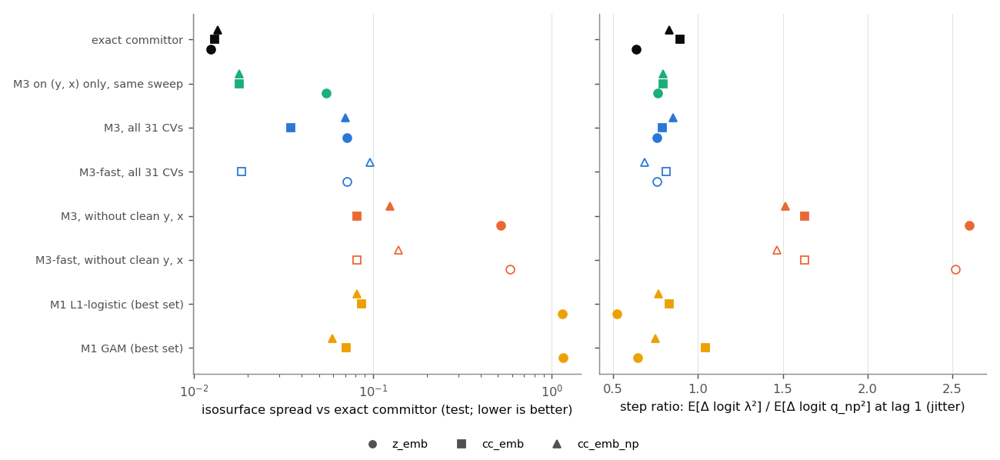
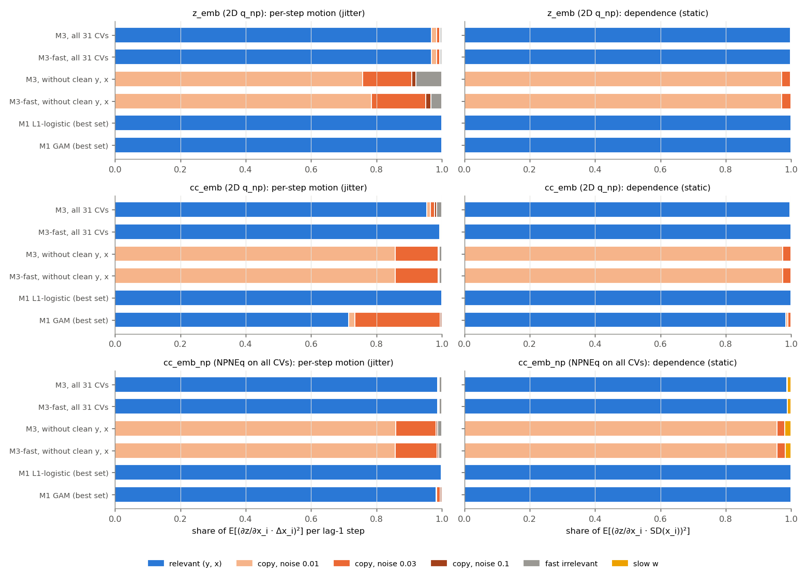
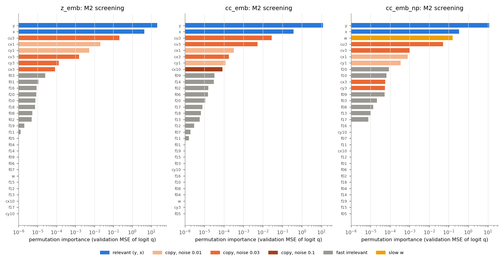
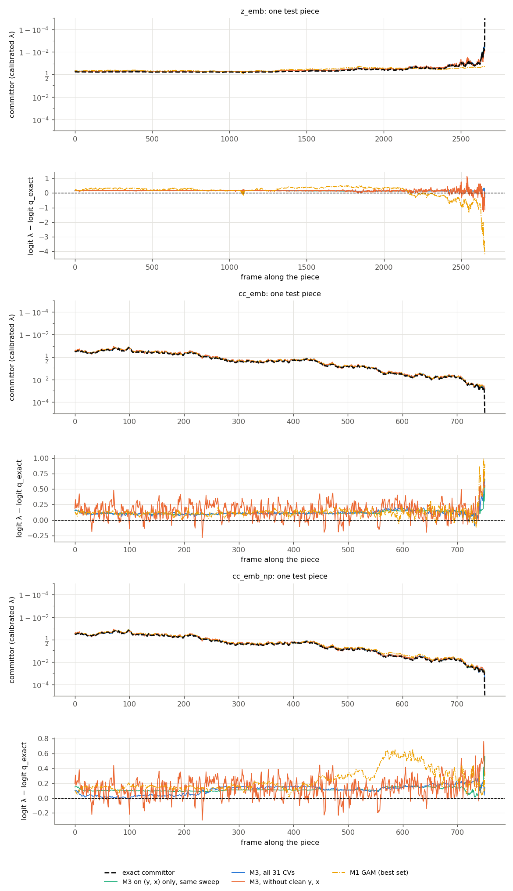
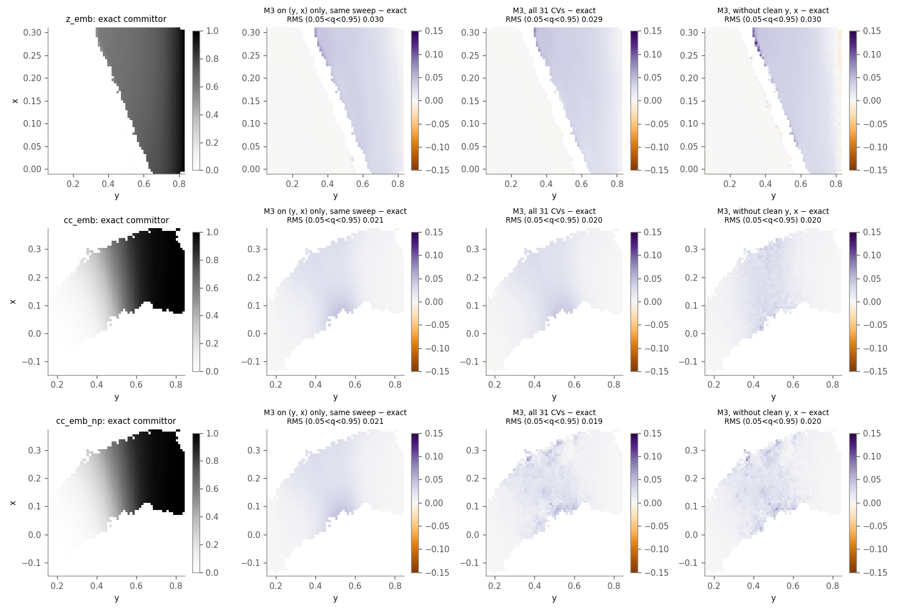

# Embedding test: λ(x) with 31 CVs

Can the pipeline (M2 screening, M1, M3) find the reaction coordinate among many CVs? Does λ stay smooth along the
paths when the inputs jitter, and does a slow coordinate that does not affect the committor stay out of it?
Generated by `examples/param_lambda/embed_report.py` from `run_embedded.sh` runs. The configs are `z_emb`,
`cc_emb` and `cc_emb_np`, and the method is described in `embed.py`.

## Findings

1. **With good labels, feature selection works.**
   - M2 ranks y and x first, then the copies, and gives the 20 fast coordinates and w zero importance.
   - M3 on all 31 CVs puts 95–99% of the per-step motion of λ on y and x.
   - The slow coordinate w moves logit λ by at most 0.004 over its spread.
   - M1 L1-logistic keeps exactly y and x.
2. **Cost of the extra CVs in accuracy.**
   - cc: M3-fast (64×64, β = 10) matches the 2D run (spread 0.018 against 0.018).
   - Z: spread 0.072 against 0.055.
   - The dynamics are as good as in 2D: test SD(Z_q) 2.1 (Z) and 3.5 (cc).
3. **Without the clean y and x, λ jitters, and no setting fixes that.**
   - The step ratio rises to 1.5–2.6 (0.75–0.85 with y and x).
   - SD(Z_q) rises to 15–22, so the selection metric flags it at once.
   - Z fails (spread 0.52); cc degrades (0.08).
   - The network leans on the least noisy copy (cy1: 70%). Combining copies cannot remove noise of about 2 RMS steps, and β = 10 does not help, because the smooth signal is not in the inputs.
   - Since λ must be memoryless, noisy CVs have to be made smooth in space (switching functions, centroids), not in time.
4. **End to end, the labels are the weak point, and the slow coordinate leaks in through them.**
   - NPNEq on all 31 CVs (40000 iterations, 52 min) gives a q_np with spread 0.092 against the exact committor (0.0185 for the 2D fit).
   - Its per-path logit offsets are 15× larger (SD 0.31 against 0.02).
   - A function of w explains 25% of those offsets (1% for w shuffled between paths). NPNEq used the coordinate that labels the paths to fit path-level noise, and M2 ranks w third.
   - M3 inherits this: w moves logit λ by 0.29–0.32, about 1.5 slab half-widths, which shifts the interfaces from path to path. M1 is affected less (0.035).
   - In N-D, an NPNEq fit therefore needs path-constant CVs screened out first (within-path against between-path variance), or a check that shuffles them between paths.
   - For the tunnelling case this means a slow coordinate that matters and one that only labels paths look the same in the labels. Telling them apart needs held-out dynamics, or runs where w is coupled.
5. **M3-fast** (the smallest network within 10% of the best validation SD(Z_q); here 64×64, β = 10) is the best or tied on cc_emb and z_emb. Its jitter share outside y and x is the lowest (0.6% on cc). On cc_emb_np it is worse (0.097 against 0.070).
6. **Per-frame cost with 31 CVs** (one-frame calls, single-threaded BLAS):

   | model | µs/frame |
   |---|---|
   | 64×64 | 10.5–11.5 |
   | 128×128×128 | 17 |
   | M1 logistic | 4–5 |
   | M1 GAM (31 splines) | 17 |

   Training takes 13–115 s per M3 run. NPNEq on 31 CVs is the expensive step: 52 min on cc with the GPU shared. Z takes 0.28 s per iteration (21M frames), so 10× its 2D fit's 25000 iterations would be about 19 h on the laptop GPU: a job for the workstation.

## Setup

The 2D staple runs (Z and curved channel) are kept as they are. Each saved frame gets 29 more coordinates that do
not interact with (y, x):

| group | CVs | what it tests |
|---|---|---|
| relevant | y, x | the coordinates the committor depends on |
| noisy copies | cy1, cy3, cy10, cx1, cx3, cx10 (y or x + a·ξ, a = 0.01, 0.03, 0.1), cu3, cv3 ((y ± x)/√2 + 0.03·ξ) | correlated, redundant inputs that jitter: ξ is a fast unit OU process (2 frames), a = 0.01 ≈ 1.5–2 RMS steps of y |
| fast irrelevant | f01–f20, OU with relaxation times 1, 2, 5, 10, 20 frames, SD 0.1 | feature selection |
| slow | w, OU with relaxation time 10⁶ frames, SD 0.1 | nearly constant along a path, so it labels the path; the q_np labels are path-correlated noise, which a model could fit through w |

**Why this is exact.**
- The extra coordinates do not interact with (y, x), so the N-D path ensemble factorizes. Appending independent
  stationary realizations to the existing paths therefore samples it exactly.
- They are reversible, so mirrored pieces are fine. A frame shared by a forward and a mirrored piece gets the same
  values in both (checked).
- The exact committor is still q_2D(y, x).

**What the test does not cover.**
- A slow coordinate that affects the committor (a hidden barrier).
- The sampler's own correlations along the MC chain: in a real run, w would carry over from path to path through
  the shooting points.

Both need new runs.

**Labels.**
- `z_emb` and `cc_emb` use the 2D q_np of the base run, so the labels are good and only the CVs change.
- `cc_emb_np` refits q_np with NPNEq on all 31 CVs (40000 iterations, about 10× the 2D fit), the end-to-end test.

**Fits.**
- M2 screening on the 31 raw CVs.
- M1 on the top-2 and top-8 screened sets, all CVs, and all but y and x.
- M3: the lean sweep (64×64 and 128×128×128, β ∈ {0, 10}) on two sets: all 31 CVs (`cvs`), and all except the clean
  y and x (`noclean`), where only noisy copies carry the reaction coordinate.
- Selection as in the main report: validation SD(Z_q), plus M3-fast, the smallest within 10%.
- The 2D comparison is the base run's own lean sweep on (y, x), with the same rule.

## Results (test paths)

Spread: mean isosurface spread against the exact committor over the report's level set. "jitter share": the share of each CV group in the per-step motion of the score along the test paths (E[(∂z/∂x_i · Δx_i)²], 1e-3 < q_exact < 0.99). "w": its static share E[(∂z/∂w · SD(w))²] and the RMS change of logit λ over the spread of w (w hardly moves along a path, so it has no jitter share). µs/frame: one-frame calls, single-threaded BLAS.

### z_emb (base z_br; labels: the 2D q_np of z_br)

| candidate | features | model | spread vs exact | SD(Z_q) | zqs_z | step ratio | turns / exact | jitter share: relevant / copies / fast | w: static share, RMS effect on logit λ | µs/frame | train s |
|---|---|---|---|---|---|---|---|---|---|---|---|
| exact committor |  |  | 0.0124 | 2.190 | 10.70 | 0.636 | 1.029 | – | – | – | – |
| q_np (labels) |  |  | 0.0494 | 2.260 | 10.52 | 0.992 | 1.049 | – | – | – | – |
| M3 on (y, x) only, same sweep | y, x (2) | 128x128x128 β=0 | 0.0550 | 2.293 | 10.55 | 0.761 | 1.055 | – | – | – | 13 |
| M1 L1-logistic (best set) | top2 (2) | hp 0.01 | 1.1404 | 8.861 | 12.25 | 0.520 | 0.953 | 1.00 / 0.00 / 0.000 | 0.0000, 0.000 | 3.7 | 3 |
| M1 GAM (best set) | top2 (2) | hp 10 | 1.1558 | 9.424 | 12.56 | 0.645 | 1.080 | 1.00 / 0.00 / 0.000 | 0.0000, 0.000 | 4.3 | 0 |
| M3, all 31 CVs | cvs (31) | 64x64 β=10 | 0.0716 | 2.123 | 10.22 | 0.758 | 1.042 | 0.97 / 0.03 / 0.005 | 0.0000, 0.001 | 10.5 | 43 |
| M3-fast, all 31 CVs | cvs (31) | 64x64 β=10 | 0.0716 | 2.123 | 10.22 | 0.758 | 1.042 | 0.97 / 0.03 / 0.005 | 0.0000, 0.001 | 10.5 | 43 |
| M3, without clean y, x | noclean (29) | 128x128x128 β=10 | 0.5193 | 20.024 | 9.80 | 2.598 | 1.800 | 0.00 / 0.92 / 0.079 | 0.0001, 0.009 | 15.6 | 115 |
| M3-fast, without clean y, x | noclean (29) | 64x64 β=10 | 0.5857 | 22.273 | 9.90 | 2.519 | 1.790 | 0.00 / 0.97 / 0.034 | 0.0001, 0.008 | 10.4 | 43 |

Largest single-CV shares: M1 L1-logistic (best set): y 0.64, x 0.36, f05 0.00; M1 GAM (best set): y 0.65, x 0.35, f05 0.00; M3, all 31 CVs: y 0.84, x 0.13, cy1 0.01; M3-fast, all 31 CVs: y 0.84, x 0.13, cy1 0.01; M3, without clean y, x: cy1 0.55, cx1 0.21, cu3 0.05; M3-fast, without clean y, x: cy1 0.63, cx1 0.15, cy3 0.06

### cc_emb (base cc_br; labels: the 2D q_np of cc_br)

| candidate | features | model | spread vs exact | SD(Z_q) | zqs_z | step ratio | turns / exact | jitter share: relevant / copies / fast | w: static share, RMS effect on logit λ | µs/frame | train s |
|---|---|---|---|---|---|---|---|---|---|---|---|
| exact committor |  |  | 0.0130 | 3.545 | 2.11 | 0.893 | 0.973 | – | – | – | – |
| q_np (labels) |  |  | 0.0185 | 3.521 | 2.12 | 0.919 | 1.045 | – | – | – | – |
| M3 on (y, x) only, same sweep | y, x (2) | 128x128x128 β=0 | 0.0178 | 3.549 | 2.13 | 0.794 | 0.832 | – | – | – | 4 |
| M1 L1-logistic (best set) | cvs (31) | hp 0.01 | 0.0861 | 5.138 | 2.87 | 0.832 | 1.084 | 1.00 / 0.00 / 0.000 | 0.0000, 0.000 | 5.1 | 13 |
| M1 GAM (best set) | cvs (31) | hp 0.1 | 0.0708 | 4.318 | 3.21 | 1.042 | 0.751 | 0.71 / 0.28 / 0.000 | 0.0000, 0.002 | 17.1 | 10 |
| M3, all 31 CVs | cvs (31) | 128x128x128 β=0 | 0.0346 | 3.474 | 2.07 | 0.787 | 0.763 | 0.95 / 0.03 / 0.016 | 0.0000, 0.004 | 16.7 | 13 |
| M3-fast, all 31 CVs | cvs (31) | 64x64 β=10 | 0.0184 | 3.583 | 2.12 | 0.811 | 0.836 | 0.99 / 0.00 / 0.002 | 0.0000, 0.001 | 11.0 | 34 |
| M3, without clean y, x | noclean (29) | 64x64 β=10 | 0.0813 | 15.508 | 8.46 | 1.628 | 1.030 | 0.00 / 0.99 / 0.008 | 0.0000, 0.009 | 10.9 | 20 |
| M3-fast, without clean y, x | noclean (29) | 64x64 β=10 | 0.0813 | 15.508 | 8.46 | 1.628 | 1.030 | 0.00 / 0.99 / 0.008 | 0.0000, 0.009 | 11.0 | 20 |

Largest single-CV shares: M1 L1-logistic (best set): y 0.92, x 0.08, cy1 0.00; M1 GAM (best set): y 0.63, cv3 0.20, x 0.08; M3, all 31 CVs: y 0.78, x 0.18, cx1 0.01; M3-fast, all 31 CVs: y 0.81, x 0.19, cy1 0.00; M3, without clean y, x: cy1 0.69, cx1 0.17, cu3 0.05; M3-fast, without clean y, x: cy1 0.69, cx1 0.17, cu3 0.05

### cc_emb_np (base cc_br; labels: NPNEq on all 31 CVs)

| candidate | features | model | spread vs exact | SD(Z_q) | zqs_z | step ratio | turns / exact | jitter share: relevant / copies / fast | w: static share, RMS effect on logit λ | µs/frame | train s |
|---|---|---|---|---|---|---|---|---|---|---|---|
| exact committor |  |  | 0.0135 | 4.083 | 2.41 | 0.831 | 0.998 | – | – | – | – |
| q_np (labels) |  |  | 0.0918 | 3.534 | 1.98 | 0.904 | 1.017 | – | – | – | – |
| M3 on (y, x) only, same sweep | y, x (2) | 128x128x128 β=0 | 0.0178 | 3.549 | 2.13 | 0.794 | 0.832 | – | – | – | 4 |
| M1 L1-logistic (best set) | cvs (31) | hp 1 | 0.0811 | 5.630 | 3.73 | 0.765 | 1.087 | 1.00 / 0.00 / 0.001 | 0.0002, 0.036 | 5.3 | 12 |
| M1 GAM (best set) | cvs (31) | hp 10 | 0.0593 | 5.463 | 3.17 | 0.748 | 0.971 | 0.98 / 0.02 / 0.001 | 0.0002, 0.034 | 17.5 | 6 |
| M3, all 31 CVs | cvs (31) | 128x128x128 β=10 | 0.0703 | 4.182 | 2.11 | 0.855 | 0.926 | 0.99 / 0.00 / 0.008 | 0.0123, 0.319 | 17.2 | 43 |
| M3-fast, all 31 CVs | cvs (31) | 64x64 β=10 | 0.0965 | 4.061 | 2.02 | 0.686 | 0.753 | 0.99 / 0.00 / 0.009 | 0.0113, 0.286 | 11.5 | 13 |
| M3, without clean y, x | noclean (29) | 128x128x128 β=10 | 0.1249 | 16.238 | 8.25 | 1.518 | 1.148 | 0.00 / 0.99 / 0.013 | 0.0200, 0.270 | 17.2 | 40 |
| M3-fast, without clean y, x | noclean (29) | 64x64 β=10 | 0.1383 | 16.119 | 8.26 | 1.466 | 1.061 | 0.00 / 0.99 / 0.010 | 0.0183, 0.253 | 11.5 | 13 |

Largest single-CV shares: M1 L1-logistic (best set): y 0.91, x 0.08, f07 0.00; M1 GAM (best set): y 0.91, x 0.07, cv3 0.01; M3, all 31 CVs: y 0.81, x 0.18, cy3 0.00; M3-fast, all 31 CVs: y 0.81, x 0.18, f16 0.00; M3, without clean y, x: cy1 0.70, cx1 0.16, cy3 0.05; M3-fast, without clean y, x: cy1 0.69, cx1 0.17, cu3 0.05

