# Parametric order parameter λ(x) for StapleTIS

A parametric λ(x) was fitted to the nonparametric committor q_np of staple runs, to replace the order
parameter of the sampler. Priorities: (1) cost per frame, (2) smoothness along trajectories, (3) λ isosurfaces
close to isocommittors, (4) pointwise accuracy.

## Findings

**Recommendation.**
- For 2D systems: the MLP (M3) on the raw CVs, with the smallest network whose validation SD(Z_q) is within 10%
  of the best.
  - Z: [`exported/z_br_m3-fast.npz`](../examples/param_lambda/exported/z_br_m3-fast.npz) (64×64, β = 10).
    10 µs per frame, against 8.6 µs per toytis MD step.
  - cc: [`exported/cc_br_m3-fast.npz`](../examples/param_lambda/exported/cc_br_m3-fast.npz) (32 units, β = 1).
    6.7 µs per frame.
- M1 is not within tolerance of M3 on either 2D system, so it is not recommended there.
- In 1D every monotone λ ties, so M1 is recommended by the rule. 1D does not need a new λ.

**Z potential** (test paths; the OOD block agrees). Spread is against the exact committor, whose floor is 0.012.

| λ | spread vs exact | SD(Z_q) | turns / exact committor | Δr² / q_np | µs/frame |
|---|---|---|---|---|---|
| y (current) | 1.26 | 93 | 4.1 | 11.6 | 2.4 |
| M1 L1-logistic / spline GAM | 1.14 / 0.93 | 8.9 / 12.7 | 0.95 / 0.90 | 2.2 | 3.4 / 5.8 |
| M3, lowest validation SD(Z_q) (128×128×128) | 0.055 | 2.29 | 1.06 | 1.01 | 64 |
| **M3, smallest within 10% (64×64, β = 10)** | **0.043** | **2.17** | **1.03** | **1.02** | **10** |
| q_np (not exportable) | 0.049 | 2.26 | 1.05 | 1.00 | – |
| exact committor | 0.012 | 2.19 | 1 | 0.98 | – |

- **y is the problem.** Its interfaces cut across the 45° ridge (interface map).
  - It turns 4× as often as the committor used as order parameter.
  - Its stopped Z_q fails at every lag.
  - This is the order-parameter failure that also breaks the turn-to-turn MSM on this system
    (notes §6.5, errors up to 0.43).
- **M1 cannot represent the step across the ridge**: linear in (y, x), or additive in the screened features.
  The M2 screening does find the ridge normal u = (y + x)/√2 as by far the most important feature.
- **The MLP matches q_np.** Its isosurfaces are as close to the exact ones as q_np's, slightly closer for the
  smaller network, which smooths q_np's noise. Dynamics and turn rates are those of the committor.
- **The increment loss helps small networks.**
  - Validation SD(Z_q), β = 0 → 10: 32 units 26 → 9.8; 64×64 5.1 → 3.5.
  - At 128×128×128 it makes no difference.

**Curved channel** (test paths; floor 0.013). The same ordering with smaller gaps:

| λ | spread vs exact | SD(Z_q) |
|---|---|---|
| y | 0.50 | 8.0 |
| M1 | 0.08–0.09 | 3.8–3.9 |
| M3 (selected, and the smallest within 10%) | 0.047 | 3.3–3.5 |
| q_np | 0.019 | 3.5 |
| exact | 0.013 | 3.5 |

**Smoothness.**
- The step-size ratio of the fitted λ is 0.5–0.8; y's is 1.1–2.3. Sign-change ratios are ≈ 1 for all of them:
  lag-1 increments are thermal noise.
- The turn replay separates the λ's instead: in its own interface system, y turns far more often than the
  committor.

**Model selection: the specified rule is the weak point.**
- The validation SD(Z_q) separates gross failures (y, M1 on Z) but cannot rank good models by isosurface
  alignment: their values lie within its noise. On cc it picks an M3 checkpoint at epoch 3.
- Selecting by validation isosurface spread instead, computed from q_np alone (selection-sensitivity tables):
  - Z: test spread against the exact committor 0.037 instead of 0.055, with equal test SD(Z_q).
  - cc: not reliably better. In an earlier sweep it gave 0.014 instead of 0.047. After a refit that differs
    only by GPU rounding it gives 0.061: the validation spread of the cc runs is itself noisy at this level.
- Suggestion: SD(Z_q) within a tolerance → validation spread → cost; on cc no rule separates the M3 runs.

**What q_np can and cannot tell.**
- Below q ≈ 1e-3 the q_np labels are noise: logit q_np varies by 10–100× the slab width on exact isocommittor
  slabs. Alignment there can only be checked against an exact committor.
- On Z, the planned levels 0.015–0.41 lie on the thin ridge (77–463 of 2.1M test frames). Interfaces equally
  spaced in ln q bunch there.
- The NPNEq fits work in linear q. A q_np that resolves small q better (more paths, or a fit in log q) would
  help interface placement more than a better λ model.

**Stopped Z_q at long lags.** On the Z test and OOD blocks, every λ including the exact committor has
zqs_z ≈ 10.5 (test) and 7.7 (OOD), from lags ≥ 256. Paths in a block of MC cycles are correlated, so the standard
error is underestimated there. Compare zqs_z with the exact committor's on the same split; SD(Z_q) ranks fine.

**Cost.**
- Exported λ on one frame: 2–10 µs, except the 128×128×128 network (60 µs).
- TorchScript is slower per frame: 9.6 µs for the forward pass alone, against 8.9 µs for the whole numpy λ.
- In the staple extension the adapter's cache removes the second λ call per MD step.

**Not done / next.**
- M0 (no replayable nonparametric model exists).
- A q_np refit without the OOD block.
- A production staple run with the new λ: compare the crossing probability and rate with the exact rate, and
  the turn-to-turn MSM against the exact committor. Only a 4-cycle toytis smoke test was run.


## What was compared

**Data.** Staple runs of four toy systems: forward and mirrored pieces, rejection weights, and the frames that
`tis_data.prepare_data` gives each run's q_np fit. The loader checks the frames, pieces, order parameter and
A/B are identical to those of the fit.

| system | run | CVs | frames | q_np | q_np − exact, RMS (mid q) |
|---|---|---|---|---|---|
| Z (2D Brownian) | `sim_istarz_br_g10`, 1500 paths/ens. | y, x | 20.9M | existing 25000-iteration fit | 0.033 |
| curved channel (2D Brownian) | `test_cc_br` (2000 cycles) | y, x | 2.7M | new fit, 4000 iterations | 0.019 |
| 1D flat | `sim_istar0br10intf`, 1000 paths/ens. | x | 1.3M | new fit, 3000 iterations | 0.013 |
| 1D two bumps | `sim_istar2cosbr_2108`, 2000 paths/ens. | x | 3.3M | new fit, 3000 iterations | 0.005 |

The exact committors (discrete-chain grid solutions in the `exact/` folder of each potential in `examples/figures_by_potential/`) are used for
validation only: never to fit or select.

**Splits.** All splits are whole paths: a path's forward and mirrored pieces stay together. They are made by
MC cycle:
- Cycles before 40% are not used (burn-in).
- 40–85% is cut into blocks of 5% of the cycles. Blocks 1 and 5 are validation (checkpoint and model
  selection), blocks 3 and 7 are the test set, and the rest is training.
- Cycles ≥ 85% are the OOD test block.

The q_np labels of the OOD block come from fits that also saw those frames (accepted for now; to be checked
later with a q_np refit that leaves the block out).

**Models.** All models share `fit / predict / export`; the exported numpy forward pass is the one evaluated.
- M1: L1 logistic regression on soft labels q_np, and an additive P-spline GAM on logit q_np.
- M2: gradient-boosted trees, used for feature screening only (permutation importance on validation paths).
  The top-K features (K = 2, 4 for 2D) and the raw CVs are swept for M1 and M3. The 2D feature library holds
  monomials of y, x, u = (y + x)/√2 and v = (y − x)/√2.
- M3: SiLU MLP (32; 64×64; 128×128×128), weight decay 1e-4, 24 epochs. Loss: weighted MSE on logit q_np
  (×5 for 0.05 < q_np < 0.95) + β × Σ over lags 1, 2, 4, 8 of the weighted MSE of within-piece increments,
  with β ∈ {0, 0.1, 1, 10}. The checkpoint is selected by the SD over q of the stopped Z_q on the validation
  paths, never by validation MSE.

**Calibration and the exported λ** (`lambda_runtime.py`).
- z(x) is mapped to m = g(z) by isotonic regression of q_np on z, over 300 bins of equal width in z, with a
  monotone cubic through the isotonic blocks. Equal widths keep low and high q resolved; bins of equal weight
  would put everything below q ≈ 1e-3 into one bin.
- A/B come from the state CV s (y, or x in 1D), not from the model. λ = s outside (λ_A, λ_B). Inside,
  λ = λ_A + (λ_B − λ_A)·log1p(h/ε)/log1p(1/ε) with h = (1 − a(s))(1 − b(s))·m + b(s).
  - a and b are smoothstep ramps of width 5% of λ_B − λ_A, a fixed fraction of the state-to-state range,
    not tied to any interface.
  - So s < λ_A ⇔ λ < λ_A and s > λ_B ⇔ λ > λ_B exactly (also with ≤ and ≥), and λ is continuous at both
    boundaries. Outside the ramps h = m.
  - The log scale (ε = 1e-3) only sets where interfaces land: `interface_for_q`. Crossings and turns
    depend only on the order of λ and the interfaces.
- The OOD flag combines a per-CV training range check (counted per frame by the adapter) with a Mahalanobis
  distance on the standardized features (`LambdaModel.ood`).

**Metrics** (path weights throughout; Z_q as in the notebooks: `w_traj` = path weight, `g_traj` = path):
- *Isosurface spread*: 12 planned interfaces equally spaced in ln q (Z, cc: 1e-4 … 0.95; 1D: 1e-2 … 0.95).
  - For each, the weighted variance of logit q_np (and of logit q_exact) over the frames with
    |logit g(λ) − logit q_k| < 0.2. A λ whose isosurfaces are isocommittors scores ≈ 0.2²/3 = 0.013.
  - The table mean is over the levels where the exact committor's slab holds ≥ 500 frames and logit q_np on it
    varies by less than 10× that baseline, i.e. where q_np resolves the committor; the levels used are listed.
  - Below about q = 1e-3 the q_np labels are noise. There, alignment can only be judged against the exact
    committor (per-level figure).
- *Smoothness*:
  - step ratio: mean squared lag-1 increment of logit g(λ) over that of logit q_np;
  - RMSE of the increments against q_np's at lags 1–8;
  - sign-change ratio of consecutive lag-1 increments;
  - turns and interface crossings per 1000 frames under the sampler's own turn rule (`pgmoves.turn_detected`,
    both directions, restarted after each turn), relative to q_np and to the exact committor used as the
    order parameter.
- *Dynamical*: the stopped Z_q of g(λ), max |Z/s.e.| (zqs_z) and its SD over q, at lags 1 … 4096; and the
  stopped Δr² relative to q_np's. N_AB is not defined for path pieces, so Δr²/2N_AB is reported as this ratio.
- *Static*: Spearman correlation with q_np, and the RMSE of logit g(λ) against logit q_np (and logit q_exact)
  after averaging over a 40×40 grid of CV-space bins.
- *Cost*: µs per frame of the exported model: one-frame calls (as the sampler makes them) and batch.

## Using it in the sampler

```python
import sys; sys.path.insert(0, 'examples/param_lambda')
import toytis_adapter
toytis_adapter.install('examples/param_lambda/exported/z_br_m3.npz')    # before Simulation(settings)
settings['interfaces'] = toytis_adapter.interfaces_for_q('examples/param_lambda/exported/z_br_m3.npz', q_levels)
settings['v_ord'] = False
```

`install` replaces `ensemble.OrderX` and `ensemble.OrderParameter` and wraps `ensemble.kick_star`; no sampler
file changes.
- calculate(ph) returns `[λ, y, x]` as numpy floats, as OrderX does. toytis' `validate_staple` relies on that,
  and order.txt keeps the positions.
- The wrapper places each initial kick point on the learned interface instead of at y = interface value.
- The adapter caches the extension start point, which `ext_propagate` asks for again at every step.
- A short fresh staple run of the Z potential with the adapter is a test (`tests/test_param_lambda.py`).

Runs analysed with `tis_data` read λ as the order parameter. The states there must still come from y:
order.txt rounds λ to 6 decimals, and `tis_data` tests `lam <= lambda_A`.

## Caveats

- The OOD block's q_np labels come from fits that saw those frames (see Splits).
- q_np level errors are inherited through the calibration: Z plateau +0.03; 1D flat up to +0.017 in the
  middle, at zqs_z 1.7. That fit is a statistical level error the stopped Z_q cannot see. The exact columns
  show it.
- The turn replay can only see turns before the point where the y-based rule of the actual run stopped the
  piece.
- zqs_z is a maximum over 200 bins × 7 lags: it grows with the number of frames. Compare it with the exact
  committor's value on the same split, not with 2.
- In 1D every strictly monotone λ has the committor's isosurfaces, so all models tie there. The 1D cases check
  the pipeline: monotone fits, calibration, A/B, export.
- The curved-channel run is the 2000-cycle test run (the production run is not on this machine).

## Recommendation rule per system

Generated by `examples/param_lambda/run.py report`; every number comes from the configs in `examples/param_lambda/configs/` (fixed seeds).

| system | recommended | reason |
|---|---|---|
| z_br | M3 MLP | M1 L1-logistic vs M3 on the test paths: spread 1.244 vs 0.0535 (outside +10%), zqs_z 12.25 vs 10.55 (outside +0.5) |
| cc_br | M3 MLP | M1 spline GAM vs M3 on the test paths: spread 0.12 vs 0.06306 (outside +10%), zqs_z 2.27 vs 1.98 (within +0.5) |
| flat1d | M1 spline GAM | M1 spline GAM vs M3 on the test paths: spread 0.0125 vs 0.01208 (within +10%), zqs_z 2.56 vs 2.56 (within +0.5) |
| bumps1d | M1 L1-logistic | M1 L1-logistic vs M3 on the test paths: spread 0.01287 vs 0.01288 (within +10%), zqs_z 1.91 vs 1.91 (within +0.5) |

## z_br

Data: `sim_istarz_br_g10`, loader `--reversed --paths-per-ensemble 1500 --seed 0` (tis_data f18c794).

M2 screening (permutation importance of the gradient-boosted trees on validation paths): `u` 11.3, `y^2*x` 2.1, `y` 1.48, `v` 0.0626, `y*x` 0.0145, `x` 0.0112.

### Test paths (held-out MC cycle blocks)

| candidate | spread (q_np) | spread (exact) | zqs_z | SD(Z_q) | step ratio | Δ RMSE lag 1 / 8 | sign-change ratio | turns / q_np | turns / exact | crossings / q_np | Δr² / q_np (lag 1) | Spearman | logit RMSE (q_np / exact) | µs/frame (one / batch) | training s |
|---|---|---|---|---|---|---|---|---|---|---|---|---|---|---|---|
| seed | 1.376 | 1.259 | 10.771 | 93.026 | 2.263 | 0.109 / 0.277 | 0.999 | 3.963 | 4.121 | 1.873 | 11.597 | 0.994 | 1.498 / 1.458 | 2.2 / 0.10 | – |
| q_np | 0.013 | 0.049 | 10.519 | 2.260 | 0.992 | 0.010 / 0.015 | 1.000 | 1.009 | 1.049 | 1.000 | 0.971 | 1.000 | 0.009 / 0.182 | – | – |
| exact committor | 0.055 | 0.012 | 10.695 | 2.190 | 0.636 | 0.046 / 0.090 | 0.999 | 0.989 | 1.029 | 0.959 | 0.980 | 1.000 | 0.137 / 0.118 | – | – |
| M1 L1-logistic [y, x; C=0.01] | 1.244 | 1.140 | 12.252 | 8.861 | 0.520 | 0.068 / 0.163 | 1.003 | 0.917 | 0.953 | 0.974 | 2.180 | 0.950 | 0.569 / 0.554 | 3.5 / 0.12 | 3.8 |
| M1 spline GAM [u, y^2*x; GAM (P-spline) penalty=10] | 0.923 | 0.933 | 11.591 | 12.685 | 0.659 | 0.076 / 0.171 | 1.004 | 0.866 | 0.900 | 0.955 | 2.166 | 0.955 | 0.657 / 0.646 | 5.5 / 0.28 | 0.2 |
| M3 MLP [y, x; 128x128x128, β=0, epoch 9] | 0.053 | 0.055 | 10.551 | 2.293 | 0.761 | 0.041 / 0.067 | 1.000 | 1.014 | 1.055 | 1.005 | 1.008 | 1.000 | 0.039 / 0.174 | 64.8 / 5.06 | 13.3 |
| M3 MLP, smallest within 10% [y, x; 64x64, β=10, epoch 18] | 0.040 | 0.043 | 10.468 | 2.173 | 0.760 | 0.038 / 0.061 | 1.000 | 0.994 | 1.033 | 1.000 | 1.016 | 1.000 | 0.031 / 0.176 | 9.6 / 1.49 | 15.8 |

### OOD block (the last 15% of the cycles)

| candidate | spread (q_np) | spread (exact) | zqs_z | SD(Z_q) | step ratio | Δ RMSE lag 1 / 8 | sign-change ratio | turns / q_np | turns / exact | crossings / q_np | Δr² / q_np (lag 1) | Spearman | logit RMSE (q_np / exact) | µs/frame (one / batch) | training s |
|---|---|---|---|---|---|---|---|---|---|---|---|---|---|---|---|
| seed | 2.061 | 1.897 | 15.319 | 191.672 | 2.450 | 0.114 / 0.292 | 0.999 | 4.310 | 4.351 | 1.906 | 13.492 | 0.994 | 1.761 / 1.721 | 2.2 / 0.10 | – |
| q_np | 0.012 | 0.044 | 7.668 | 2.385 | 0.997 | 0.011 / 0.015 | 1.000 | 1.016 | 1.026 | 0.999 | 0.989 | 1.000 | 0.010 / 0.177 | – | – |
| exact committor | 0.053 | 0.013 | 7.726 | 2.430 | 0.651 | 0.046 / 0.091 | 0.999 | 1.020 | 1.030 | 0.983 | 1.025 | 1.000 | 0.135 / 0.114 | – | – |
| M1 L1-logistic [y, x; C=0.01] | 1.113 | 0.991 | 13.180 | 14.538 | 0.622 | 0.070 / 0.164 | 1.003 | 1.075 | 1.086 | 1.047 | 2.957 | 0.955 | 0.544 / 0.536 | 3.5 / 0.12 | 3.8 |
| M1 spline GAM [u, y^2*x; GAM (P-spline) penalty=10] | 0.983 | 0.977 | 10.690 | 15.936 | 0.709 | 0.076 / 0.171 | 1.003 | 0.995 | 1.004 | 0.979 | 2.279 | 0.955 | 0.629 / 0.625 | 5.5 / 0.28 | 0.2 |
| M3 MLP [y, x; 128x128x128, β=0, epoch 9] | 0.043 | 0.052 | 7.504 | 2.311 | 0.778 | 0.041 / 0.066 | 0.999 | 1.047 | 1.057 | 1.011 | 1.004 | 1.000 | 0.039 / 0.167 | 64.8 / 5.06 | 13.3 |
| M3 MLP, smallest within 10% [y, x; 64x64, β=10, epoch 18] | 0.037 | 0.047 | 7.559 | 2.091 | 0.776 | 0.038 / 0.060 | 1.000 | 1.019 | 1.029 | 1.002 | 1.006 | 1.000 | 0.030 / 0.169 | 9.6 / 1.49 | 15.8 |

Mean spreads use the planned levels q_k = test: 0.0001, 0.00023, 0.00053, 0.0012, 0.0028, 0.0064, 0.015, 0.034, 0.078, 0.41, 0.95; ood: 0.0001, 0.00023, 0.00053, 0.0012, 0.0028, 0.0064, 0.015, 0.034, 0.078, 0.18, 0.41, 0.95 (enough frames, and q_np resolves the committor there: on the exact isocommittor slab logit q_np varies by less than 10x the slab width; per-level values in the figure).

Reference rates per 1000 frames (sampler turn rule, planned interfaces): test: turns qnp 2.0, crossings qnp 27.3, turns exact 1.9, crossings exact 26.7; OOD: turns qnp 2.0, crossings qnp 28.6, turns exact 2.0, crossings exact 28.4.

A/B ramps (width 0.04 = 0.05 × (λ_B − λ_A)): 1.81% of the test frame weight lies in them; there h differs from the calibrated committor m by RMS seed 0.00272, M1-logit 0.0349, M1-gam 0.0288, M3 0.00275, M3-fast 0.00272.

Validation selection metric SD(Z_q) of the references on the same paths: q_np 1.372 (spread 0.013), exact 1.349 (spread 0.055); fitted runs: 1.120 … 639.255.

Selection sensitivity: the rule selects by validation SD(Z_q); a selection by validation isosurface spread (q_np only) would take:

| family | selected by | run | val SD(Z_q) | val spread (q_np) | test spread (q_np) | test spread (exact) | test zqs_z | test SD(Z_q) |
|---|---|---|---|---|---|---|---|---|
| M1-logit | SD(Z_q) (rule) | m1_logit_cvs_0.01 | 11.920 | 1.291 | 1.244 | 1.140 | 12.252 | 8.861 |
| M1-logit | spread | m1_logit_cvs_10 | 12.047 | 1.249 | 1.219 | 1.118 | 12.314 | 8.998 |
| M1-gam | SD(Z_q) (rule) | m1_gam_top2_10 | 12.207 | 0.977 | 0.923 | 0.933 | 11.591 | 12.685 |
| M1-gam | spread | m1_gam_top4_0.001 | 34.691 | 0.119 | 0.105 | 0.067 | 13.779 | 36.264 |
| M3 | SD(Z_q) (rule) | m3_cvs_128x128x128_b0 | 1.120 | 0.048 | 0.053 | 0.055 | 10.551 | 2.293 |
| M3 | spread | m3_top4_128x128x128_b10 | 1.277 | 0.028 | 0.027 | 0.037 | 10.451 | 2.272 |

Recommendation: **M3 MLP**. M1 L1-logistic vs M3 on the test paths: spread 1.244 vs 0.0535 (outside +10%), zqs_z 12.25 vs 10.55 (outside +0.5).

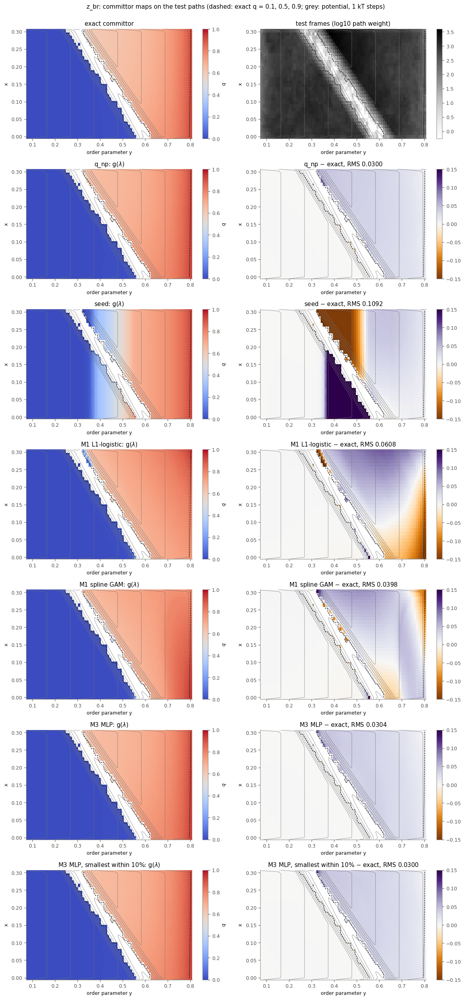

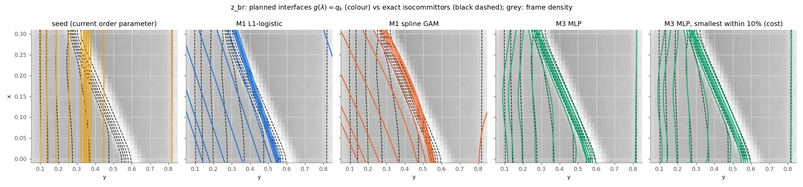

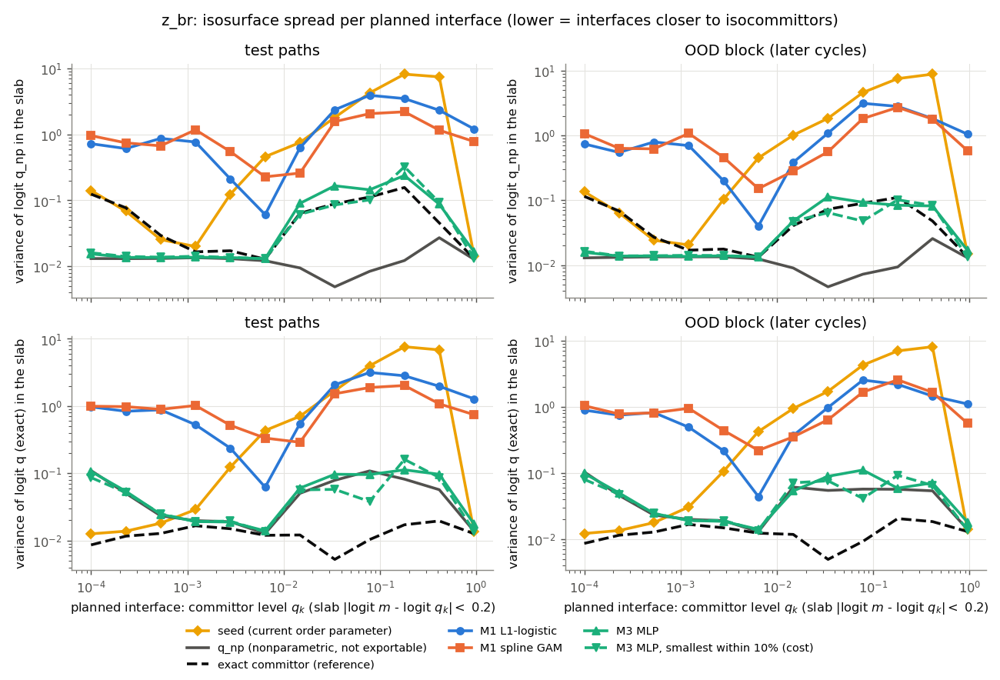

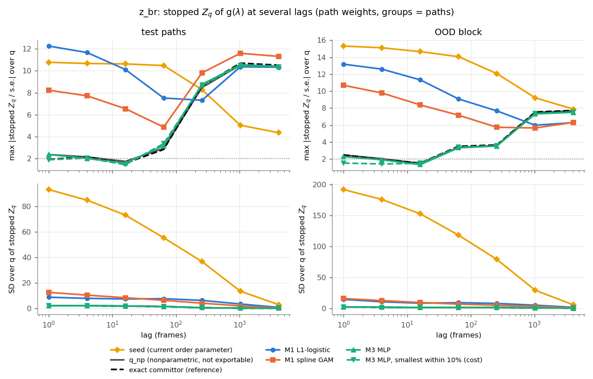

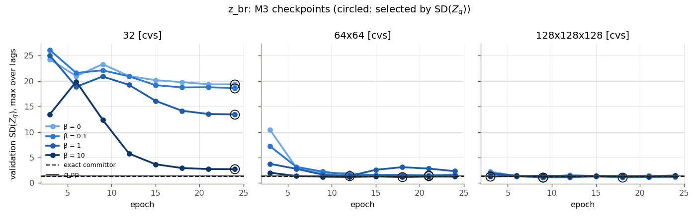

TIS diagnostics (plots_tis) and path-weighted feps of every row: [`../examples/figures_by_potential/2d_zpot/brownian_g10/staple/param_lambda/z_br/eval/tis_plots`](../examples/figures_by_potential/2d_zpot/brownian_g10/staple/param_lambda/z_br/eval/tis_plots).

<details><summary>All runs (test paths)</summary>

| candidate | spread (q_np) | spread (exact) | zqs_z | SD(Z_q) | step ratio | Δ RMSE lag 1 / 8 | sign-change ratio | turns / q_np | turns / exact | crossings / q_np | Δr² / q_np (lag 1) | Spearman | logit RMSE (q_np / exact) | µs/frame (one / batch) | training s |
|---|---|---|---|---|---|---|---|---|---|---|---|---|---|---|---|
| m1_logit_top2_0.01 (val SD(Z_q) 24.1) | 1.285 | 1.271 | 10.033 | 13.365 | 0.589 | 0.075 / 0.178 | 1.003 | 0.918 | 0.954 | 0.960 | 3.632 | 0.960 | 0.661 / 0.648 | – | 3.3 |
| m1_logit_top2_0.1 (val SD(Z_q) 23.3) | 1.251 | 1.242 | 9.945 | 12.659 | 0.583 | 0.075 / 0.179 | 1.003 | 0.915 | 0.951 | 0.961 | 3.526 | 0.960 | 0.661 / 0.648 | – | 3.0 |
| m1_logit_top2_1 (val SD(Z_q) 23.5) | 1.270 | 1.262 | 9.947 | 13.491 | 0.595 | 0.076 / 0.179 | 1.003 | 0.922 | 0.958 | 0.962 | 3.707 | 0.960 | 0.661 / 0.648 | – | 3.9 |
| m1_logit_top2_10 (val SD(Z_q) 23.5) | 1.267 | 1.259 | 9.948 | 13.492 | 0.596 | 0.076 / 0.179 | 1.003 | 0.921 | 0.958 | 0.961 | 3.709 | 0.960 | 0.661 / 0.648 | – | 3.6 |
| m1_gam_top2_0.001 (val SD(Z_q) 34.8) | 0.493 | 0.506 | 13.997 | 35.614 | 0.724 | 0.074 / 0.163 | 1.011 | 0.877 | 0.912 | 0.916 | 2.416 | 0.958 | 0.652 / 0.639 | – | 0.5 |
| m1_gam_top2_0.1 (val SD(Z_q) 23.5) | 0.575 | 0.581 | 12.048 | 25.671 | 0.503 | 0.071 / 0.170 | 1.005 | 0.832 | 0.866 | 0.905 | 2.068 | 0.938 | 0.676 / 0.662 | – | 0.2 |
| m1_gam_top2_10 (val SD(Z_q) 12.2) | 0.923 | 0.933 | 11.591 | 12.685 | 0.659 | 0.076 / 0.171 | 1.004 | 0.866 | 0.900 | 0.955 | 2.166 | 0.955 | 0.657 / 0.646 | – | 0.2 |
| m1_logit_top4_0.01 (val SD(Z_q) 18.5) | 2.053 | 2.149 | 12.156 | 18.932 | 0.646 | 0.082 / 0.190 | 1.004 | 0.927 | 0.964 | 0.899 | 2.757 | 0.923 | 0.777 / 0.764 | – | 3.2 |
| m1_logit_top4_0.1 (val SD(Z_q) 18.9) | 2.386 | 2.503 | 12.525 | 19.479 | 0.650 | 0.082 / 0.191 | 1.004 | 0.918 | 0.955 | 0.908 | 2.786 | 0.921 | 0.780 / 0.767 | – | 3.3 |
| m1_logit_top4_1 (val SD(Z_q) 19) | 2.376 | 2.491 | 12.546 | 19.603 | 0.649 | 0.082 / 0.191 | 1.004 | 0.921 | 0.958 | 0.906 | 2.792 | 0.921 | 0.780 / 0.767 | – | 7.0 |
| m1_logit_top4_10 (val SD(Z_q) 19.1) | 2.377 | 2.492 | 12.595 | 19.611 | 0.651 | 0.082 / 0.191 | 1.004 | 0.922 | 0.959 | 0.903 | 2.793 | 0.921 | 0.780 / 0.767 | – | 69.9 |
| m1_gam_top4_0.001 (val SD(Z_q) 34.7) | 0.105 | 0.067 | 13.779 | 36.264 | 0.871 | 0.055 / 0.108 | 1.008 | 1.255 | 1.305 | 1.105 | 2.440 | 0.986 | 0.129 / 0.209 | – | 0.4 |
| m1_gam_top4_0.1 (val SD(Z_q) 29.7) | 0.494 | 0.339 | 13.131 | 34.688 | 0.853 | 0.065 / 0.140 | 1.004 | 1.223 | 1.272 | 1.129 | 2.901 | 0.955 | 0.346 / 0.337 | – | 0.4 |
| m1_gam_top4_10 (val SD(Z_q) 16.4) | 0.744 | 0.768 | 11.767 | 20.805 | 0.506 | 0.072 / 0.172 | 1.005 | 0.862 | 0.896 | 0.939 | 2.116 | 0.943 | 0.670 / 0.657 | – | 0.4 |
| m1_logit_cvs_0.01 (val SD(Z_q) 11.9) | 1.244 | 1.140 | 12.252 | 8.861 | 0.520 | 0.068 / 0.163 | 1.003 | 0.917 | 0.953 | 0.974 | 2.180 | 0.950 | 0.569 / 0.554 | – | 3.8 |
| m1_logit_cvs_0.1 (val SD(Z_q) 12) | 1.218 | 1.117 | 12.369 | 8.976 | 0.523 | 0.069 / 0.163 | 1.003 | 0.917 | 0.953 | 0.973 | 2.170 | 0.950 | 0.569 / 0.555 | – | 3.7 |
| m1_logit_cvs_1 (val SD(Z_q) 12.1) | 1.219 | 1.118 | 12.321 | 9.002 | 0.524 | 0.069 / 0.163 | 1.003 | 0.917 | 0.953 | 0.974 | 2.171 | 0.950 | 0.569 / 0.555 | – | 3.7 |
| m1_logit_cvs_10 (val SD(Z_q) 12) | 1.219 | 1.118 | 12.314 | 8.998 | 0.523 | 0.069 / 0.163 | 1.003 | 0.917 | 0.953 | 0.974 | 2.170 | 0.950 | 0.569 / 0.555 | – | 3.7 |
| m1_gam_cvs_0.001 (val SD(Z_q) 639) | 1.564 | 1.446 | 11.260 | 448.221 | 2.937 | 0.133 / 0.304 | 1.004 | 3.914 | 4.070 | 1.772 | 57.700 | 0.929 | 0.942 / 0.913 | – | 0.2 |
| m1_gam_cvs_0.1 (val SD(Z_q) 419) | 1.398 (1 missing) | 1.312 (1 missing) | 9.975 | 305.097 | 2.099 | 0.116 / 0.272 | 1.002 | 2.971 | 3.089 | 1.563 | 38.934 | 0.936 | 0.734 / 0.709 | – | 0.2 |
| m1_gam_cvs_10 (val SD(Z_q) 14.9) | 1.257 | 1.156 | 12.561 | 9.424 | 0.645 | 0.071 / 0.166 | 1.002 | 1.039 | 1.080 | 0.988 | 3.166 | 0.951 | 0.520 / 0.507 | – | 0.2 |
| m3_top2_32_b0 (val SD(Z_q) 26.1) | 0.544 | 0.561 | 13.160 | 26.875 | 0.591 | 0.071 / 0.166 | 1.008 | 0.899 | 0.935 | 0.937 | 1.997 | 0.958 | 0.655 / 0.641 | – | 13.6 |
| m3_top2_32_b0.1 (val SD(Z_q) 25.7) | 0.524 | 0.555 | 13.150 | 26.387 | 0.584 | 0.071 / 0.165 | 1.008 | 0.874 | 0.908 | 0.935 | 2.013 | 0.958 | 0.655 / 0.641 | – | 18.9 |
| m3_top2_32_b1 (val SD(Z_q) 21.2) | 0.555 | 0.575 | 12.613 | 21.483 | 0.593 | 0.070 / 0.164 | 1.009 | 0.924 | 0.961 | 0.954 | 1.840 | 0.960 | 0.654 / 0.641 | – | 17.2 |
| m3_top2_32_b10 (val SD(Z_q) 9.82) | 0.505 | 0.504 | 11.548 | 10.464 | 0.598 | 0.068 / 0.158 | 1.010 | 0.892 | 0.927 | 0.941 | 1.396 | 0.966 | 0.647 / 0.635 | – | 18.9 |
| m3_top2_64x64_b0 (val SD(Z_q) 5.09) | 0.454 | 0.473 | 11.671 | 4.911 | 0.544 | 0.065 / 0.152 | 1.008 | 0.793 | 0.824 | 0.938 | 1.190 | 0.970 | 0.629 / 0.619 | – | 14.9 |
| m3_top2_64x64_b0.1 (val SD(Z_q) 4.73) | 0.442 | 0.473 | 11.650 | 4.476 | 0.528 | 0.065 / 0.151 | 1.007 | 0.781 | 0.812 | 0.934 | 1.184 | 0.970 | 0.629 / 0.619 | – | 21.0 |
| m3_top2_64x64_b1 (val SD(Z_q) 3.96) | 0.440 | 0.452 | 11.776 | 4.007 | 0.530 | 0.065 / 0.150 | 1.004 | 0.771 | 0.802 | 0.930 | 1.124 | 0.969 | 0.637 / 0.626 | – | 18.5 |
| m3_top2_64x64_b10 (val SD(Z_q) 3.46) | 0.421 | 0.437 | 11.766 | 3.413 | 0.537 | 0.064 / 0.148 | 1.004 | 0.763 | 0.793 | 0.920 | 1.085 | 0.970 | 0.630 / 0.620 | – | 16.3 |
| m3_top2_128x128x128_b0 (val SD(Z_q) 3.65) | 0.411 | 0.423 | 11.437 | 3.206 | 0.662 | 0.071 / 0.163 | 1.003 | 0.987 | 1.026 | 1.038 | 1.103 | 0.972 | 0.605 / 0.604 | – | 17.2 |
| m3_top2_128x128x128_b0.1 (val SD(Z_q) 3.87) | 0.388 | 0.413 | 11.441 | 3.384 | 0.829 | 0.078 / 0.178 | 1.004 | 1.271 | 1.322 | 1.169 | 1.098 | 0.974 | 0.587 / 0.590 | – | 37.5 |
| m3_top2_128x128x128_b1 (val SD(Z_q) 3.85) | 0.360 | 0.379 | 11.544 | 3.475 | 0.629 | 0.068 / 0.157 | 1.003 | 0.809 | 0.841 | 1.004 | 1.085 | 0.973 | 0.598 / 0.596 | – | 37.6 |
| m3_top2_128x128x128_b10 (val SD(Z_q) 3.62) | 0.381 | 0.398 | 11.852 | 3.307 | 0.546 | 0.063 / 0.146 | 1.003 | 0.754 | 0.784 | 0.930 | 1.068 | 0.971 | 0.618 / 0.611 | – | 37.7 |
| m3_top4_32_b0 (val SD(Z_q) 19.6) | 0.225 | 0.120 | 11.596 | 19.601 | 0.784 | 0.050 / 0.098 | 1.005 | 1.165 | 1.212 | 1.085 | 1.903 | 0.996 | 0.122 / 0.152 | – | 10.4 |
| m3_top4_32_b0.1 (val SD(Z_q) 14.9) | 0.216 | 0.128 | 11.038 | 16.471 | 0.804 | 0.051 / 0.100 | 1.004 | 1.174 | 1.220 | 1.072 | 1.797 | 0.996 | 0.122 / 0.156 | – | 14.0 |
| m3_top4_32_b1 (val SD(Z_q) 7.66) | 0.188 | 0.090 | 10.131 | 9.500 | 0.734 | 0.049 / 0.099 | 1.005 | 1.103 | 1.147 | 1.047 | 1.480 | 0.998 | 0.130 / 0.142 | – | 13.6 |
| m3_top4_32_b10 (val SD(Z_q) 3.27) | 0.191 | 0.091 | 10.120 | 4.111 | 0.711 | 0.044 / 0.082 | 1.002 | 1.010 | 1.051 | 0.981 | 1.238 | 0.999 | 0.107 / 0.153 | – | 14.7 |
| m3_top4_64x64_b0 (val SD(Z_q) 4.5) | 0.125 | 0.067 | 10.219 | 4.300 | 0.761 | 0.043 / 0.074 | 1.012 | 1.041 | 1.082 | 1.012 | 1.204 | 0.999 | 0.049 / 0.170 | – | 11.3 |
| m3_top4_64x64_b0.1 (val SD(Z_q) 3.83) | 0.129 | 0.064 | 9.786 | 3.676 | 0.742 | 0.042 / 0.073 | 1.011 | 1.019 | 1.059 | 1.007 | 1.178 | 1.000 | 0.048 / 0.169 | – | 16.0 |
| m3_top4_64x64_b1 (val SD(Z_q) 1.53) | 0.105 | 0.058 | 10.066 | 2.140 | 0.724 | 0.041 / 0.070 | 1.006 | 1.009 | 1.049 | 0.990 | 1.076 | 1.000 | 0.047 / 0.166 | – | 16.1 |
| m3_top4_64x64_b10 (val SD(Z_q) 1.26) | 0.045 | 0.044 | 10.364 | 2.270 | 0.739 | 0.039 / 0.063 | 1.002 | 0.983 | 1.022 | 0.989 | 1.028 | 1.000 | 0.036 / 0.170 | – | 16.1 |
| m3_top4_128x128x128_b0 (val SD(Z_q) 1.19) | 0.037 | 0.045 | 10.367 | 2.294 | 0.753 | 0.038 / 0.059 | 1.000 | 0.997 | 1.037 | 0.993 | 1.013 | 1.000 | 0.032 / 0.172 | – | 13.4 |
| m3_top4_128x128x128_b0.1 (val SD(Z_q) 1.19) | 0.034 | 0.039 | 10.326 | 2.137 | 0.762 | 0.037 / 0.057 | 1.000 | 0.991 | 1.031 | 0.990 | 1.011 | 1.000 | 0.029 / 0.173 | – | 37.7 |
| m3_top4_128x128x128_b1 (val SD(Z_q) 1.16) | 0.045 | 0.042 | 10.354 | 2.126 | 0.741 | 0.039 / 0.062 | 1.000 | 0.991 | 1.030 | 0.994 | 1.023 | 1.000 | 0.039 / 0.168 | – | 37.5 |
| m3_top4_128x128x128_b10 (val SD(Z_q) 1.28) | 0.027 | 0.037 | 10.451 | 2.272 | 0.864 | 0.027 / 0.039 | 1.000 | 1.013 | 1.054 | 0.994 | 0.988 | 1.000 | 0.020 / 0.185 | – | 37.5 |
| m3_cvs_32_b0 (val SD(Z_q) 19.4) | 0.132 | 0.086 | 13.455 | 18.595 | 0.829 | 0.049 / 0.097 | 1.004 | 1.262 | 1.312 | 1.118 | 1.643 | 0.992 | 0.108 / 0.178 | – | 10.4 |
| m3_cvs_32_b0.1 (val SD(Z_q) 18.6) | 0.132 | 0.085 | 13.415 | 17.917 | 0.831 | 0.050 / 0.097 | 1.004 | 1.261 | 1.311 | 1.113 | 1.600 | 0.993 | 0.108 / 0.176 | – | 13.3 |
| m3_cvs_32_b1 (val SD(Z_q) 13.5) | 0.120 | 0.076 | 12.057 | 13.145 | 0.805 | 0.049 / 0.096 | 1.005 | 1.229 | 1.278 | 1.107 | 1.431 | 0.995 | 0.109 / 0.162 | – | 13.3 |
| m3_cvs_32_b10 (val SD(Z_q) 2.72) | 0.082 | 0.051 | 10.294 | 3.370 | 0.743 | 0.045 / 0.082 | 1.004 | 1.049 | 1.091 | 1.007 | 1.119 | 0.999 | 0.088 / 0.149 | – | 14.1 |
| m3_cvs_64x64_b0 (val SD(Z_q) 1.41) | 0.058 | 0.064 | 10.323 | 2.310 | 0.759 | 0.042 / 0.073 | 1.003 | 1.055 | 1.097 | 1.014 | 1.042 | 1.000 | 0.048 / 0.171 | – | 11.7 |
| m3_cvs_64x64_b0.1 (val SD(Z_q) 1.51) | 0.048 | 0.052 | 10.341 | 2.064 | 0.756 | 0.042 / 0.072 | 1.004 | 1.039 | 1.081 | 1.011 | 1.040 | 1.000 | 0.046 / 0.171 | – | 15.5 |
| m3_cvs_64x64_b1 (val SD(Z_q) 1.37) | 0.045 | 0.046 | 10.340 | 2.071 | 0.765 | 0.043 / 0.074 | 1.001 | 1.036 | 1.077 | 1.014 | 1.036 | 1.000 | 0.055 / 0.173 | – | 15.8 |
| m3_cvs_64x64_b10 (val SD(Z_q) 1.19) | 0.040 | 0.043 | 10.468 | 2.173 | 0.760 | 0.038 / 0.061 | 1.000 | 0.994 | 1.033 | 1.000 | 1.016 | 1.000 | 0.031 / 0.176 | – | 15.8 |
| m3_cvs_128x128x128_b0 (val SD(Z_q) 1.12) | 0.053 | 0.055 | 10.551 | 2.293 | 0.761 | 0.041 / 0.067 | 1.000 | 1.014 | 1.055 | 1.005 | 1.008 | 1.000 | 0.039 / 0.174 | – | 13.3 |
| m3_cvs_128x128x128_b0.1 (val SD(Z_q) 1.14) | 0.042 | 0.045 | 10.443 | 2.156 | 0.759 | 0.038 / 0.059 | 1.000 | 0.997 | 1.037 | 0.996 | 1.013 | 1.000 | 0.024 / 0.176 | – | 37.9 |
| m3_cvs_128x128x128_b1 (val SD(Z_q) 1.15) | 0.038 | 0.041 | 10.400 | 2.097 | 0.768 | 0.036 / 0.053 | 0.999 | 0.999 | 1.038 | 0.995 | 1.015 | 1.000 | 0.023 / 0.177 | – | 39.4 |
| m3_cvs_128x128x128_b10 (val SD(Z_q) 1.3) | 0.043 | 0.045 | 10.427 | 2.280 | 0.770 | 0.037 / 0.057 | 0.999 | 1.000 | 1.040 | 1.001 | 1.020 | 1.000 | 0.033 / 0.170 | – | 39.2 |

</details>


## cc_br

Data: `test_cc_br`, loader `--reversed`.

M2 screening (permutation importance of the gradient-boosted trees on validation paths): `y` 6.67, `u` 1.84, `x^2` 0.0483, `y^2` 0.0215, `v` 0.012, `y^3` 0.00297.

### Test paths (held-out MC cycle blocks)

| candidate | spread (q_np) | spread (exact) | zqs_z | SD(Z_q) | step ratio | Δ RMSE lag 1 / 8 | sign-change ratio | turns / q_np | turns / exact | crossings / q_np | Δr² / q_np (lag 1) | Spearman | logit RMSE (q_np / exact) | µs/frame (one / batch) | training s |
|---|---|---|---|---|---|---|---|---|---|---|---|---|---|---|---|
| seed | 0.604 | 0.503 | 6.131 | 8.043 | 1.107 | 0.075 / 0.189 | 1.003 | 1.181 | 1.235 | 1.150 | 1.149 | 0.993 | 0.408 / 0.427 | 2.2 / 0.12 | – |
| q_np | 0.013 | 0.019 | 2.117 | 3.521 | 0.919 | 0.036 / 0.068 | 1.000 | 0.999 | 1.045 | 1.001 | 1.000 | 1.000 | 0.014 / 0.135 | – | – |
| exact committor | 0.014 | 0.013 | 2.115 | 3.545 | 0.893 | 0.040 / 0.085 | 1.000 | 0.931 | 0.973 | 0.996 | 0.998 | 1.000 | 0.029 / 0.134 | – | – |
| M1 L1-logistic [y, u, x^2, y^2; C=10] | 0.104 | 0.078 | 2.136 | 3.935 | 0.679 | 0.070 / 0.145 | 1.003 | 0.632 | 0.660 | 0.926 | 1.004 | 0.999 | 0.240 / 0.257 | 4.0 / 0.14 | 2.5 |
| M1 spline GAM [y, u, x^2, y^2; GAM (P-spline) penalty=0.1] | 0.120 | 0.093 | 2.268 | 3.782 | 0.754 | 0.065 / 0.131 | 1.001 | 0.590 | 0.617 | 0.887 | 1.005 | 1.000 | 0.160 / 0.202 | 7.9 / 0.42 | 0.3 |
| M3 MLP [y, u; 64x64, β=0.1, epoch 3] | 0.063 | 0.047 | 1.978 | 3.297 | 0.803 | 0.055 / 0.105 | 1.000 | 0.672 | 0.703 | 0.933 | 1.006 | 1.000 | 0.073 / 0.149 | 9.8 / 1.75 | 5.4 |
| M3 MLP, smallest within 10% [y, x; 32, β=0.1, epoch 3] | 0.066 | 0.047 | 2.244 | 3.530 | 0.807 | 0.055 / 0.108 | 1.001 | 0.680 | 0.711 | 0.927 | 1.005 | 1.000 | 0.086 / 0.153 | 6.6 / 0.36 | 5.6 |

### OOD block (the last 15% of the cycles)

| candidate | spread (q_np) | spread (exact) | zqs_z | SD(Z_q) | step ratio | Δ RMSE lag 1 / 8 | sign-change ratio | turns / q_np | turns / exact | crossings / q_np | Δr² / q_np (lag 1) | Spearman | logit RMSE (q_np / exact) | µs/frame (one / batch) | training s |
|---|---|---|---|---|---|---|---|---|---|---|---|---|---|---|---|
| seed | 0.523 | 0.569 | 6.687 | 13.932 | 1.158 | 0.063 / 0.159 | 1.003 | 1.175 | 1.219 | 1.129 | 1.141 | 0.994 | 0.389 / 0.424 | 2.2 / 0.12 | – |
| q_np | 0.013 | 0.014 | 2.194 | 7.434 | 0.980 | 0.014 / 0.012 | 1.000 | 1.000 | 1.037 | 1.000 | 1.000 | 1.000 | 0.001 / 0.137 | – | – |
| exact committor | 0.014 | 0.013 | 2.140 | 7.533 | 0.967 | 0.021 / 0.029 | 1.000 | 0.955 | 0.991 | 0.988 | 0.997 | 1.000 | 0.023 / 0.134 | – | – |
| M1 L1-logistic [y, u, x^2, y^2; C=10] | 0.075 | 0.062 | 2.310 | 7.344 | 0.740 | 0.059 / 0.123 | 0.998 | 0.705 | 0.731 | 0.939 | 1.010 | 0.998 | 0.241 / 0.252 | 4.0 / 0.14 | 2.5 |
| M1 spline GAM [y, u, x^2, y^2; GAM (P-spline) penalty=0.1] | 0.092 | 0.075 | 2.347 | 7.919 | 0.828 | 0.051 / 0.100 | 0.997 | 0.656 | 0.681 | 0.917 | 1.006 | 0.999 | 0.154 / 0.195 | 7.9 / 0.42 | 0.3 |
| M3 MLP [y, u; 64x64, β=0.1, epoch 3] | 0.042 | 0.035 | 2.167 | 7.419 | 0.880 | 0.040 / 0.067 | 0.999 | 0.750 | 0.779 | 0.950 | 1.001 | 1.000 | 0.067 / 0.147 | 9.8 / 1.75 | 5.4 |
| M3 MLP, smallest within 10% [y, x; 32, β=0.1, epoch 3] | 0.041 | 0.034 | 2.242 | 7.661 | 0.883 | 0.040 / 0.069 | 0.999 | 0.750 | 0.778 | 0.955 | 1.000 | 1.000 | 0.080 / 0.152 | 6.6 / 0.36 | 5.6 |

Mean spreads use the planned levels q_k = test: 0.0012, 0.0028, 0.0064, 0.015, 0.034, 0.078, 0.18, 0.41, 0.95; ood: 0.0012, 0.0028, 0.0064, 0.015, 0.034, 0.078, 0.18, 0.41, 0.95 (enough frames, and q_np resolves the committor there: on the exact isocommittor slab logit q_np varies by less than 10x the slab width; per-level values in the figure).

Reference rates per 1000 frames (sampler turn rule, planned interfaces): test: turns qnp 7.3, crossings qnp 57.9, turns exact 7.0, crossings exact 59.3; OOD: turns qnp 6.7, crossings qnp 56.6, turns exact 6.4, crossings exact 57.3.

A/B ramps (width 0.035 = 0.05 × (λ_B − λ_A)): 5.29% of the test frame weight lies in them; there h differs from the calibrated committor m by RMS seed 0.00106, M1-logit 0.00267, M1-gam 0.00284, M3 0.00242, M3-fast 0.00249.

Validation selection metric SD(Z_q) of the references on the same paths: q_np 3.882 (spread 0.351), exact 3.887 (spread 0.551); fitted runs: 3.618 … 4.218.

Selection sensitivity: the rule selects by validation SD(Z_q); a selection by validation isosurface spread (q_np only) would take:

| family | selected by | run | val SD(Z_q) | val spread (q_np) | test spread (q_np) | test spread (exact) | test zqs_z | test SD(Z_q) |
|---|---|---|---|---|---|---|---|---|
| M1-logit | SD(Z_q) (rule) | m1_logit_top4_10 | 4.041 | 0.608 | 0.104 | 0.078 | 2.136 | 3.935 |
| M1-logit | spread | m1_logit_top4_0.01 | 4.045 | 0.603 | 0.061 | 0.047 | 2.487 | 4.312 |
| M1-gam | SD(Z_q) (rule) | m1_gam_top4_0.1 | 3.673 | 0.558 | 0.120 | 0.093 | 2.268 | 3.782 |
| M1-gam | spread | m1_gam_top2_10 | 4.111 | 0.444 | 0.267 | 0.100 | 3.625 | 5.461 |
| M3 | SD(Z_q) (rule) | m3_top2_64x64_b0.1 | 3.618 | 0.550 | 0.063 | 0.047 | 1.978 | 3.297 |
| M3 | spread | m3_top4_32_b0.1 | 3.777 | 0.450 | 0.147 | 0.061 | 2.220 | 3.464 |

Recommendation: **M3 MLP**. M1 spline GAM vs M3 on the test paths: spread 0.12 vs 0.06306 (outside +10%), zqs_z 2.27 vs 1.98 (within +0.5).

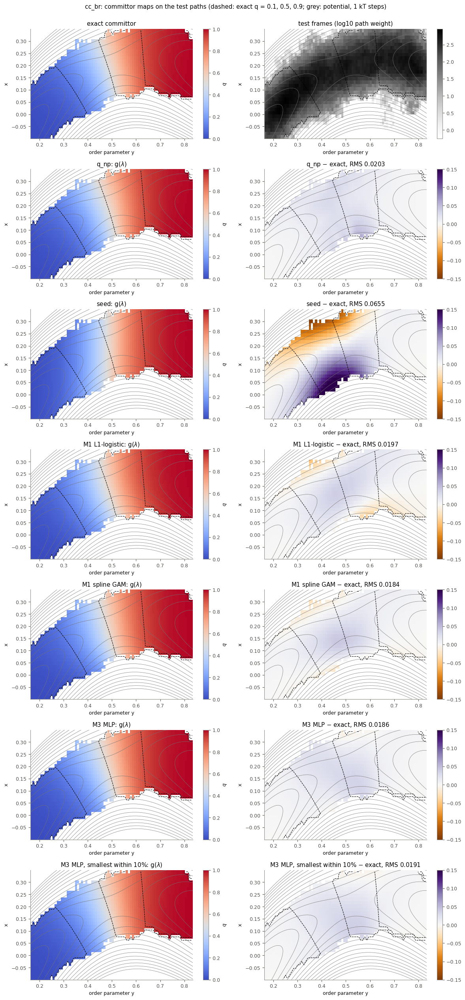

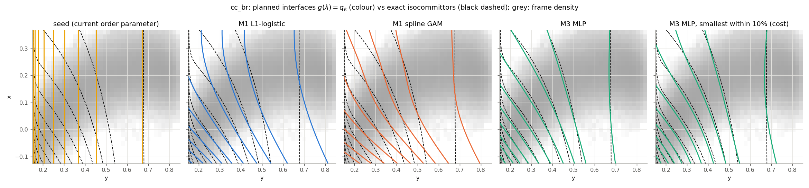

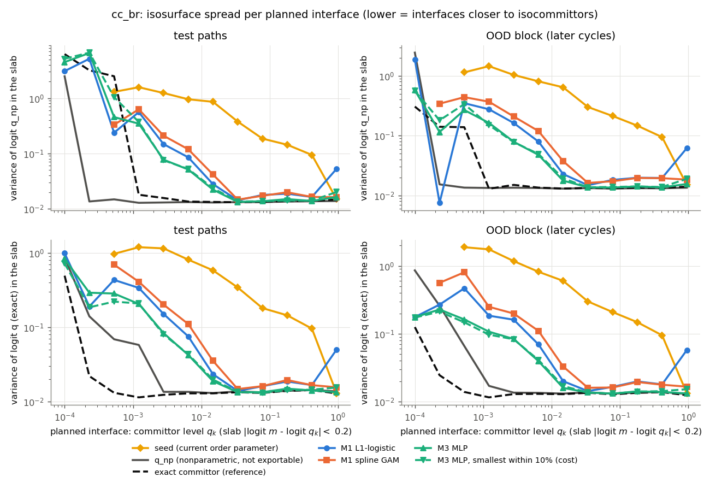

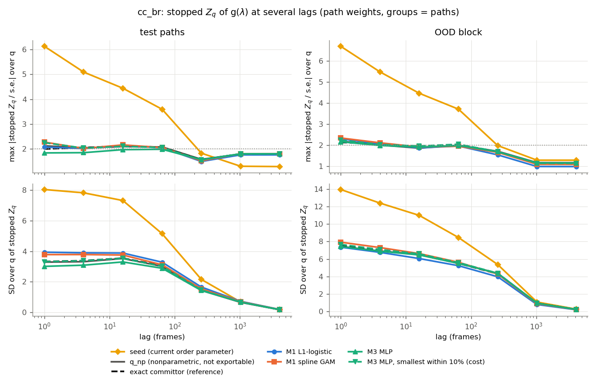

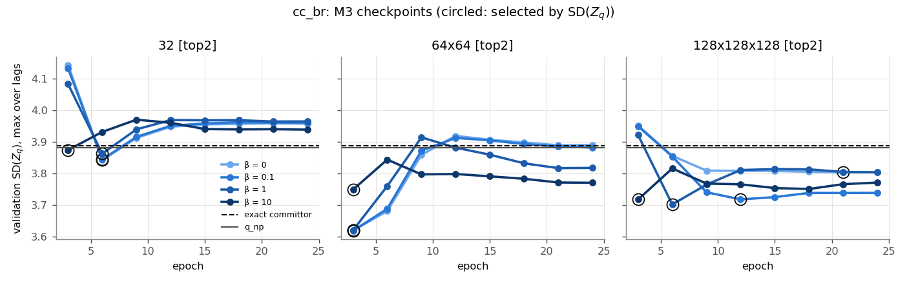

TIS diagnostics (plots_tis) and path-weighted feps of every row: [`../examples/figures_by_potential/2d_curved_channel/brownian_g10/param_lambda/cc_br/eval/tis_plots`](../examples/figures_by_potential/2d_curved_channel/brownian_g10/param_lambda/cc_br/eval/tis_plots).

<details><summary>All runs (test paths)</summary>

| candidate | spread (q_np) | spread (exact) | zqs_z | SD(Z_q) | step ratio | Δ RMSE lag 1 / 8 | sign-change ratio | turns / q_np | turns / exact | crossings / q_np | Δr² / q_np (lag 1) | Spearman | logit RMSE (q_np / exact) | µs/frame (one / batch) | training s |
|---|---|---|---|---|---|---|---|---|---|---|---|---|---|---|---|
| m1_logit_top2_0.01 (val SD(Z_q) 4.22) | 0.267 | 0.086 | 2.940 | 5.143 | 0.832 | 0.074 / 0.175 | 1.003 | 1.035 | 1.082 | 1.091 | 1.012 | 0.997 | 0.336 / 0.336 | – | 1.8 |
| m1_logit_top2_0.1 (val SD(Z_q) 4.21) | 0.267 | 0.086 | 2.940 | 5.131 | 0.832 | 0.074 / 0.175 | 1.003 | 1.032 | 1.080 | 1.091 | 1.012 | 0.997 | 0.336 / 0.336 | – | 1.9 |
| m1_logit_top2_1 (val SD(Z_q) 4.22) | 0.267 | 0.086 | 2.940 | 5.131 | 0.832 | 0.074 / 0.175 | 1.003 | 1.032 | 1.080 | 1.092 | 1.012 | 0.997 | 0.336 / 0.336 | – | 1.7 |
| m1_logit_top2_10 (val SD(Z_q) 4.22) | 0.267 | 0.086 | 2.940 | 5.131 | 0.832 | 0.074 / 0.175 | 1.003 | 1.032 | 1.080 | 1.092 | 1.012 | 0.997 | 0.336 / 0.336 | – | 1.9 |
| m1_gam_top2_0.001 (val SD(Z_q) 3.75) | 0.028 | 0.025 | 2.052 | 3.473 | 0.819 | 0.055 / 0.106 | 1.002 | 0.740 | 0.773 | 0.954 | 1.002 | 1.000 | 0.065 / 0.144 | – | 0.2 |
| m1_gam_top2_0.1 (val SD(Z_q) 3.81) | 0.027 | 0.024 | 2.402 | 3.828 | 0.796 | 0.059 / 0.119 | 1.001 | 0.796 | 0.832 | 0.965 | 0.999 | 0.999 | 0.154 / 0.188 | – | 0.2 |
| m1_gam_top2_10 (val SD(Z_q) 4.11) | 0.267 | 0.100 | 3.625 | 5.461 | 0.865 | 0.074 / 0.175 | 1.003 | 1.051 | 1.099 | 1.100 | 1.018 | 0.997 | 0.321 / 0.325 | – | 0.2 |
| m1_logit_top4_0.01 (val SD(Z_q) 4.04) | 0.061 | 0.047 | 2.487 | 4.312 | 0.707 | 0.068 / 0.143 | 1.003 | 0.725 | 0.758 | 0.966 | 1.003 | 0.999 | 0.248 / 0.261 | – | 2.5 |
| m1_logit_top4_0.1 (val SD(Z_q) 4.09) | 0.099 | 0.074 | 2.218 | 3.999 | 0.681 | 0.069 / 0.144 | 1.003 | 0.637 | 0.666 | 0.930 | 1.004 | 0.999 | 0.240 / 0.256 | – | 2.7 |
| m1_logit_top4_1 (val SD(Z_q) 4.05) | 0.104 | 0.078 | 2.144 | 3.936 | 0.679 | 0.070 / 0.145 | 1.003 | 0.633 | 0.662 | 0.925 | 1.004 | 0.999 | 0.240 / 0.257 | – | 2.7 |
| m1_logit_top4_10 (val SD(Z_q) 4.04) | 0.104 | 0.078 | 2.136 | 3.935 | 0.679 | 0.070 / 0.145 | 1.003 | 0.632 | 0.660 | 0.926 | 1.004 | 0.999 | 0.240 / 0.257 | – | 2.5 |
| m1_gam_top4_0.001 (val SD(Z_q) 3.75) | 0.030 | 0.027 | 2.089 | 3.408 | 0.807 | 0.055 / 0.105 | 1.000 | 0.732 | 0.765 | 0.950 | 1.003 | 1.000 | 0.044 / 0.139 | – | 0.3 |
| m1_gam_top4_0.1 (val SD(Z_q) 3.67) | 0.120 | 0.093 | 2.268 | 3.782 | 0.754 | 0.065 / 0.131 | 1.001 | 0.590 | 0.617 | 0.887 | 1.005 | 1.000 | 0.160 / 0.202 | – | 0.3 |
| m1_gam_top4_10 (val SD(Z_q) 3.8) | 0.149 | 0.121 | 2.017 | 3.713 | 0.693 | 0.073 / 0.157 | 1.003 | 0.569 | 0.595 | 0.889 | 1.031 | 0.999 | 0.232 / 0.256 | – | 0.3 |
| m1_logit_cvs_0.01 (val SD(Z_q) 4.22) | 0.268 | 0.086 | 2.934 | 5.144 | 0.832 | 0.074 / 0.175 | 1.003 | 1.033 | 1.080 | 1.091 | 1.013 | 0.997 | 0.336 / 0.336 | – | 1.8 |
| m1_logit_cvs_0.1 (val SD(Z_q) 4.22) | 0.267 | 0.086 | 2.939 | 5.144 | 0.832 | 0.074 / 0.175 | 1.003 | 1.034 | 1.081 | 1.091 | 1.012 | 0.997 | 0.336 / 0.336 | – | 1.9 |
| m1_logit_cvs_1 (val SD(Z_q) 4.22) | 0.267 | 0.086 | 2.939 | 5.138 | 0.832 | 0.074 / 0.175 | 1.003 | 1.034 | 1.082 | 1.092 | 1.012 | 0.997 | 0.336 / 0.336 | – | 1.8 |
| m1_logit_cvs_10 (val SD(Z_q) 4.22) | 0.267 | 0.086 | 2.940 | 5.138 | 0.832 | 0.074 / 0.175 | 1.003 | 1.033 | 1.080 | 1.091 | 1.012 | 0.997 | 0.336 / 0.336 | – | 1.8 |
| m1_gam_cvs_0.001 (val SD(Z_q) 3.74) | 0.261 | 0.055 | 2.179 | 4.159 | 0.768 | 0.064 / 0.134 | 1.003 | 0.731 | 0.765 | 0.955 | 1.018 | 0.999 | 0.193 / 0.222 | – | 0.1 |
| m1_gam_cvs_0.1 (val SD(Z_q) 3.73) | 0.278 | 0.063 | 2.163 | 4.154 | 0.714 | 0.069 / 0.145 | 1.002 | 0.664 | 0.694 | 0.934 | 1.015 | 0.999 | 0.212 / 0.235 | – | 0.2 |
| m1_gam_cvs_10 (val SD(Z_q) 4.08) | 0.308 | 0.098 | 3.106 | 5.338 | 0.845 | 0.074 / 0.173 | 1.002 | 1.016 | 1.063 | 1.084 | 1.016 | 0.997 | 0.311 / 0.316 | – | 0.2 |
| m3_top2_32_b0 (val SD(Z_q) 3.84) | 0.030 | 0.023 | 2.175 | 3.631 | 0.874 | 0.051 / 0.104 | 1.001 | 0.813 | 0.850 | 0.967 | 1.000 | 1.000 | 0.101 / 0.156 | – | 3.4 |
| m3_top2_32_b0.1 (val SD(Z_q) 3.84) | 0.030 | 0.023 | 2.168 | 3.616 | 0.873 | 0.051 / 0.104 | 1.001 | 0.812 | 0.849 | 0.966 | 1.000 | 1.000 | 0.099 / 0.156 | – | 5.2 |
| m3_top2_32_b1 (val SD(Z_q) 3.86) | 0.029 | 0.023 | 2.130 | 3.542 | 0.863 | 0.051 / 0.103 | 1.000 | 0.806 | 0.842 | 0.962 | 1.001 | 1.000 | 0.088 / 0.150 | – | 5.1 |
| m3_top2_32_b10 (val SD(Z_q) 3.87) | 0.048 | 0.027 | 2.477 | 3.985 | 0.823 | 0.056 / 0.115 | 1.001 | 0.831 | 0.869 | 0.989 | 0.998 | 0.999 | 0.164 / 0.195 | – | 5.1 |
| m3_top2_64x64_b0 (val SD(Z_q) 3.62) | 0.067 | 0.049 | 1.973 | 3.291 | 0.804 | 0.055 / 0.105 | 1.000 | 0.673 | 0.704 | 0.933 | 1.006 | 1.000 | 0.074 / 0.149 | – | 3.3 |
| m3_top2_64x64_b0.1 (val SD(Z_q) 3.62) | 0.063 | 0.047 | 1.978 | 3.297 | 0.803 | 0.055 / 0.105 | 1.000 | 0.672 | 0.703 | 0.933 | 1.006 | 1.000 | 0.073 / 0.149 | – | 5.4 |
| m3_top2_64x64_b1 (val SD(Z_q) 3.62) | 0.066 | 0.047 | 1.988 | 3.310 | 0.802 | 0.055 / 0.104 | 1.000 | 0.679 | 0.709 | 0.932 | 1.005 | 1.000 | 0.070 / 0.148 | – | 5.3 |
| m3_top2_64x64_b10 (val SD(Z_q) 3.75) | 0.036 | 0.030 | 2.044 | 3.384 | 0.792 | 0.054 / 0.102 | 1.000 | 0.713 | 0.745 | 0.948 | 1.002 | 1.000 | 0.049 / 0.140 | – | 5.4 |
| m3_top2_128x128x128_b0 (val SD(Z_q) 3.8) | 0.023 | 0.016 | 2.095 | 3.529 | 0.829 | 0.047 / 0.093 | 1.000 | 0.809 | 0.846 | 0.970 | 1.000 | 1.000 | 0.035 / 0.136 | – | 4.2 |
| m3_top2_128x128x128_b0.1 (val SD(Z_q) 3.72) | 0.023 | 0.017 | 2.075 | 3.528 | 0.805 | 0.050 / 0.096 | 1.000 | 0.801 | 0.838 | 0.968 | 1.001 | 1.000 | 0.035 / 0.137 | – | 14.6 |
| m3_top2_128x128x128_b1 (val SD(Z_q) 3.7) | 0.025 | 0.018 | 2.077 | 3.512 | 0.802 | 0.051 / 0.098 | 1.000 | 0.790 | 0.826 | 0.968 | 1.001 | 1.000 | 0.037 / 0.137 | – | 14.7 |
| m3_top2_128x128x128_b10 (val SD(Z_q) 3.72) | 0.024 | 0.017 | 2.086 | 3.472 | 0.826 | 0.049 / 0.095 | 1.000 | 0.803 | 0.840 | 0.973 | 1.002 | 1.000 | 0.037 / 0.136 | – | 14.8 |
| m3_top4_32_b0 (val SD(Z_q) 3.76) | 0.159 | 0.063 | 2.247 | 3.496 | 0.923 | 0.053 / 0.119 | 0.999 | 0.952 | 0.996 | 1.020 | 1.008 | 1.000 | 0.115 / 0.164 | – | 3.1 |
| m3_top4_32_b0.1 (val SD(Z_q) 3.78) | 0.147 | 0.061 | 2.220 | 3.464 | 0.923 | 0.053 / 0.119 | 1.000 | 0.949 | 0.993 | 1.019 | 1.007 | 1.000 | 0.114 / 0.163 | – | 4.8 |
| m3_top4_32_b1 (val SD(Z_q) 3.78) | 0.175 | 0.064 | 2.217 | 3.458 | 0.918 | 0.053 / 0.118 | 1.000 | 0.944 | 0.987 | 1.015 | 1.006 | 1.000 | 0.110 / 0.161 | – | 4.8 |
| m3_top4_32_b10 (val SD(Z_q) 3.78) | 0.226 | 0.035 | 2.168 | 3.470 | 0.864 | 0.051 / 0.109 | 0.999 | 0.843 | 0.882 | 0.987 | 1.003 | 1.000 | 0.080 / 0.146 | – | 5.2 |
| m3_top4_64x64_b0 (val SD(Z_q) 3.79) | 0.083 | 0.059 | 2.066 | 3.524 | 0.745 | 0.058 / 0.108 | 1.000 | 0.660 | 0.690 | 0.927 | 1.001 | 1.000 | 0.060 / 0.148 | – | 3.9 |
| m3_top4_64x64_b0.1 (val SD(Z_q) 3.77) | 0.078 | 0.056 | 2.076 | 3.532 | 0.750 | 0.057 / 0.106 | 1.000 | 0.677 | 0.708 | 0.930 | 1.001 | 1.000 | 0.057 / 0.147 | – | 5.7 |
| m3_top4_64x64_b1 (val SD(Z_q) 3.67) | 0.039 | 0.032 | 2.149 | 3.557 | 0.778 | 0.054 / 0.099 | 1.000 | 0.732 | 0.765 | 0.952 | 1.002 | 1.000 | 0.043 / 0.140 | – | 5.7 |
| m3_top4_64x64_b10 (val SD(Z_q) 3.71) | 0.017 | 0.016 | 2.071 | 3.520 | 0.846 | 0.047 / 0.088 | 1.000 | 0.814 | 0.852 | 0.970 | 1.003 | 1.000 | 0.027 / 0.136 | – | 5.7 |
| m3_top4_128x128x128_b0 (val SD(Z_q) 3.72) | 0.023 | 0.021 | 2.093 | 3.508 | 0.790 | 0.053 / 0.097 | 1.001 | 0.776 | 0.811 | 0.966 | 1.001 | 1.000 | 0.039 / 0.137 | – | 4.0 |
| m3_top4_128x128x128_b0.1 (val SD(Z_q) 3.7) | 0.021 | 0.019 | 2.167 | 3.514 | 0.794 | 0.052 / 0.097 | 1.000 | 0.782 | 0.817 | 0.965 | 1.001 | 1.000 | 0.038 / 0.137 | – | 15.5 |
| m3_top4_128x128x128_b1 (val SD(Z_q) 3.73) | 0.015 | 0.015 | 2.066 | 3.538 | 0.891 | 0.041 / 0.079 | 1.000 | 0.896 | 0.937 | 0.988 | 1.002 | 1.000 | 0.025 / 0.135 | – | 16.9 |
| m3_top4_128x128x128_b10 (val SD(Z_q) 3.75) | 0.015 | 0.015 | 2.061 | 3.524 | 0.888 | 0.041 / 0.080 | 1.000 | 0.896 | 0.937 | 0.992 | 1.002 | 1.000 | 0.026 / 0.135 | – | 16.9 |
| m3_cvs_32_b0 (val SD(Z_q) 3.64) | 0.066 | 0.047 | 2.236 | 3.532 | 0.807 | 0.055 / 0.108 | 1.001 | 0.680 | 0.711 | 0.929 | 1.005 | 1.000 | 0.086 / 0.154 | – | 3.5 |
| m3_cvs_32_b0.1 (val SD(Z_q) 3.64) | 0.066 | 0.047 | 2.244 | 3.530 | 0.807 | 0.055 / 0.108 | 1.001 | 0.680 | 0.711 | 0.927 | 1.005 | 1.000 | 0.086 / 0.153 | – | 5.6 |
| m3_cvs_32_b1 (val SD(Z_q) 3.65) | 0.066 | 0.047 | 2.121 | 3.492 | 0.802 | 0.055 / 0.109 | 1.001 | 0.667 | 0.697 | 0.926 | 1.004 | 1.000 | 0.079 / 0.151 | – | 5.6 |
| m3_cvs_32_b10 (val SD(Z_q) 3.81) | 0.060 | 0.044 | 2.059 | 3.409 | 0.781 | 0.056 / 0.110 | 1.000 | 0.671 | 0.701 | 0.923 | 1.004 | 1.000 | 0.063 / 0.146 | – | 5.4 |
| m3_cvs_64x64_b0 (val SD(Z_q) 3.75) | 0.091 | 0.068 | 2.186 | 3.513 | 0.734 | 0.062 / 0.117 | 1.000 | 0.624 | 0.653 | 0.904 | 1.003 | 1.000 | 0.079 / 0.158 | – | 3.6 |
| m3_cvs_64x64_b0.1 (val SD(Z_q) 3.77) | 0.089 | 0.067 | 2.121 | 3.517 | 0.734 | 0.061 / 0.117 | 1.000 | 0.622 | 0.651 | 0.906 | 1.002 | 1.000 | 0.078 / 0.157 | – | 5.6 |
| m3_cvs_64x64_b1 (val SD(Z_q) 3.81) | 0.085 | 0.061 | 2.159 | 3.536 | 0.739 | 0.059 / 0.112 | 1.000 | 0.643 | 0.673 | 0.919 | 1.001 | 1.000 | 0.070 / 0.153 | – | 5.6 |
| m3_cvs_64x64_b10 (val SD(Z_q) 3.76) | 0.015 | 0.014 | 2.135 | 3.588 | 0.874 | 0.043 / 0.084 | 1.001 | 0.877 | 0.917 | 0.988 | 1.001 | 1.000 | 0.024 / 0.135 | – | 5.5 |
| m3_cvs_128x128x128_b0 (val SD(Z_q) 3.74) | 0.020 | 0.018 | 2.133 | 3.549 | 0.794 | 0.053 / 0.098 | 1.001 | 0.796 | 0.832 | 0.972 | 1.001 | 1.000 | 0.036 / 0.137 | – | 3.7 |
| m3_cvs_128x128x128_b0.1 (val SD(Z_q) 3.71) | 0.017 | 0.016 | 2.114 | 3.563 | 0.804 | 0.050 / 0.095 | 1.001 | 0.807 | 0.844 | 0.972 | 1.002 | 1.000 | 0.032 / 0.136 | – | 14.8 |
| m3_cvs_128x128x128_b1 (val SD(Z_q) 3.76) | 0.034 | 0.029 | 2.083 | 3.497 | 0.775 | 0.055 / 0.103 | 1.001 | 0.729 | 0.763 | 0.952 | 1.001 | 1.000 | 0.043 / 0.139 | – | 14.7 |
| m3_cvs_128x128x128_b10 (val SD(Z_q) 3.74) | 0.015 | 0.015 | 2.086 | 3.524 | 0.889 | 0.040 / 0.079 | 1.001 | 0.900 | 0.941 | 0.992 | 1.003 | 1.000 | 0.024 / 0.136 | – | 14.7 |

</details>


## flat1d

Data: `sim_istar0br10intf`, loader `--reversed --paths-per-ensemble 1000`.

M2 screening (permutation importance of the gradient-boosted trees on validation paths): `x` 2.95, `x^2` 0.0593, `x^3` 0.0101.

### Test paths (held-out MC cycle blocks)

| candidate | spread (q_np) | spread (exact) | zqs_z | SD(Z_q) | step ratio | Δ RMSE lag 1 / 8 | sign-change ratio | turns / q_np | turns / exact | crossings / q_np | Δr² / q_np (lag 1) | Spearman | logit RMSE (q_np / exact) | µs/frame (one / batch) | training s |
|---|---|---|---|---|---|---|---|---|---|---|---|---|---|---|---|
| seed | 0.012 | 0.012 | 2.562 | 5.784 | 0.998 | 0.003 / 0.003 | 1.000 | 0.929 | 0.915 | 0.990 | 1.000 | 1.000 | 1.40e-04 / 0.063 | 2.4 / 0.11 | – |
| q_np | 0.012 | 0.012 | 2.562 | 5.784 | 0.998 | 0.002 / 0.001 | 1.000 | 0.930 | 0.915 | 0.990 | 1.000 | 1.000 | 1.28e-04 / 0.063 | – | – |
| exact committor | 0.012 | 0.012 | 2.562 | 5.784 | 0.999 | 0.003 / 0.003 | 1.000 | 0.930 | 0.915 | 0.990 | 1.000 | 1.000 | 9.07e-05 / 0.063 | – | – |
| M1 L1-logistic [x; C=0.1] | 0.012 | 0.012 | 2.562 | 5.784 | 0.998 | 0.003 / 0.003 | 1.000 | 0.929 | 0.915 | 0.990 | 1.000 | 1.000 | 1.40e-04 / 0.063 | 2.5 / 0.11 | 1.9 |
| M1 spline GAM [x; GAM (P-spline) penalty=10] | 0.013 | 0.012 | 2.562 | 5.784 | 0.995 | 0.007 / 0.006 | 1.000 | 0.930 | 0.916 | 0.990 | 1.000 | 1.000 | 3.65e-04 / 0.063 | 3.4 / 0.17 | 0.1 |
| M3 MLP [x; 64x64, β=0, epoch 3] | 0.012 | 0.012 | 2.562 | 5.784 | 0.998 | 0.003 / 0.003 | 1.000 | 0.930 | 0.915 | 0.990 | 1.000 | 1.000 | 1.30e-04 / 0.063 | 8.7 / 1.55 | 1.8 |
| M3 MLP, smallest within 10% [x; 32, β=1, epoch 9] | 0.012 | 0.012 | 2.562 | 5.784 | 0.998 | 0.003 / 0.003 | 1.000 | 0.929 | 0.915 | 0.990 | 1.000 | 1.000 | 1.32e-04 / 0.063 | 5.6 / 0.41 | 2.6 |

### OOD block (the last 15% of the cycles)

| candidate | spread (q_np) | spread (exact) | zqs_z | SD(Z_q) | step ratio | Δ RMSE lag 1 / 8 | sign-change ratio | turns / q_np | turns / exact | crossings / q_np | Δr² / q_np (lag 1) | Spearman | logit RMSE (q_np / exact) | µs/frame (one / batch) | training s |
|---|---|---|---|---|---|---|---|---|---|---|---|---|---|---|---|
| seed | 0.012 | 0.012 | 1.113 | 4.107 | 0.988 | 0.012 / 0.012 | 1.000 | 0.925 | 0.908 | 0.990 | 1.000 | 1.000 | 4.07e-04 / 0.063 | 2.4 / 0.11 | – |
| q_np | 0.012 | 0.012 | 1.113 | 4.107 | 0.988 | 0.012 / 0.012 | 1.000 | 0.925 | 0.909 | 0.990 | 1.000 | 1.000 | 3.82e-04 / 0.063 | – | – |
| exact committor | 0.012 | 0.012 | 1.113 | 4.109 | 0.989 | 0.012 / 0.012 | 1.000 | 0.925 | 0.909 | 0.990 | 1.000 | 1.000 | 3.68e-04 / 0.063 | – | – |
| M1 L1-logistic [x; C=0.1] | 0.012 | 0.012 | 1.113 | 4.107 | 0.988 | 0.012 / 0.012 | 1.000 | 0.925 | 0.908 | 0.990 | 1.000 | 1.000 | 4.07e-04 / 0.063 | 2.5 / 0.11 | 1.9 |
| M1 spline GAM [x; GAM (P-spline) penalty=10] | 0.013 | 0.012 | 1.113 | 4.105 | 0.986 | 0.014 / 0.014 | 1.000 | 0.925 | 0.909 | 0.990 | 1.000 | 1.000 | 5.57e-04 / 0.063 | 3.4 / 0.17 | 0.1 |
| M3 MLP [x; 64x64, β=0, epoch 3] | 0.012 | 0.012 | 1.113 | 4.106 | 0.988 | 0.012 / 0.012 | 1.000 | 0.925 | 0.908 | 0.990 | 1.000 | 1.000 | 3.87e-04 / 0.063 | 8.7 / 1.55 | 1.8 |
| M3 MLP, smallest within 10% [x; 32, β=1, epoch 9] | 0.012 | 0.012 | 1.113 | 4.106 | 0.988 | 0.012 / 0.012 | 1.000 | 0.924 | 0.908 | 0.990 | 1.000 | 1.000 | 3.92e-04 / 0.063 | 5.6 / 0.41 | 2.6 |

Mean spreads use the planned levels q_k = test: 0.015, 0.023, 0.035, 0.052, 0.079, 0.12, 0.18, 0.27, 0.42, 0.63, 0.95; ood: 0.015, 0.023, 0.035, 0.052, 0.079, 0.12, 0.18, 0.27, 0.42, 0.63, 0.95 (enough frames, and q_np resolves the committor there: on the exact isocommittor slab logit q_np varies by less than 10x the slab width; per-level values in the figure).

Reference rates per 1000 frames (sampler turn rule, planned interfaces): test: turns qnp 26.5, crossings qnp 129.3, turns exact 26.9, crossings exact 131.7; OOD: turns qnp 25.0, crossings qnp 126.4, turns exact 25.5, crossings exact 128.6.

A/B ramps (width 0.045 = 0.05 × (λ_B − λ_A)): 3.23% of the test frame weight lies in them; there h differs from the calibrated committor m by RMS seed 0.0143, M1-logit 0.0143, M1-gam 0.0143, M3 0.0143, M3-fast 0.0143.

Validation selection metric SD(Z_q) of the references on the same paths: q_np 3.325 (spread 0.012), exact 3.326 (spread 0.012); fitted runs: 3.324 … 3.325.

Selection sensitivity: the rule selects by validation SD(Z_q); a selection by validation isosurface spread (q_np only) would take:

| family | selected by | run | val SD(Z_q) | val spread (q_np) | test spread (q_np) | test spread (exact) | test zqs_z | test SD(Z_q) |
|---|---|---|---|---|---|---|---|---|
| M1-logit | SD(Z_q) (rule) | m1_logit_top1_0.1 | 3.325 | 0.012 | 0.012 | 0.012 | 2.562 | 5.784 |
| M1-logit | spread | m1_logit_top1_0.01 | 3.325 | 0.012 | 0.012 | 0.012 | 2.562 | 5.784 |
| M1-gam | SD(Z_q) (rule) | m1_gam_top1_10 | 3.324 | 0.012 | 0.013 | 0.012 | 2.562 | 5.784 |
| M1-gam | spread | m1_gam_top1_10 | 3.324 | 0.012 | 0.013 | 0.012 | 2.562 | 5.784 |
| M3 | SD(Z_q) (rule) | m3_top1_64x64_b0 | 3.325 | 0.012 | 0.012 | 0.012 | 2.562 | 5.784 |
| M3 | spread | m3_top1_128x128x128_b0.1 | 3.325 | 0.012 | 0.012 | 0.012 | 2.562 | 5.784 |

Recommendation: **M1 spline GAM**. M1 spline GAM vs M3 on the test paths: spread 0.0125 vs 0.01208 (within +10%), zqs_z 2.56 vs 2.56 (within +0.5).

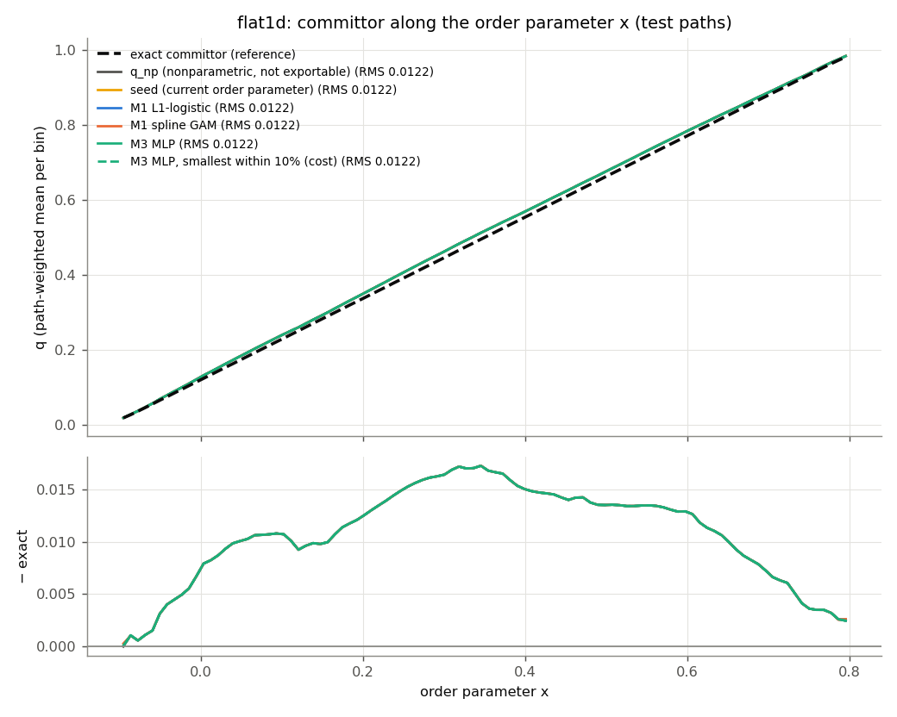

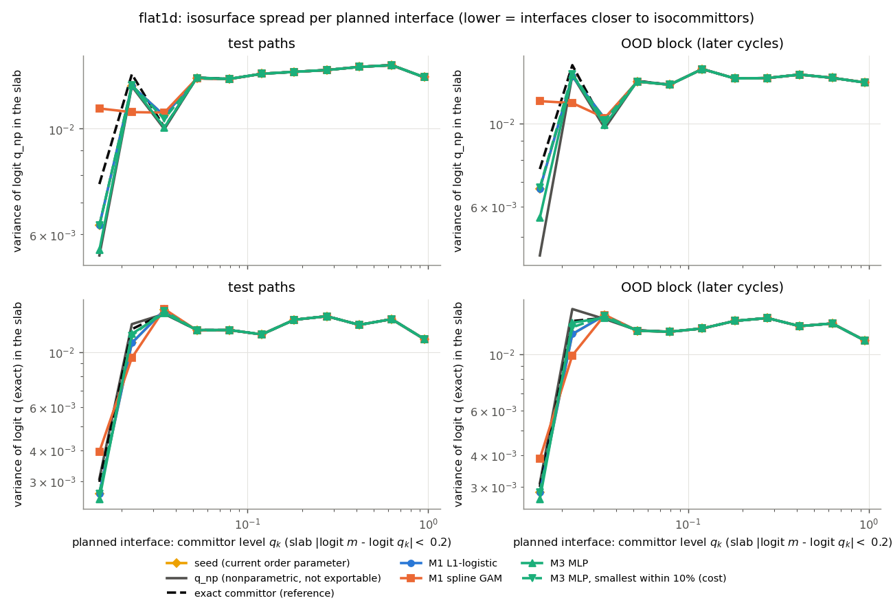

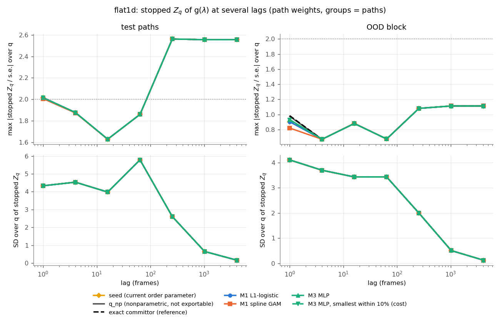

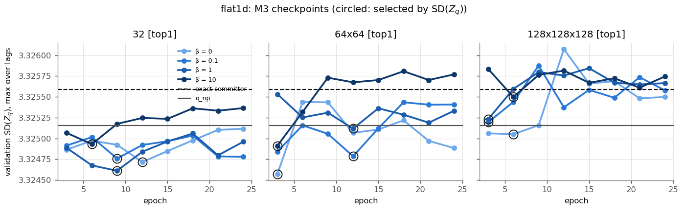

TIS diagnostics (plots_tis) and path-weighted feps of every row: [`../examples/figures_by_potential/1d_flat/brownian_staple/param_lambda/eval/tis_plots`](../examples/figures_by_potential/1d_flat/brownian_staple/param_lambda/eval/tis_plots).

<details><summary>All runs (test paths)</summary>

| candidate | spread (q_np) | spread (exact) | zqs_z | SD(Z_q) | step ratio | Δ RMSE lag 1 / 8 | sign-change ratio | turns / q_np | turns / exact | crossings / q_np | Δr² / q_np (lag 1) | Spearman | logit RMSE (q_np / exact) | µs/frame (one / batch) | training s |
|---|---|---|---|---|---|---|---|---|---|---|---|---|---|---|---|
| m1_logit_top1_0.01 (val SD(Z_q) 3.32) | 0.012 | 0.012 | 2.562 | 5.784 | 0.998 | 0.003 / 0.003 | 1.000 | 0.929 | 0.915 | 0.990 | 1.000 | 1.000 | 1.40e-04 / 0.063 | – | 2.0 |
| m1_logit_top1_0.1 (val SD(Z_q) 3.32) | 0.012 | 0.012 | 2.562 | 5.784 | 0.998 | 0.003 / 0.003 | 1.000 | 0.929 | 0.915 | 0.990 | 1.000 | 1.000 | 1.40e-04 / 0.063 | – | 1.9 |
| m1_logit_top1_1 (val SD(Z_q) 3.32) | 0.012 | 0.012 | 2.562 | 5.784 | 0.998 | 0.003 / 0.003 | 1.000 | 0.929 | 0.915 | 0.990 | 1.000 | 1.000 | 1.40e-04 / 0.063 | – | 1.9 |
| m1_logit_top1_10 (val SD(Z_q) 3.32) | 0.012 | 0.012 | 2.562 | 5.784 | 0.998 | 0.003 / 0.003 | 1.000 | 0.929 | 0.915 | 0.990 | 1.000 | 1.000 | 1.40e-04 / 0.063 | – | 2.3 |
| m1_gam_top1_0.001 (val SD(Z_q) 3.32) | 0.012 | 0.012 | 2.562 | 5.784 | 0.996 | 0.006 / 0.006 | 1.000 | 0.930 | 0.915 | 0.990 | 1.000 | 1.000 | 2.27e-04 / 0.063 | – | 0.1 |
| m1_gam_top1_0.1 (val SD(Z_q) 3.32) | 0.013 | 0.012 | 2.562 | 5.784 | 0.997 | 0.006 / 0.006 | 1.000 | 0.930 | 0.915 | 0.990 | 1.000 | 1.000 | 1.15e-04 / 0.063 | – | 0.1 |
| m1_gam_top1_10 (val SD(Z_q) 3.32) | 0.013 | 0.012 | 2.562 | 5.784 | 0.995 | 0.007 / 0.006 | 1.000 | 0.930 | 0.916 | 0.990 | 1.000 | 1.000 | 3.65e-04 / 0.063 | – | 0.1 |
| m3_top1_32_b0 (val SD(Z_q) 3.32) | 0.012 | 0.012 | 2.562 | 5.784 | 0.998 | 0.003 / 0.003 | 1.000 | 0.930 | 0.915 | 0.990 | 1.000 | 1.000 | 1.46e-04 / 0.063 | – | 1.9 |
| m3_top1_32_b0.1 (val SD(Z_q) 3.32) | 0.012 | 0.012 | 2.562 | 5.784 | 0.998 | 0.003 / 0.003 | 1.000 | 0.929 | 0.915 | 0.990 | 1.000 | 1.000 | 1.32e-04 / 0.063 | – | 2.9 |
| m3_top1_32_b1 (val SD(Z_q) 3.32) | 0.012 | 0.012 | 2.562 | 5.784 | 0.998 | 0.003 / 0.003 | 1.000 | 0.929 | 0.915 | 0.990 | 1.000 | 1.000 | 1.32e-04 / 0.063 | – | 2.6 |
| m3_top1_32_b10 (val SD(Z_q) 3.32) | 0.012 | 0.012 | 2.562 | 5.784 | 0.998 | 0.003 / 0.003 | 1.000 | 0.930 | 0.915 | 0.990 | 1.000 | 1.000 | 1.37e-04 / 0.063 | – | 2.6 |
| m3_top1_64x64_b0 (val SD(Z_q) 3.32) | 0.012 | 0.012 | 2.562 | 5.784 | 0.998 | 0.003 / 0.003 | 1.000 | 0.930 | 0.915 | 0.990 | 1.000 | 1.000 | 1.30e-04 / 0.063 | – | 1.8 |
| m3_top1_64x64_b0.1 (val SD(Z_q) 3.32) | 0.012 | 0.012 | 2.562 | 5.784 | 0.998 | 0.003 / 0.003 | 1.000 | 0.930 | 0.915 | 0.990 | 1.000 | 1.000 | 9.82e-05 / 0.063 | – | 2.7 |
| m3_top1_64x64_b1 (val SD(Z_q) 3.33) | 0.012 | 0.012 | 2.562 | 5.784 | 0.998 | 0.003 / 0.003 | 1.000 | 0.930 | 0.915 | 0.990 | 1.000 | 1.000 | 1.07e-04 / 0.063 | – | 2.7 |
| m3_top1_64x64_b10 (val SD(Z_q) 3.32) | 0.012 | 0.012 | 2.562 | 5.784 | 0.998 | 0.003 / 0.003 | 1.000 | 0.930 | 0.915 | 0.990 | 1.000 | 1.000 | 9.88e-05 / 0.063 | – | 2.7 |
| m3_top1_128x128x128_b0 (val SD(Z_q) 3.33) | 0.012 | 0.012 | 2.562 | 5.784 | 0.998 | 0.003 / 0.003 | 1.000 | 0.930 | 0.915 | 0.990 | 1.000 | 1.000 | 9.81e-05 / 0.063 | – | 2.1 |
| m3_top1_128x128x128_b0.1 (val SD(Z_q) 3.33) | 0.012 | 0.012 | 2.562 | 5.784 | 0.998 | 0.003 / 0.003 | 1.000 | 0.930 | 0.915 | 0.990 | 1.000 | 1.000 | 1.15e-04 / 0.063 | – | 7.1 |
| m3_top1_128x128x128_b1 (val SD(Z_q) 3.33) | 0.012 | 0.012 | 2.562 | 5.784 | 0.998 | 0.003 / 0.003 | 1.000 | 0.930 | 0.915 | 0.990 | 1.000 | 1.000 | 1.18e-04 / 0.063 | – | 7.1 |
| m3_top1_128x128x128_b10 (val SD(Z_q) 3.33) | 0.012 | 0.012 | 2.562 | 5.784 | 0.998 | 0.003 / 0.003 | 1.000 | 0.930 | 0.915 | 0.990 | 1.000 | 1.000 | 1.15e-04 / 0.063 | – | 7.1 |

</details>


## bumps1d

Data: `sim_istar2cosbr_2108`, loader `--reversed --paths-per-ensemble 2000`.

M2 screening (permutation importance of the gradient-boosted trees on validation paths): `x` 3.26, `x^2` 0.363, `x^3` 0.000696.

### Test paths (held-out MC cycle blocks)

| candidate | spread (q_np) | spread (exact) | zqs_z | SD(Z_q) | step ratio | Δ RMSE lag 1 / 8 | sign-change ratio | turns / q_np | turns / exact | crossings / q_np | Δr² / q_np (lag 1) | Spearman | logit RMSE (q_np / exact) | µs/frame (one / batch) | training s |
|---|---|---|---|---|---|---|---|---|---|---|---|---|---|---|---|
| seed | 0.013 | 0.013 | 1.912 | 7.834 | 0.996 | 0.003 / 0.003 | 1.000 | 0.999 | 0.995 | 1.000 | 1.000 | 1.000 | 2.23e-04 / 0.022 | 2.2 / 0.11 | – |
| q_np | 0.013 | 0.013 | 1.913 | 7.834 | 0.996 | 0.003 / 0.003 | 1.000 | 1.000 | 0.996 | 1.000 | 1.000 | 1.000 | 2.29e-04 / 0.022 | – | – |
| exact committor | 0.013 | 0.013 | 1.912 | 7.836 | 0.996 | 0.003 / 0.003 | 1.000 | 1.000 | 0.995 | 1.000 | 1.000 | 1.000 | 2.31e-04 / 0.022 | – | – |
| M1 L1-logistic [x; C=1] | 0.013 | 0.013 | 1.912 | 7.834 | 0.996 | 0.003 / 0.003 | 1.000 | 0.999 | 0.995 | 1.000 | 1.000 | 1.000 | 2.23e-04 / 0.022 | 2.4 / 0.11 | 2.1 |
| M1 spline GAM [x; GAM (P-spline) penalty=0.1] | 0.013 | 0.013 | 1.912 | 7.832 | 0.995 | 0.009 / 0.007 | 1.000 | 0.960 | 0.955 | 0.991 | 1.000 | 1.000 | 3.38e-04 / 0.022 | 3.4 / 0.17 | 0.1 |
| M3 MLP [x; 64x64, β=0.1, epoch 21] | 0.013 | 0.013 | 1.911 | 7.832 | 0.996 | 0.003 / 0.003 | 1.000 | 1.000 | 0.995 | 1.000 | 1.000 | 1.000 | 2.22e-04 / 0.022 | 8.3 / 1.57 | 7.2 |
| M3 MLP, smallest within 10% [x; 32, β=10, epoch 6] | 0.013 | 0.013 | 1.911 | 7.833 | 0.996 | 0.003 / 0.003 | 1.000 | 1.000 | 0.995 | 1.000 | 1.000 | 1.000 | 2.22e-04 / 0.022 | 5.4 / 0.43 | 6.8 |

### OOD block (the last 15% of the cycles)

| candidate | spread (q_np) | spread (exact) | zqs_z | SD(Z_q) | step ratio | Δ RMSE lag 1 / 8 | sign-change ratio | turns / q_np | turns / exact | crossings / q_np | Δr² / q_np (lag 1) | Spearman | logit RMSE (q_np / exact) | µs/frame (one / batch) | training s |
|---|---|---|---|---|---|---|---|---|---|---|---|---|---|---|---|
| seed | 0.013 | 0.013 | 2.484 | 6.224 | 0.997 | 0.003 / 0.003 | 1.000 | 1.000 | 0.990 | 1.000 | 1.000 | 1.000 | 2.00e-04 / 0.022 | 2.2 / 0.11 | – |
| q_np | 0.013 | 0.013 | 2.490 | 6.223 | 0.997 | 0.002 / 0.002 | 1.000 | 1.000 | 0.990 | 1.000 | 1.000 | 1.000 | 2.09e-04 / 0.022 | – | – |
| exact committor | 0.013 | 0.013 | 2.486 | 6.223 | 0.997 | 0.003 / 0.003 | 1.000 | 1.000 | 0.990 | 1.000 | 1.000 | 1.000 | 2.08e-04 / 0.022 | – | – |
| M1 L1-logistic [x; C=1] | 0.013 | 0.013 | 2.484 | 6.224 | 0.997 | 0.003 / 0.003 | 1.000 | 1.000 | 0.990 | 1.000 | 1.000 | 1.000 | 2.00e-04 / 0.022 | 2.4 / 0.11 | 2.1 |
| M1 spline GAM [x; GAM (P-spline) penalty=0.1] | 0.013 | 0.013 | 2.532 | 6.219 | 0.996 | 0.008 / 0.007 | 1.000 | 0.959 | 0.950 | 0.989 | 1.000 | 1.000 | 2.73e-04 / 0.022 | 3.4 / 0.17 | 0.1 |
| M3 MLP [x; 64x64, β=0.1, epoch 21] | 0.013 | 0.013 | 2.486 | 6.230 | 0.997 | 0.003 / 0.003 | 1.000 | 1.000 | 0.990 | 1.000 | 1.000 | 1.000 | 2.00e-04 / 0.022 | 8.3 / 1.57 | 7.2 |
| M3 MLP, smallest within 10% [x; 32, β=10, epoch 6] | 0.013 | 0.013 | 2.487 | 6.226 | 0.997 | 0.003 / 0.003 | 1.000 | 1.000 | 0.990 | 1.000 | 1.000 | 1.000 | 1.99e-04 / 0.022 | 5.4 / 0.43 | 6.8 |

Mean spreads use the planned levels q_k = test: 0.01, 0.015, 0.023, 0.035, 0.052, 0.079, 0.12, 0.18, 0.27, 0.42, 0.63, 0.95; ood: 0.01, 0.015, 0.023, 0.035, 0.052, 0.079, 0.12, 0.18, 0.27, 0.42, 0.63, 0.95 (enough frames, and q_np resolves the committor there: on the exact isocommittor slab logit q_np varies by less than 10x the slab width; per-level values in the figure).

Reference rates per 1000 frames (sampler turn rule, planned interfaces): test: turns qnp 26.7, crossings qnp 119.0, turns exact 26.8, crossings exact 119.8; OOD: turns qnp 26.6, crossings qnp 120.1, turns exact 26.9, crossings exact 121.6.

A/B ramps (width 0.02 = 0.05 × (λ_B − λ_A)): 2.51% of the test frame weight lies in them; there h differs from the calibrated committor m by RMS seed 0.00875, M1-logit 0.00875, M1-gam 0.00876, M3 0.00875, M3-fast 0.00875.

Validation selection metric SD(Z_q) of the references on the same paths: q_np 8.319 (spread 0.013), exact 8.318 (spread 0.013); fitted runs: 8.317 … 8.320.

Selection sensitivity: the rule selects by validation SD(Z_q); a selection by validation isosurface spread (q_np only) would take:

| family | selected by | run | val SD(Z_q) | val spread (q_np) | test spread (q_np) | test spread (exact) | test zqs_z | test SD(Z_q) |
|---|---|---|---|---|---|---|---|---|
| M1-logit | SD(Z_q) (rule) | m1_logit_top1_1 | 8.317 | 0.013 | 0.013 | 0.013 | 1.912 | 7.834 |
| M1-logit | spread | m1_logit_top1_0.01 | 8.317 | 0.013 | 0.013 | 0.013 | 1.912 | 7.834 |
| M1-gam | SD(Z_q) (rule) | m1_gam_top1_0.1 | 8.318 | 0.013 | 0.013 | 0.013 | 1.912 | 7.832 |
| M1-gam | spread | m1_gam_top1_0.1 | 8.318 | 0.013 | 0.013 | 0.013 | 1.912 | 7.832 |
| M3 | SD(Z_q) (rule) | m3_top1_64x64_b0.1 | 8.317 | 0.013 | 0.013 | 0.013 | 1.911 | 7.832 |
| M3 | spread | m3_top1_64x64_b0.1 | 8.317 | 0.013 | 0.013 | 0.013 | 1.911 | 7.832 |

Recommendation: **M1 L1-logistic**. M1 L1-logistic vs M3 on the test paths: spread 0.01287 vs 0.01288 (within +10%), zqs_z 1.91 vs 1.91 (within +0.5).

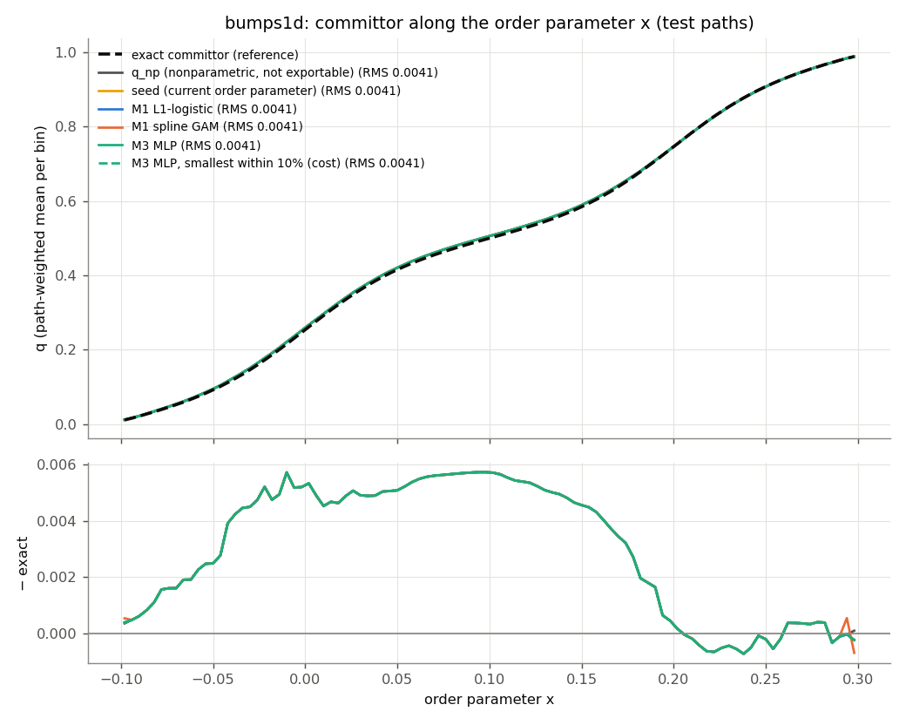

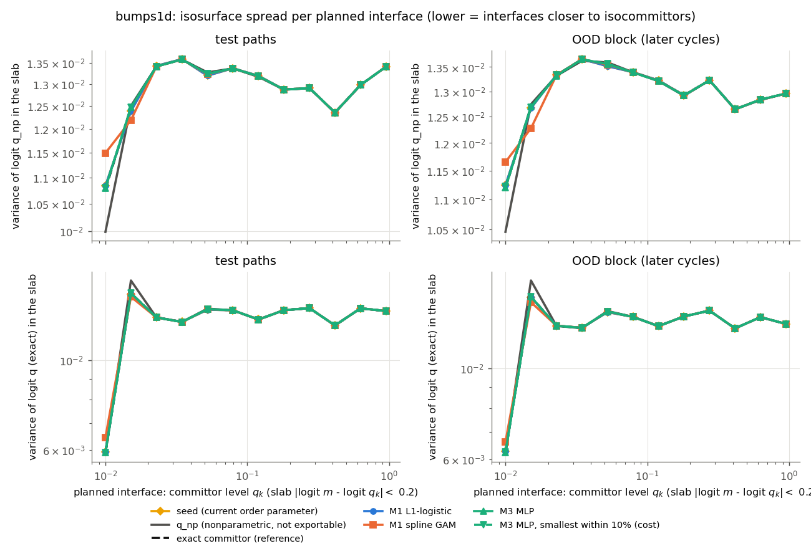

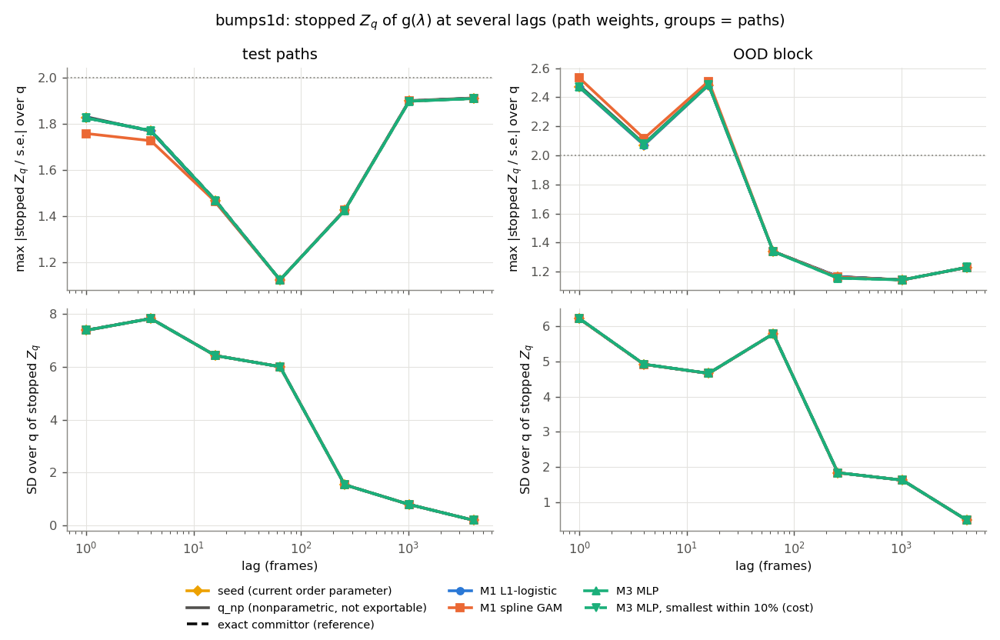

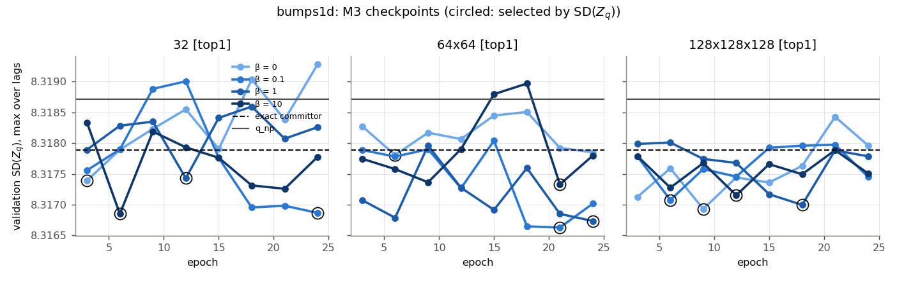

TIS diagnostics (plots_tis) and path-weighted feps of every row: [`../examples/figures_by_potential/1d_two_bumps/brownian_staple/param_lambda/eval/tis_plots`](../examples/figures_by_potential/1d_two_bumps/brownian_staple/param_lambda/eval/tis_plots).

<details><summary>All runs (test paths)</summary>

| candidate | spread (q_np) | spread (exact) | zqs_z | SD(Z_q) | step ratio | Δ RMSE lag 1 / 8 | sign-change ratio | turns / q_np | turns / exact | crossings / q_np | Δr² / q_np (lag 1) | Spearman | logit RMSE (q_np / exact) | µs/frame (one / batch) | training s |
|---|---|---|---|---|---|---|---|---|---|---|---|---|---|---|---|
| m1_logit_top1_0.01 (val SD(Z_q) 8.32) | 0.013 | 0.013 | 1.912 | 7.834 | 0.996 | 0.003 / 0.003 | 1.000 | 0.999 | 0.995 | 1.000 | 1.000 | 1.000 | 2.23e-04 / 0.022 | – | 1.8 |
| m1_logit_top1_0.1 (val SD(Z_q) 8.32) | 0.013 | 0.013 | 1.912 | 7.834 | 0.996 | 0.003 / 0.003 | 1.000 | 0.999 | 0.995 | 1.000 | 1.000 | 1.000 | 2.23e-04 / 0.022 | – | 1.9 |
| m1_logit_top1_1 (val SD(Z_q) 8.32) | 0.013 | 0.013 | 1.912 | 7.834 | 0.996 | 0.003 / 0.003 | 1.000 | 0.999 | 0.995 | 1.000 | 1.000 | 1.000 | 2.23e-04 / 0.022 | – | 2.1 |
| m1_logit_top1_10 (val SD(Z_q) 8.32) | 0.013 | 0.013 | 1.912 | 7.834 | 0.996 | 0.003 / 0.003 | 1.000 | 0.999 | 0.995 | 1.000 | 1.000 | 1.000 | 2.23e-04 / 0.022 | – | 1.7 |
| m1_gam_top1_0.001 (val SD(Z_q) 8.32) | 0.013 | 0.013 | 1.912 | 7.831 | 0.996 | 0.008 / 0.007 | 1.000 | 0.960 | 0.955 | 0.991 | 1.000 | 1.000 | 2.65e-04 / 0.022 | – | 0.1 |
| m1_gam_top1_0.1 (val SD(Z_q) 8.32) | 0.013 | 0.013 | 1.912 | 7.832 | 0.995 | 0.009 / 0.007 | 1.000 | 0.960 | 0.955 | 0.991 | 1.000 | 1.000 | 3.38e-04 / 0.022 | – | 0.1 |
| m1_gam_top1_10 (val SD(Z_q) 8.32) | 0.013 | 0.013 | 1.914 | 7.833 | 0.994 | 0.009 / 0.008 | 1.000 | 0.960 | 0.955 | 0.991 | 1.000 | 1.000 | 4.79e-04 / 0.022 | – | 0.1 |
| m3_top1_32_b0 (val SD(Z_q) 8.32) | 0.013 | 0.013 | 1.911 | 7.834 | 0.996 | 0.003 / 0.003 | 1.000 | 1.000 | 0.995 | 1.000 | 1.000 | 1.000 | 2.20e-04 / 0.022 | – | 4.1 |
| m3_top1_32_b0.1 (val SD(Z_q) 8.32) | 0.013 | 0.013 | 1.911 | 7.833 | 0.996 | 0.003 / 0.003 | 1.000 | 1.000 | 0.995 | 1.000 | 1.000 | 1.000 | 2.20e-04 / 0.022 | – | 6.7 |
| m3_top1_32_b1 (val SD(Z_q) 8.32) | 0.013 | 0.013 | 1.911 | 7.829 | 0.996 | 0.003 / 0.003 | 1.000 | 1.000 | 0.995 | 1.000 | 1.000 | 1.000 | 2.21e-04 / 0.022 | – | 6.8 |
| m3_top1_32_b10 (val SD(Z_q) 8.32) | 0.013 | 0.013 | 1.911 | 7.833 | 0.996 | 0.003 / 0.003 | 1.000 | 1.000 | 0.995 | 1.000 | 1.000 | 1.000 | 2.22e-04 / 0.022 | – | 6.8 |
| m3_top1_64x64_b0 (val SD(Z_q) 8.32) | 0.013 | 0.013 | 1.913 | 7.832 | 0.996 | 0.003 / 0.003 | 1.000 | 1.000 | 0.995 | 1.000 | 1.000 | 1.000 | 2.21e-04 / 0.022 | – | 4.8 |
| m3_top1_64x64_b0.1 (val SD(Z_q) 8.32) | 0.013 | 0.013 | 1.911 | 7.832 | 0.996 | 0.003 / 0.003 | 1.000 | 1.000 | 0.995 | 1.000 | 1.000 | 1.000 | 2.22e-04 / 0.022 | – | 7.2 |
| m3_top1_64x64_b1 (val SD(Z_q) 8.32) | 0.013 | 0.013 | 1.912 | 7.830 | 0.996 | 0.003 / 0.003 | 1.000 | 1.000 | 0.996 | 1.000 | 1.000 | 1.000 | 2.23e-04 / 0.022 | – | 7.1 |
| m3_top1_64x64_b10 (val SD(Z_q) 8.32) | 0.013 | 0.013 | 1.912 | 7.834 | 0.996 | 0.003 / 0.003 | 1.000 | 1.000 | 0.995 | 1.000 | 1.000 | 1.000 | 2.29e-04 / 0.022 | – | 7.2 |
| m3_top1_128x128x128_b0 (val SD(Z_q) 8.32) | 0.013 | 0.013 | 1.911 | 7.831 | 0.996 | 0.003 / 0.003 | 1.000 | 1.000 | 0.995 | 1.000 | 1.000 | 1.000 | 2.23e-04 / 0.022 | – | 5.5 |
| m3_top1_128x128x128_b0.1 (val SD(Z_q) 8.32) | 0.013 | 0.013 | 1.911 | 7.833 | 0.996 | 0.003 / 0.003 | 1.000 | 1.000 | 0.995 | 1.000 | 1.000 | 1.000 | 2.23e-04 / 0.022 | – | 43.8 |
| m3_top1_128x128x128_b1 (val SD(Z_q) 8.32) | 0.013 | 0.013 | 1.912 | 7.832 | 0.996 | 0.003 / 0.003 | 1.000 | 1.000 | 0.996 | 1.000 | 1.000 | 1.000 | 2.29e-04 / 0.022 | – | 43.1 |
| m3_top1_128x128x128_b10 (val SD(Z_q) 8.32) | 0.013 | 0.013 | 1.912 | 7.831 | 0.996 | 0.003 / 0.003 | 1.000 | 1.000 | 0.996 | 1.000 | 1.000 | 1.000 | 2.29e-04 / 0.022 | – | 42.5 |

</details>

