# Committors from MD and path sampling with optimalrcs: results so far

Overview of the tests run with the non-parametric committor optimizations NPq
(`Committor`, equilibrium) and NPNEq (`CommittorNE`, non-equilibrium) on toy systems with a
known committor. Part I covers long MD, Part II path sampling ((RE)TIS, REPPTIS, staple).
For every example the usual optimalrcs plots are shown (metrics, free-energy profiles with
Z_q, observed vs predicted on linear and log scales), plus, for path data, the path-sampling
diagnostics and comparisons with the exact committor. Plots marked *(regenerated)* were made
for this overview from the saved fits, or by refitting with the original settings
(`examples/figures/overview_plots/regen_all.py`). Details and
derivations: [`npneq_tis_notes.md`](npneq_tis_notes.md) ("notes §n"). Figures:
`examples/figures/` (not in git).

All systems are toytis simulations. "Exact" committors come from a PDE or brute-force
reference, checked by shooting with the engine's own integrator.

---

## Conclusions at a glance

1. **MD, overdamped** (1D flat, two bumps, 2D Z): NPq finds the committor. Z_q converges to
   N_AB, the number of A→B transitions. In 2D the plateau behind the ridge comes out
   0.05–0.07 too high. That is the data, not the method: the 16-seed MD has ~2.5σ more
   transitions than average, as an independent rate test with 32768 GPU walkers shows.
2. **MD, underdamped** (1D cosine well, full state (x, v)): the standard lag-1 NPNEq fit
   stalls along energy contours, because energy is nearly conserved over one step. **A fit
   at lag Δ ≈ 16 steps reaches the exact committor** in ~3000 iterations. Histories do not
   fix this.
3. **Path sampling**: NPNEq works on staple/REPPTIS paths once each path is cut at its first
   crossing of the ensemble's interface M and weighted by its Monte Carlo repeat count.
   The original Z_q and observed-vs-predicted plots are biased for path data. Path data
   need the *stopped* versions (explained below); the convergence criterion is `zqs_z` ≲ 2.
4. **Path sampling, 2D Brownian Z**: the staple fit with forward pieces only overshot the
   plateau by +0.06; with both pieces of every path (`--reversed`, rejection weights) it is
   +0.03. **Most of what is left is statistical:** path pieces end at interfaces, so only the
   few that reach A or B fix the plateau level. Independent halves of the paths scatter by
   ±0.02–0.03, on clean synthetic data cut the same way too, and a longer fit lag does not
   change that. The method itself recovers the exact committor on clean data (−0.007).
5. **Path sampling, underdamped 2D Z, positions only**: histories fail. Finite-difference
   velocities, a lag-4 fit and the ridge-normal coordinate y + x as a CV bring `zqs_z` from
   ~33 to 14.

---

## How to read the plots

### The original optimalrcs plots (as in the MD examples)

- **metrics**: cross-entropy, mse, `max_sd_zq`, Δr², AUC, |dx| against the iteration.
  In the library's `plots_metrics` the blue dotted line is the whole run (left axis) and
  the red line the later part on its own scale (right axis).
- **feps**: F(q) and the natural-coordinate profile F(q̃); right panel Z_q(q, Δt) for lags
  Δt = 1, 2, 4, …. For the committor all lags are flat in q at the same level.
- **obs_pred**: observed fraction reaching B against the predicted q per bin, two random
  halves for the noise; the frame histogram; the ROC curve and AUC.

### What changes for path-sampling data, and the extra plots

Path-sampling segments end where the sampler stops them (an interface exit, a staple turn,
A or B), not at an arbitrary time. Three things break:

- **F(q)** is the path-sampling density, not the equilibrium free energy.
- **Z_q** drops every window that runs past a segment end. The dropped windows are exactly
  the frames about to exit, so even the exact committor gives a lag-dependent Z_q.
  Also, the level is 0 here, not N_AB: paths cut at M never start inside A
  (see "Which value Z_q converges to" below).
- **obs vs pred** can only use frames whose segment reaches A or B, which selects frames by
  their future.

The path-data diagnostics (`tis_diagnostics.png`, from `q.plots_tis()`) have three panels:

1. **Original Z_q at short lags** (Δt = 1, 2, 4, 8). The legend gives the share of windows
   dropped at each lag; usable while that share is small.
2. **Stopped Z_q / standard error**, all lags (colour = lag). A window that reaches the end
   of its segment is *stopped* there: q at the last frame stands in for the unobserved rest.
   For the committor this has zero mean at every q and lag (optional stopping theorem).
   The standard error comes from the spread between independent paths. The grey band is
   ±2. **Convergence criterion: `zqs_z` = the largest |value| over q and lags, ≲ 2.**
3. **Stopped obs vs pred**: per bin of predicted q, the mean q where the window stops (0 or 1
   if the segment reaches A or B). It lies on the diagonal for the committor. It is
   much less sensitive than panel 2.

The metrics plot of a path fit shows Δr², `max_z_zq_stopped` (= `zqs_z`) and |dx|.

### Which value Z_q converges to (notes §8.1)

Z_q sums the forward change of q from frames at or below the level q. For the committor,
frames outside A and B add zero on average. Each departure from A that reaches B adds 1.

| Data | Converged Z_q of the committor |
|---|---|
| Long MD (one or several seeds) | **N_AB** |
| MD cut into excursions out of A/B, with `set_boundary_traps()` | **N_AB** (identical to the continuous run) |
| same, without traps | drops at large lags (artifact) |
| Paths cut at M (TIS / REPPTIS / staple) | **0**, so judge it by the z-score |

---

# Part I: Molecular dynamics

## I.1 1D overdamped, flat and two bumps (NPq)

Long overdamped MD (50M frames, γ = 5); NPq on ten 5M-frame blocks. A: λ ≤ −0.1, B: λ ≥ 0.3.
Error against the exact committor: **RMS 0.0022 (flat), 0.0054 (two bumps)**.

**Settings:** `Committor` (NPq), CV λ, lag 1 frame, ny 6, envelope 0.01 (library default;
NPq has no gamma), 1500 iterations per block, no traps, seed = block number
(`figures/longmd_npq/npq_longmd.py`).

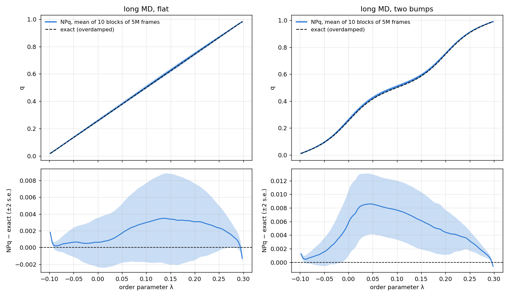

Original plots, two bumps (one 5M-frame block):

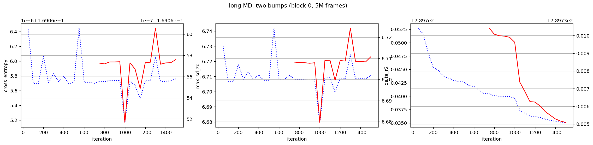
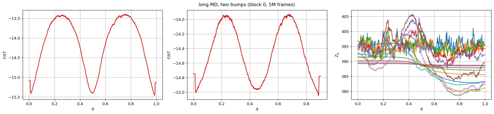
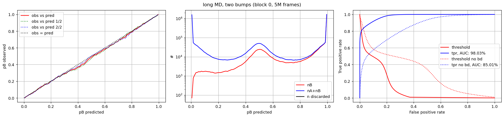

Flat potential:

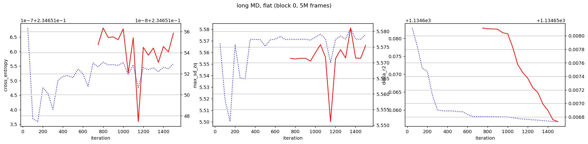
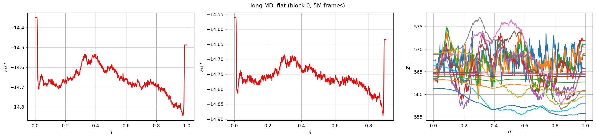
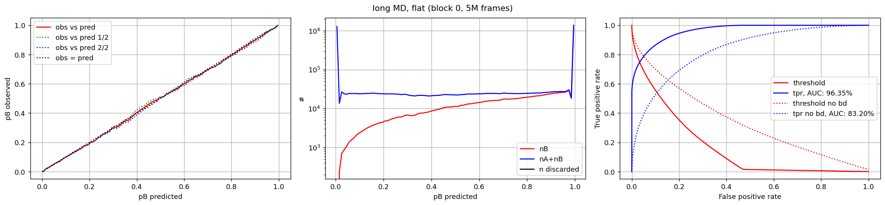
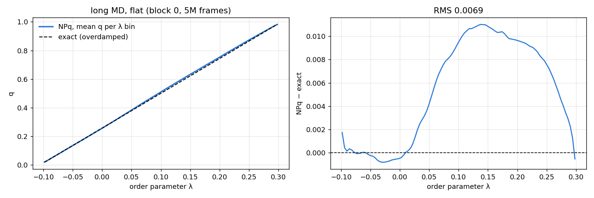

**Observations.** The metrics barely move (changes in the 6th digit): converged. F(q)
shows the two barriers. Z_q is flat at ≈ 380–405 for all lags (N_AB of the block ≈ 395).
Observed vs predicted lies on the diagonal, and AUC is 98.0%.

## I.2 2D Brownian Z potential (NPq)

Z potential (`sjoelbak_angle`, Lx = 0.3): a 6 kT barrier along a 45° line, and a constant
force along y. Overdamped, γ = 10, kT = 0.05, dt = 0.002. A: y ≤ 0.1, B: y ≥ 0.85.
16 seeds, 53M saved rows (every 20 steps), 37 A→B transitions. Only the excursions out of
A/B are kept (4.6M rows), which is exact for NPq. 8000 iterations.

**Settings:**
- NPq: CVs (y, x), lag 1 saved row (20 steps), ny 6, envelope 0.01, 8000 iterations, A/B as
  traps (`set_boundary_traps`), seed 0 (halves of the seeds: 1, 2); `figures/z_brownian/npq_md.py`.
- NPNEq lag fits on seeds 1–8 (2.4M rows): stopped-window update at lag 1, 10 and 50 rows
  (custom, also at lag 1), gamma 0.1, envelope 0.01, ny 6, 5000 iterations in 1000-iteration
  chunks, no traps; `figures/z_brownian/lag_md.py`, `lag_md.log`. Seeds 9–16 at lag 10: same
  settings; its iteration count was not logged.
- Envelope schedule: envelope 1 → 0.1 → 0.01 → 0.001 for 1000 + 1000 + 1000 + 2000
  iterations, otherwise as the lag fits (`env_sched.log`; its fit lag was not logged).

Exact committor (finite-volume solution of the backward equation): ≈ 0 up to the ridge,
a jump to ≈ 0.64 across it, then a rise to 1.

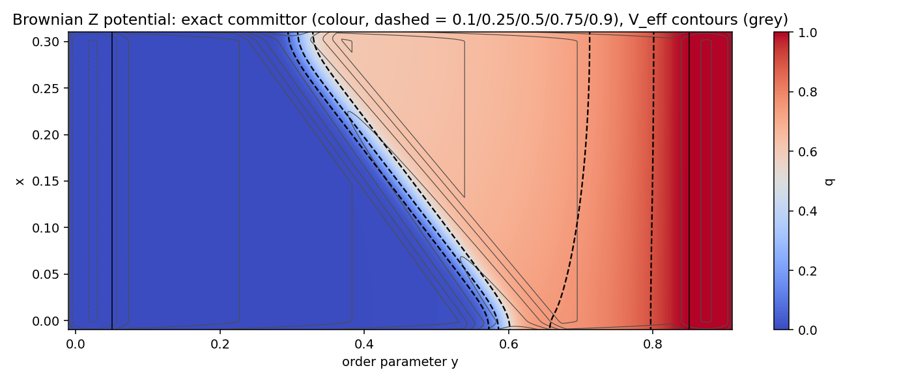

Original plots:

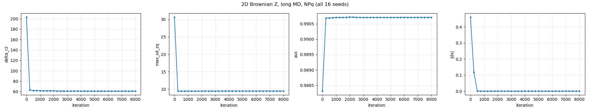
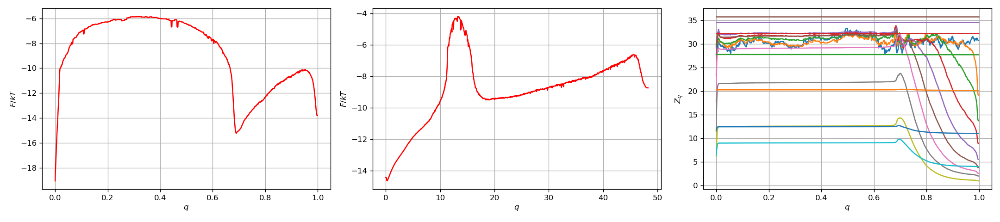
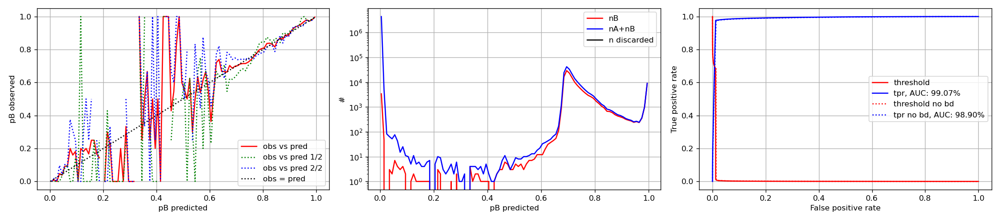
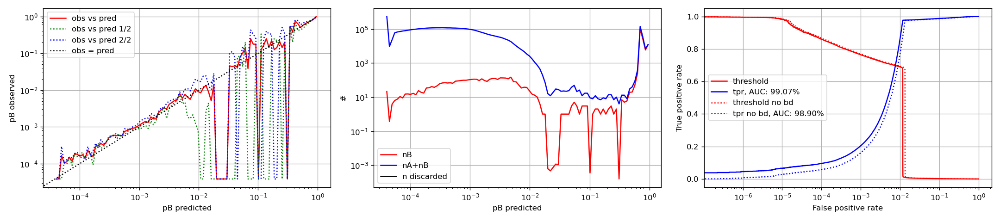

Z_q with A/B treated as traps (the excursions start and end in A/B):

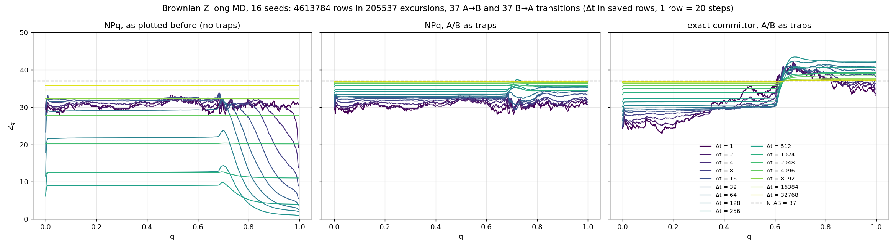

Comparison with the exact committor:

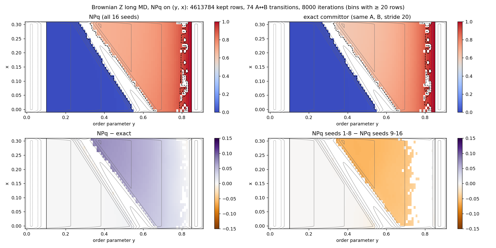
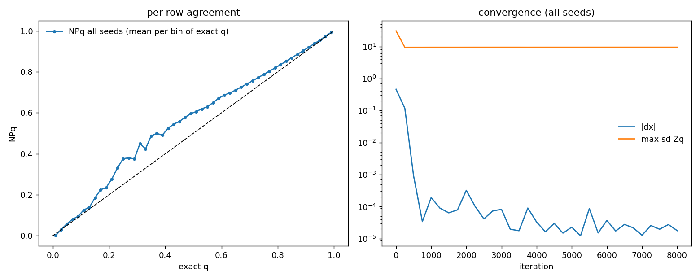

**Observations.**
- The metrics settle within ~500 iterations, with AUC 99.07%.
- The F(q) minimum at q ≈ 0.69 is the plateau behind the ridge.
- Obs vs pred is noisy for q 0.05–0.6: few frames sit there, because the committor jumps
  across a narrow ridge.
- In the feps plot (no traps) Z_q falls at large lags. With traps, every lag converges to
  N_AB = 37.
- The shape is right, but **the plateau is 0.05–0.07 too high** (RMS 0.048 per bin).
- **This is the data, not the fit.** 32768 independent GPU walkers with the same dynamics give
  4.30·10⁷ ± 4% steps per A→B transition, matching the reference (4.4·10⁷). This MD had 37 A→B
  transitions where ~25 were expected (+2.5σ). NPNEq fits on the two halves of the seeds
  give plateau offsets of +0.031 and +0.079. They do not depend on the fit lag (1, 10 or 50
  saved rows) or on an envelope schedule (1 → 0.001): the fits follow the data, and 37
  transitions pin the plateau level down only to several hundredths.

## I.3 1D underdamped cosine well (NPNEq)

Cosine well (1.2 kT, two 0.15 kT bumps), Langevin with γ = 1, kT = 1, dt = 0.005.
6M frames (5007 A→B transitions); A: x ≤ −0.35, B: x ≥ 0.35. The committor depends on
position and velocity, q(x, v). NPq does not apply: under time reversal v → −v.

The fits are compared with a brute-force q(x, v) and with a model-free committor taken
directly from the MD outcomes (which boundary each frame reaches next). The two
references agree to RMS **0.012**, which is the noise floor.

**Settings** (first 6M frames, one trajectory, no traps, ny 6; `figures/well_md_fit/`):

| Fit | Update, lag | gamma | Envelope | Iterations | Basis | Script |
|---|---|---|---|---|---|---|
| x, history `[0, 1]` (`y(t-d),y(t)`) | library, 1 | 0.2 | 0.001 | 1500 | lazy | `overview_plots/regen_all.py hist01` |
| (x, v) | library, 1 | 0.2 | 0.001 | 10000 | not recorded | an earlier version of `base_documented_1d_langevin.ipynb` |
| (x, v, E) | library, 1 | 0.2, then 0.05 | 0.001 | 10000 + 5000 | lazy | `energy_cv.py` |
| (x, v), stopped by its own criterion | library, 1 | 0.1 | 0.001 | 95000 (5000-it. chunks; stop when the cross-entropy gains < 3·10⁻⁵ over 3 chunks) | lazy | `long_xv.py` |
| **(x, v)** | **stopped windows, 16** | **0.1** | **0.001** | **12000** (1000-it. chunks) | chunked | `lag_xv.py` |

| Fit | Iterations | Cross-entropy | AUC | RMS − exact (bin / frame) | Error on the E ≈ 0.15 band |
|---|---|---|---|---|---|
| exact reference | | 0.3948 | 0.8735 | | |
| x with history `[0, 1]` | 1500–3000 | 0.3972 | 0.8726 | | |
| (x, v), lag 1 | 10000 | 0.3963 | 0.8717 | 0.034 / 0.038 | 0.080 |
| (x, v, E = ½v² + V), lag 1 | 10000 + 5000 | 0.3952 | 0.8730 | 0.020 / 0.024 | 0.045 |
| (x, v), lag 1 (stopped by its own criterion) | 95000 | 0.3955 | 0.8727 | 0.022 / 0.027 | 0.064 |
| **(x, v), lag 16** | **12000** | **0.3947** | **0.8737** | **0.011 / 0.018** | **0.027** |

### History `[0, 1]`, CV x only (the notebook setting, 1500 iterations) *(regenerated)*

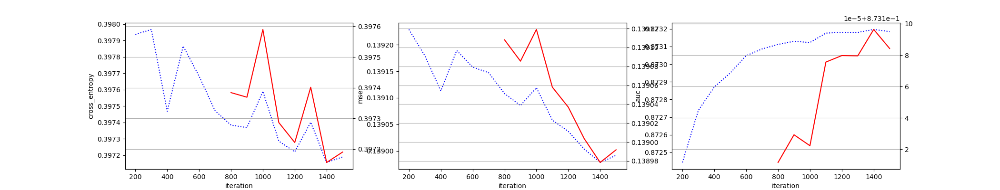
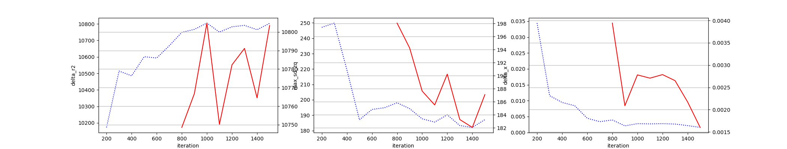
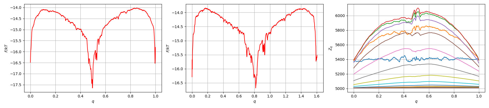
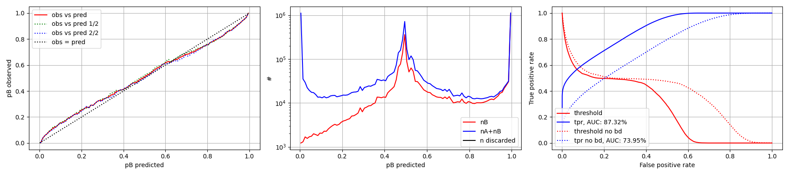
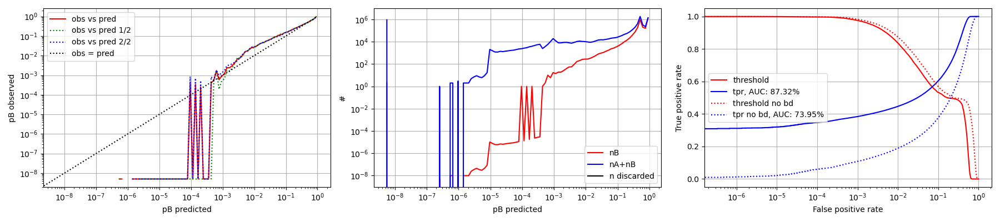
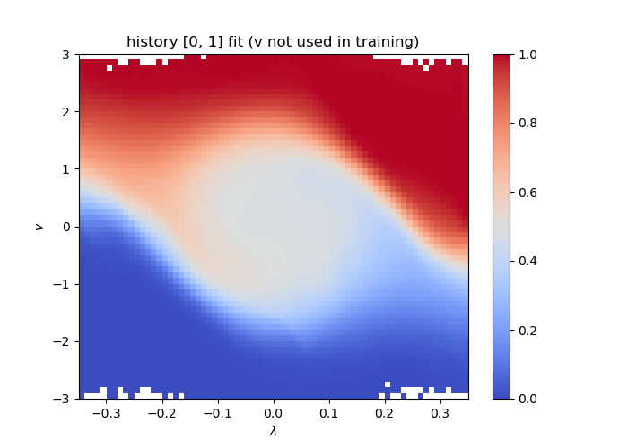

Cross-entropy 0.3972 and AUC 0.8732 after 1500 iterations, still decreasing slowly. Z_q is
strongly lag-dependent (4160–5000 against N_AB = 5007). Observed vs predicted bends away
from the diagonal: the fit is too low below q = 0.5 and too high above it. The (x, v) map
already has the right overall structure: the history picks up part of the velocity.

### (x, v), lag-1 fit, 95000 iterations

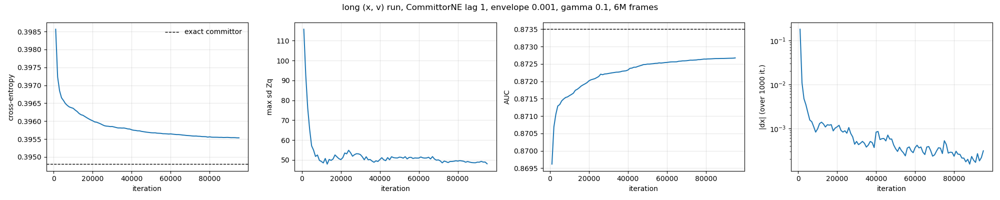
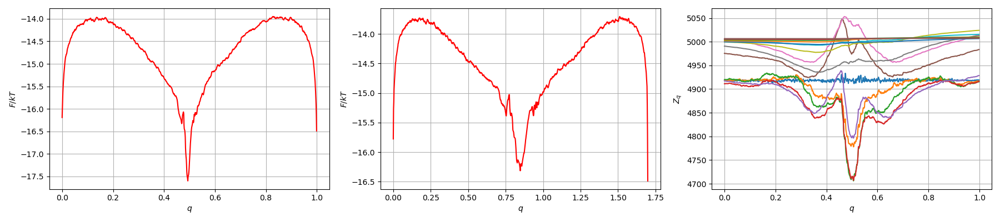
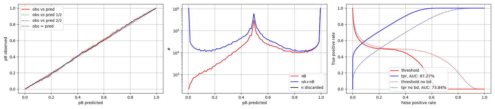
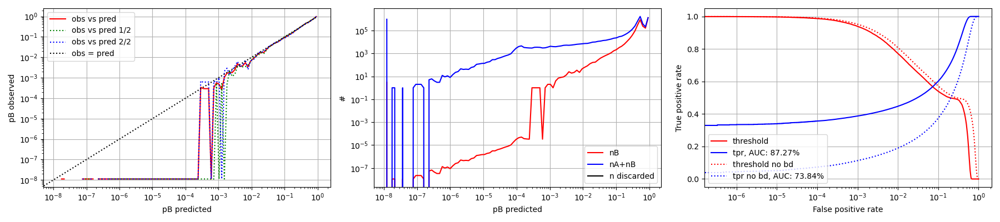
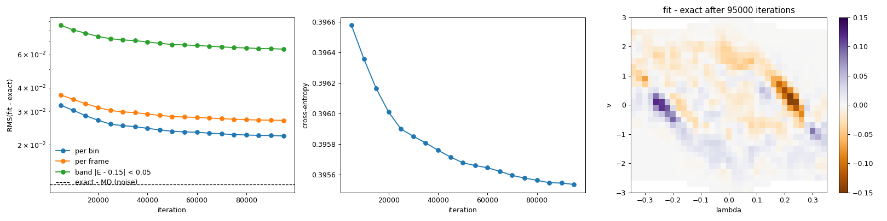
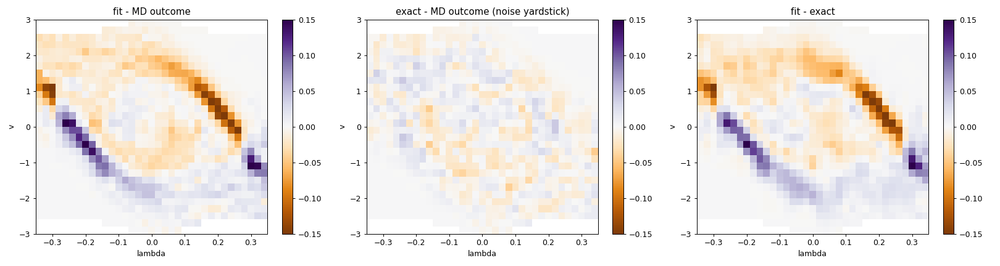

The metrics creep for 95000 iterations, with no clear plateau. Z_q is 2% low at short lags
and dips to ~4700 around q ≈ 0.5. Observed vs predicted looks perfect, but the error map
shows thin bands of ±0.1–0.2 along the energy contour E ≈ 0.15, and vertical edges at
x ≈ ±0.29. The MD-outcome committor has neither.

### (x, v), lag-16 fit, 12000 iterations

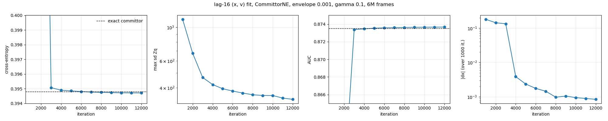
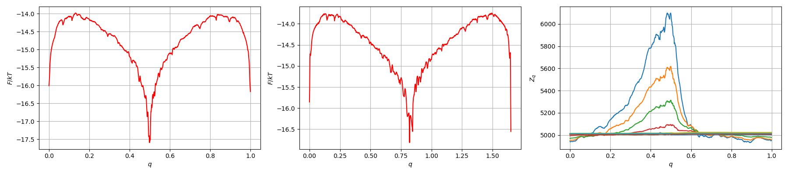
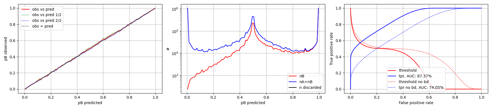
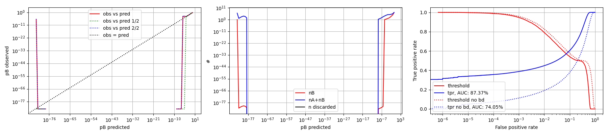
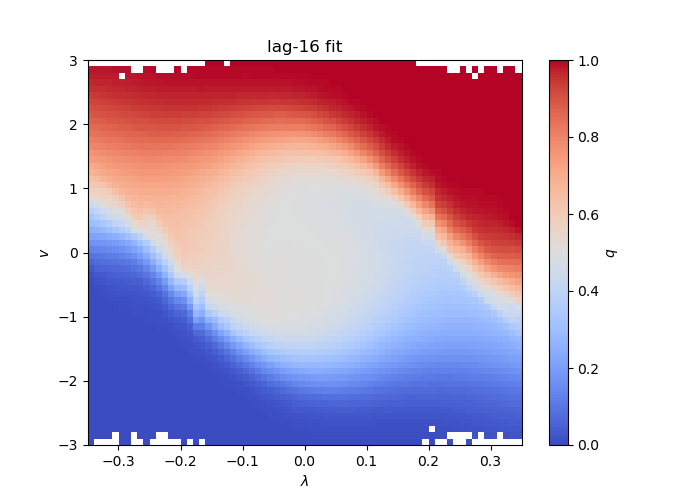
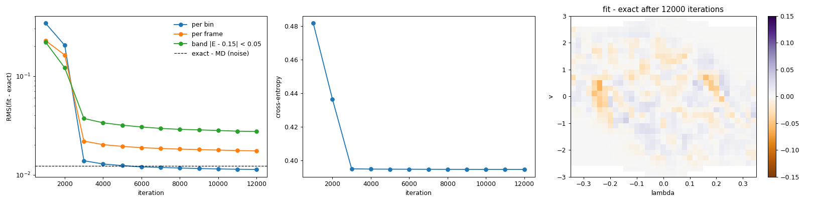

The error reaches the noise floor (0.011) after ~3000 iterations, and the edges are gone.
Z_q is flat at N_AB for lags ≥ 16, but overshoots at lags 1–8: small wiggles that cancel
over 16 steps. `max_sd_zq` therefore rises (~340 against ~50), even though q is more accurate.
**Judge a lag-Δ fit at lags ≥ Δ.**

**Why lag 1 stalls, even with the full state.** Over one step, underdamped dynamics is
almost Newtonian: the energy E = ½v² + V(x) changes by only ~γ·dt (0.5%). Errors in q that
depend only on E are therefore almost invisible to the one-step equations. In this well
the committor changes fastest exactly with E: a particle at the bump-top energy either
crosses or bounces back. With the full state the dynamics is Markov, so the committor is a
fair bet over any stretch of time, E[q(t+Δ)] = q(t), with the window stopped at A/B. At lag
Δ those slow errors become ~Δ times more visible. Rule of thumb: γ·Δ·dt ≈ 0.05–0.1.

Energy as an extra CV (lag 1), 10000 iterations, then gamma lowered:

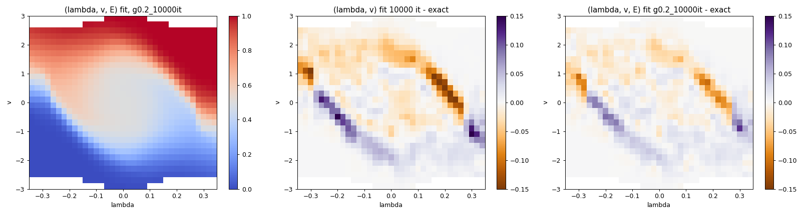
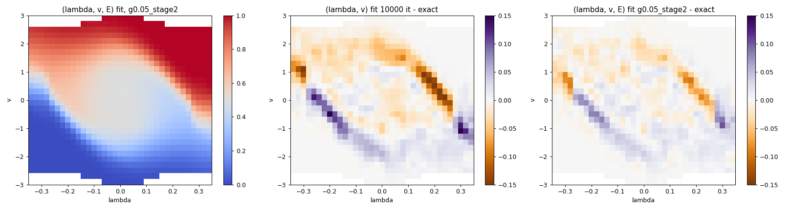

**Did not help at lag 1:** the `gamma` regularization (it only scales the step), envelope
0.01 vs 0.001, coarser histories. NPq is invalid for (x, v).

---

# Part II: Path sampling

## II.0 What was changed for path data (notes §3–§9)

| Change | Why |
|---|---|
| Cut every path at its first frame past M (t\*) | before that crossing the frames are conditioned on crossing M |
| Monte Carlo path weights (rejection repeat counts, tistools) | accepted paths are a fair sample only with their weights |
| Stopped Z_q with a per-path standard error; `zqs_z` ≲ 2 | see "How to read the plots" |
| A/B ends as traps | the library's Z_q dropped windows reaching A/B at a segment end |
| Mirrored pieces (the part before the last M crossing, read backwards), `--reversed` | recovers the frames the cut drops; halved the error on 1D REPPTIS; **required for staple paths** (II.3) |

Check on a lattice random walk with segments ending at random window exits: `zqs_z` of the
exact committor 1.1–1.7; of a wrong RC (q²) about 10. The standard Z_q rejects even the
exact committor (9–13).

## II.1 1D overdamped flat, staple (`sim_istar0br10intf`) *(regenerated)*

Flat potential, overdamped, γ = 1, kT = 1, dt = 2·10⁻⁴; A: λ ≤ −0.1, B: λ ≥ 0.8. Refitted
with the settings of `load_tis_data_cupy.py` (cut at M, rejection weights, gamma 0.1,
3000 iterations). 12000 paths per ensemble (7.6M frames): all 33M frames do not fit the
GPU for the stopped-Z_q metric. The exact committor is linear, with the usual
boundary shift.

**Settings:** `CommittorNE`, CV λ, library lag-1 update, gamma 0.1, envelope 0.01, ny 6,
3000 iterations, lazy basis, A/B traps (`set_fixed_traj_length_trap`), forward pieces,
paths subset seed 0, fit seed 0 (`figures/overview_plots/regen_all.py flat`).

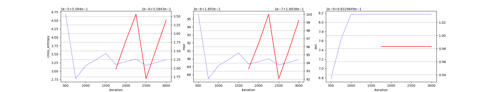
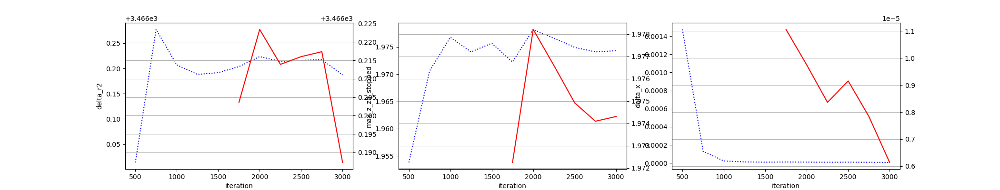
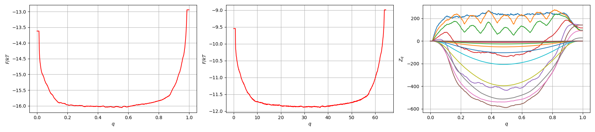
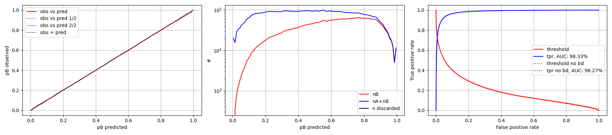
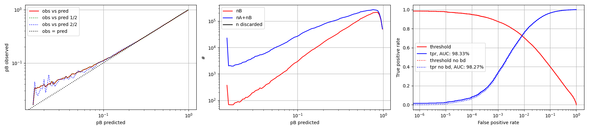
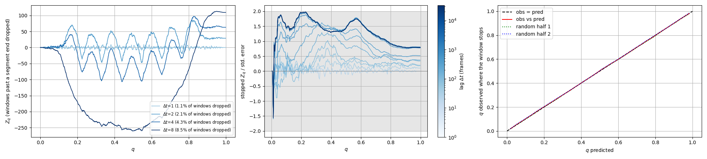
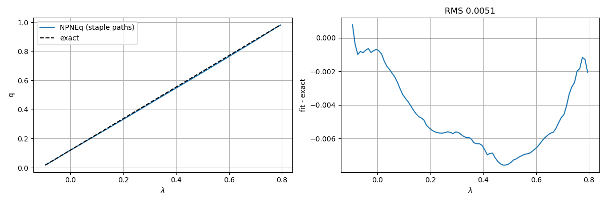

**Observations.**
- **Converged:** `zqs_z` = 1.97, and the stopped Z_q is within ±2 at every q and lag. RMS
  against the exact committor 0.005 (the fit is at most 0.008 low, in the middle).
- **The original Z_q is not usable here.** It is flat at Δt = 1 but swings by ±100 at
  Δt = 2–4 and reaches −250 at Δt = 8, where 8.5% of the windows are dropped at
  segment ends.
- The original obs vs pred is on the diagonal (AUC 98.3%). A version of this plot made on
  8 October with older code was S-shaped and its two halves disagreed
  (`examples/figures/sim_istar0br10intf/obs_pred.png`); which change made the difference
  was not checked. The original obs vs pred is in any case not a reliable test for path
  data, because which frames it counts depends on how their segments end.

## II.2 1D underdamped cosine well, staple (`sim_istarwell2rv`, recorded v)

Same well and dynamics as I.3. 2000 paths per ensemble; CVs (x, v); lag-1 fit.

**Settings** (both: 2000 paths per ensemble, subset seed 0, rejection weights, forward
pieces, gamma 0.1, envelope 0.01, ny 6, 4000 iterations, fit seed 0):
- Table below (`figures/well_check/well_test.py`): hand-written stopped-window update at
  lag 1 or 4, full (non-lazy) basis, no traps.
- Refit (`figures/overview_plots/regen_all.py wellpath`): library lag-1 update, lazy basis,
  A/B traps.

| Setup (notes §10) | RMS vs exact |
|---|---|
| recorded v, lag 1 | 0.019, passes every lag |
| finite-difference v, lag 1 | 0.032, fails lags 2–256 |
| finite-difference v, lag 4 | 0.021, lags ≥ 4 pass |

Refit with the library (recorded v, lag 1, gamma 0.1, 4000 iterations) *(regenerated)*:

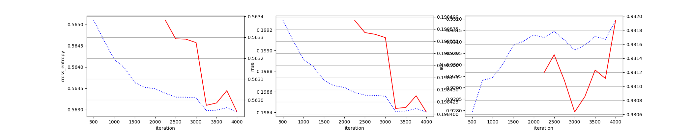
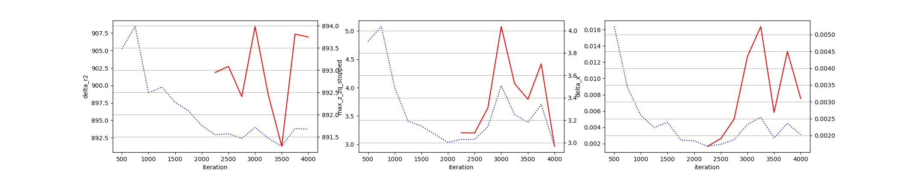
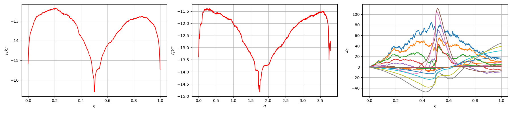
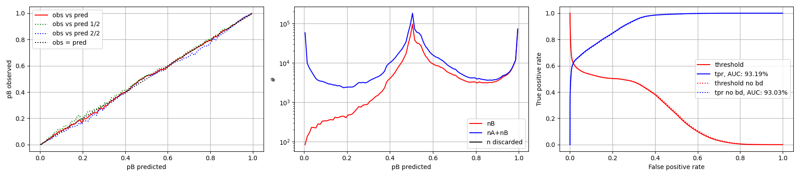
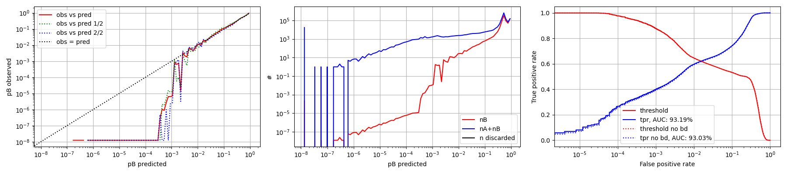
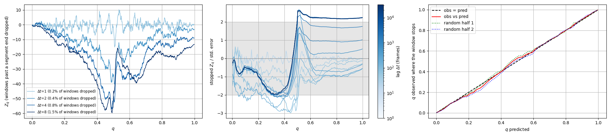
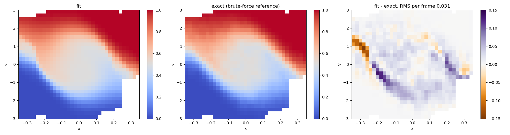

**Observations.**
- **Not converged:** `zqs_z` ≈ 3. The stopped Z_q leaves the ±2 band only at long lags, and
  changes sign at q ≈ 0.5. The original Z_q drifts with the lag (down to −60 at Δt = 8).
- Obs vs pred is close to the diagonal (AUC 93.6%), noisy in the middle.
- The error in (x, v) (RMS 0.031 per frame) has **the same bands along the energy contour
  through the bump tops as the lag-1 MD fit** (I.3): the same slow lag-1 convergence, now
  in path data.
- This refit (library update step, A/B traps) gives RMS 0.031. The earlier test with a
  hand-written lag-1 update gave 0.019 (table above). Both are lag-1 fits with the same
  gamma, envelope and iterations; they differ only in the update code and the basis
  evaluation (the traps affect only the metrics). The difference is not explained yet.

## II.3 2D Brownian Z potential, staple (`sim_istarz_br_g10`)

Same system as I.2, but A: y ≤ 0.05. 3000 paths per ensemble, cut at M (20.8M frames), rejection
weights, 10000 iterations.

**Settings:** `load_tis_data_cupy.py` with its defaults: `CommittorNE`, CVs (y, x), library
lag-1 update, gamma 0.1, envelope 0.01, ny 6, 10000 iterations, A/B traps, forward pieces,
no random seed. It ran twice: the first run (`run_first.log`, `zqs_z` 3.23 at the end) lost
its q in a plotting crash; the rerun (`run.log`, `zqs_z` 3.05) gave the q used for all plots
and comparisons below.

Original plots (obs vs pred on every second path):

Path-data plots and the committor:

Staple NPNEq against MD NPq (I.2) against the exact committor:

| | RMS fit − exact (per bin, 0.05 < q < 0.95) |
|---|---|
| MD NPq | 0.048 |
| staple NPNEq | 0.058 |
| staple − MD | **0.008** |

Shooting with the toytis engine itself (1200 trajectories per point):

| Point (y, x) | Engine shooting | Reference | Staple NPNEq | MD NPq |
|---|---|---|---|---|
| (0.50, 0.25) | 0.639 ± 0.014 | 0.638 | 0.707 | 0.703 |
| (0.55, 0.10) | 0.664 ± 0.014 | 0.671 | 0.738 | 0.725 |
| (0.62, 0.15) | 0.698 ± 0.013 | 0.693 | 0.754 | 0.742 |
| (0.70, 0.15) | 0.747 ± 0.013 | 0.748 | 0.799 | 0.783 |

**Observations.**
- `zqs_z` was still falling at the end (first run: 3.68 → 3.23 over the last 6000 iterations).
- The original Z_q is flat around 0 up to the plateau (q ≈ 0.7) and swings ±20 above it.
  Obs vs pred is on the diagonal (AUC 99.9%), noisy where few frames lie.
- The stopped Z_q is within ±2 up to lags of ~10³, but **≈ −3 at the longest lags for every q
  below the plateau**. That is the signature of a q that is too high there; obs vs pred does
  not show it.
- The staple and MD fits make the same error (they agree to 0.008), and shooting confirms
  the reference. So the overshoot is a property of the fit.
- The hypothesis at this point was that each update, a polynomial in the current q and *one*
  coordinate, resolves a sharp 45° step only slowly. The run below tests it.

### With the ridge-normal coordinate y + x as a CV (`base_documented_2d_brownian_staple_diag.ipynb`)

Same data. CVs (y, x, y + x), fit from scratch, gamma 0.1, **envelope 1** (the original fit
used the default 0.01), stopped by hand at iteration 22752. ny 6, lazy basis, A/B traps,
seed 0 (`examples/base_documented_2d_brownian_staple_diag.ipynb`).

| | Original fit (y, x; 10000 it.) | With y + x (22752 it.) |
|---|---|---|
| `zqs_z` | 3.23 (still falling) | **2.76** (flat since ~15000) |
| \|dx\| at the end | 1.2·10⁻³ | 3·10⁻⁵ |
| RMS − exact (per bin, 0.05 < q < 0.95) | 0.058 | **0.065** |
| q at (0.50, 0.25), shooting 0.639 ± 0.014 | 0.707 | 0.716 |
| q at (0.55, 0.10), shooting 0.664 ± 0.014 | 0.738 | 0.750 |
| q at (0.62, 0.15), shooting 0.698 ± 0.013 | 0.754 | 0.763 |
| q at (0.70, 0.15), shooting 0.747 ± 0.013 | 0.799 | 0.807 |

**Observations.**
- The fit has converged by its own metrics: Δr², `zqs_z` and |dx| are all flat, and |dx| is
  40 times smaller than in the original fit.
- **y + x does not remove the overshoot.** The plateau is still 0.06–0.09 too high, slightly
  more than in the original fit (RMS 0.065 vs 0.058).
- What it does change: the ridge is smoother. The jagged spots along the ridge in the
  original fit's error map (+0.1 at x ≈ 0.25, −0.05 near x ≈ 0.05) are gone. The error is
  now a uniform offset of the whole plateau.
- The stopped Z_q still sits at ≈ −2.7 at the longest lags for every q below the plateau,
  and `zqs_z` = 2.76 stays above 2. **The diagnostic keeps flagging the error**, as in the
  original fit.
- **So the one-coordinate-per-update hypothesis is not supported**: with the 45° coordinate
  available, the fit converges cleanly to the same wrong plateau level. This is a different
  situation from the 2D underdamped Z runs (II.4), where y + x helped a lot.
- Caveat: envelope 1 is not the original setting (0.01), so this run differs from the
  original fit in two ways.

### What was wrong: the forward pieces alone are a biased sample

**Test the data with the exact committor.** Put the exact committor into the stopped Z_q
test of the *data*: if it fails, no fit can be right. It takes about a minute and needs
no fit.

| Exact committor on the staple data (1500 paths per ensemble) | Worst z, plateau (lags 1, 16, 256, 4096) | Next to A/B |
|---|---|---|
| rejection weights, forward only (as fitted) | +3.0 +2.8 +3.3 +2.6 | +2.1 +1.9 +1.8 +2.4 |
| **rejection weights, forward + mirrored** | **+1.6 +1.2 +0.7 +1.4** | **−0.9 −1.2 −0.8 +1.3** |
| staple weights (×2 for shot LML/RMR), forward only | −2.1 −2.2 +2.3 +1.5 | −3.2 −3.2 −2.6 −1.6 |
| staple weights, forward + mirrored | −3.9 −4.1 −3.9 −1.9 | −5.6 −5.6 −5.0 −2.0 |

- With forward pieces only, the exact committor fails on the plateau. The excess comes from
  the ensembles past the ridge, and it is present in both halves of the paths.
- A factor on the shot LML/RMR paths moves it steadily from +3 (factor 1) to −3 (factor 2);
  about 1.4 nearly passes. **Adding the mirrored pieces with plain rejection weights passes
  everywhere**, without a tuned factor. Each accepted path has to contribute both halves
  around its M crossings; the factor 2 of the `staple` weighting looks like the whole-path
  version of the same correction (not yet derived from the staple move rules).
- On the 1D flat staple run (II.1) the mirrored pieces change nothing and do no harm; the
  `staple` weighting fails there too.

### Refit with forward + mirrored pieces

Same data and settings, plus `--reversed`; 1500 paths per ensemble (20.9M frames).

**Settings:** paths subset seed 0, rejection weights, forward + mirrored pieces; library
lag-1 update, gamma 0.1, envelope 0.01, ny 6, A/B traps. First 10000 iterations with
`load_tis_data_cupy.py` (no seed, `run.log`), then 15000 more from that q in 5000-iteration
chunks, lazy basis, seed 100 + chunk (`continue_fit.py`, `continue.log`).

| | Forward only (3000 paths/ens.) | **Forward + mirrored (1500 paths/ens.)** |
|---|---|---|
| `zqs_z` after 10000 iterations | 3.23 (first run; rerun 3.05) | **1.36** |
| stopped Z_q at the longest lags, q below the plateau | ≈ −3 | **≈ −0.5** |
| RMS − exact per bin | 0.058 | **0.025** |
| mean (fit − exact) on the plateau | +0.061 | **+0.023** |
| q at the shooting points (0.639, 0.664, 0.698, 0.747) | 0.707 0.738 0.754 0.799 | 0.665 0.700 0.715 0.767 |

The stopped Z_q is now within ±1 at every q and lag. Continued to 25000 iterations the
fit converged at **+0.031** (RMS 0.029).

### Is the remaining +0.03 noise or bias?

**Settings** (all: CVs (y, x), gamma 0.1, envelope 0.01, ny 6):
- Staple halves at lag 1 (`half_fits.py`): library update, lazy basis, A/B traps, 2500-
  iteration chunks, seed = chunk number, stopped when the plateau changed by < 0.001 and
  |dx| < 2·10⁻⁴: even half 25000, odd half 22500 iterations.
- Staple halves and 2250 paths/ens. at lag 50 (`lag_halves.py`): stopped-window update,
  chunked basis, no traps, 3000 iterations in 1000-iteration chunks.
- Synthetic walkers (`z_brownian/synth_fit.py`): no weights, library lag-1 update with lazy
  basis and A/B traps (uncut: 2500 iterations; cut at interfaces: 10000), or the
  stopped-window update at lag 10 rows (7500 iterations).

| Plateau (fit − exact) | lag 1 | longer lag |
|---|---|---|
| synthetic walkers run until absorbed (exact answer known) | −0.007 | |
| synthetic walkers **cut at interfaces** like path pieces: all / even half / odd half | −0.015 / −0.040 / +0.009 | halves −0.031 / +0.031 (lag 10 rows) |
| staple, both pieces, 1500 paths/ens.: all / even half / odd half | +0.031 / +0.049 / +0.014 | halves +0.034 / +0.016 (lag 50) |
| staple, both pieces, 2250 paths/ens. (31.5M frames) | | +0.022 (lag 50) |

- **On clean data the method is right:** walkers started between A and B and run until
  they are absorbed give the exact plateau within 0.007.
- **Cutting the same clean data at interfaces makes the plateau level uncertain by about
  ±0.025** for 15000 pieces, and a longer fit lag does not help. Only pieces that reach A
  or B fix the plateau directly; for the staple pieces entering the plateau that is
  3–19%. The staple halves scatter by the same amount.
- **The diagnostics cannot see this:** the stopped Z_q passes for all these fits, and on
  clean data the exact committor itself reaches |z| ≈ 3. A martingale test (outcome
  minus prediction at each piece's first entry into the plateau) confirms that the staple
  data with rejection weights are unbiased (+0.0015 ± 0.0012), but the fitted q passes it
  just as well. The `staple` weighting fails it at −6σ.
- **Overall:** +0.031, +0.025 (mean of the halves at lag 50) and +0.022 (2250 paths per
  ensemble) give about **+0.02 ± 0.015**: mostly statistical. Since all estimates are
  positive, a small residual bias of order +0.01 cannot be excluded at this sample size.
- **Conclusion:** use rejection weights with both pieces, and estimate the uncertainty of
  flat regions far from A and B from independent halves of the paths. More paths reduce
  it as 1/√N. Details: notes §9.2.

The other two things tried did not help: the ridge-normal CV y + x (above), and, on the MD,
longer fit lags and an envelope schedule (I.2).

### The plateau investigation in figures

Every fit of this system, on one axis. "Plateau" is the mean of (fit − exact committor)
over the frames where the exact committor is 0.55–0.85: the flat region between the ridge
and B, where the fits overshoot. Open circles joined by a line are fits of two disjoint
halves of the same data set; their spread shows the statistical uncertainty of one fit.

- Green: synthetic walkers whose exact committor is known. Run until absorbed, the fit is
  right (−0.007). Cut at interfaces like path pieces, the halves already scatter by ±0.025
  to ±0.03, on clean data.
- Blue: the staple fits scatter in the same way, but around +0.02 instead of 0. The fit with
  forward pieces only (+0.061) is the outlier; that data set was biased (see above).
- Purple: the long MD shows the same pattern: its two halves differ by 0.05.

The same fits as maps of fit − exact on the potential (purple = fit too high). The error
is a near-uniform shift of the plateau; the ridge and the region near A are right in all
fits:

The two tests behind "statistical, not a bias of the method":

- Left: martingale test. For each piece entering a q band: (exact q where the piece stops)
  − (exact q at entry). It averages to 0 for unbiased data. The staple data with rejection
  weights pass (both pieces, mirrored pieces); forward pieces alone lean slightly positive
  (+2.6σ in the lower band). The `staple` weighting fails in the upper band (−6σ). The
  right-most pair uses the fitted q (plateau +0.031) instead of the exact one: it passes
  too, so this test cannot detect a plateau shift.
- Right: why. Only 3% (lower band) and 19% (upper band) of the pieces that enter the
  plateau reach A or B before they end at an interface. All others end inside the
  plateau, where a uniform shift of q does not change their increments.

### Per-case plots

For every fit in the figure above: the original optimalrcs plots (FEP of the fitted
committor, observed vs predicted), the path-data diagnostics (Z_q per lag, stopped z-score,
calibration, as explained at the top), the fit against the exact committor on the
potential, and the error against the exact committor while fitting (from the run logs).
The MD cases have no path-data plot (one long trajectory per seed).
Script: `examples/figures/z_brownian/case_plots.py`; summary figures: `summary_plots.py`.

#### Synthetic walkers, run until absorbed (5.2M frames; plateau −0.007)

#### Synthetic walkers cut at interfaces, all 30000 pieces (plateau −0.015)

#### Synthetic cut walkers, even half, lag 1 (plateau −0.040)

#### Synthetic cut walkers, odd half, lag 1 (plateau +0.009)

#### Synthetic cut walkers, even half, lag 10 (plateau −0.031)

#### Synthetic cut walkers, odd half, lag 10 (plateau +0.031)

#### Staple, forward pieces only, 3000 paths/ens., lag 1 (plateau +0.061)

The first fit (above). Its convergence is in the original metrics plot.

#### Staple, forward + mirrored pieces, 1500 paths/ens., lag 1, 25000 iterations (plateau +0.031)

The convergence plot covers the continued run (10000 → 25000 iterations); the first 10000 are in `istarz_br_g10_reversed/continued/convergence.png`.

#### Staple, both pieces, even half (7500 paths), lag 1 (plateau +0.049)

#### Staple, both pieces, odd half (7500 paths), lag 1 (plateau +0.014)

#### Staple, both pieces, even half, lag 50 (plateau +0.034)

#### Staple, both pieces, odd half, lag 50 (plateau +0.016)

#### Staple, both pieces, 2250 paths/ens. (31.5M frames), lag 50 (plateau +0.022)

#### Long MD, NPq, all 16 seeds (plateau +0.060)

#### Long MD, NPNEq, seeds 1–8, lag 1 (plateau +0.029)

#### Long MD, NPNEq, seeds 1–8, lag 10 (plateau +0.031)

#### Long MD, NPNEq, seeds 9–16, lag 10 (plateau +0.079)

#### Long MD, NPNEq, seeds 1–8, lag 50 (plateau +0.027)

#### Long MD, NPNEq, seeds 1–8, envelope schedule 1 → 0.1 → 0.01 → 0.001 (plateau +0.030)

## II.4 2D underdamped Z potential, staple, positions only (`sim_istarz_2603`)

γ = 2, kT = 0.05, dt = 0.002, no velocities recorded. 1000 paths per ensemble (8M frames).

**Settings** (all: paths subset seed 0, rejection weights, forward pieces, gamma 0.2,
envelope 0.001, ny 6, A/B traps, fit seed 0):
- History `[0, 1]`: library lag-1 update, `y(t-d),y(t)`, shift `r(t)`, lazy basis, 10000
  iterations (`base_documented_2d_langevin.ipynb`; the committed version has `REVERSED = True`,
  so this row may have included the mirrored pieces).
- Coarser histories: same, 2000 iterations (`figures/zlgv_history/history_test.py`).
- Finite-difference velocities (± ridge-normal CVs): 3000 iterations; lag 1 with the library
  update and lazy basis, lag 4 with the stopped-window update and chunked basis
  (`figures/zlgv_fd/fd_test.py`).
The one-frame change of a position is only ~4·10⁻⁴ of its range (1D well: 2·10⁻³), so a
history basis barely reaches the velocity.

| CVs | Fit lag | `zqs_z` | Worst \|z\| at lags 1, 2, 4, 8, 16, 64, 256, 1024 |
|---|---|---|---|
| y, x, history `[0, 1]` | 1 | 33 | lag 1 fine, lags ≥ 2 fail |
| y, x, coarser histories (d = 4, 8, 16) | 1 | 30–37 | fail at all lags |
| y, x, Δy, Δx | 1 | 29 | 4.3 6.1 11.8 17.2 21.6 21.8 16.9 28.9 |
| y, x, Δy, Δx | 4 | 30 | 3.4 5.2 6.4 7.5 8.6 11.7 23.7 30.2 |
| **y, x, Δy, Δx, y + x, Δy + Δx** | **4** | **14** | **2.3 1.3 2.1 3.7** 6.8 14.1 10.7 8.2 |

Original plots (last row of the table):

Committor of that fit against the order parameter and in the planes (y, x), (y, v_y),
(y, v_x), with finite-difference velocities *(regenerated)*:

Path-data diagnostics for every setup in the table:

![history [0, 4]](../examples/figures/zlgv_history/tis_h0_4.png)
![history [0, 8]](../examples/figures/zlgv_history/tis_h0_8.png)
![history [0, 16]](../examples/figures/zlgv_history/tis_h0_16.png)
![history [0, 1, 4, 16]](../examples/figures/zlgv_history/tis_h0_1_4_16.png)

**Observations.**
- The original obs vs pred is on the diagonal (AUC 99.7%), and the original Z_q is ≈ 0
  except for a spike up to ~90 at q ≈ 0.74, the plateau.
- With the ridge-normal CVs, the stopped Z_q stays within ±2.5 except at the same plateau
  level (up to +14 at lags 16–1024).
- `zqs_z` fell from 36 to 14 in 3000 iterations and was still falling.
- The planes show the velocity dependence the fit has learned: past the ridge, q rises
  with v_y (moving towards B). The dependence on v_x is weak.
- There is no exact reference for this run.

---

## What to use

| System | CVs | Estimator | Fit lag | Judge by |
|---|---|---|---|---|
| Overdamped, long MD | positions | NPq | 1 (or the saving stride) | Z_q flat at N_AB (traps for excursions) |
| Overdamped, path sampling | positions | NPNEq, cut at M, rejection weights, **mirrored pieces** (`--reversed`) | 1 | `zqs_z` ≲ 2; check the data with the exact committor where known |
| Underdamped, velocities recorded | (x, v) | NPNEq (not NPq) | **Δ with γ·Δ·dt ≈ 0.05–0.1**, windows stopped at A/B | Z_q / `zqs_z` at lags ≥ Δ, cross-entropy |
| Underdamped, positions only | positions + finite-difference velocities | NPNEq | ≥ 4 | as above; expect a residual bias |
| Sharp diagonal features (2D) | add the coordinate normal to the feature (e.g. y + x) | | | |

Practical: `lazy_basis=True` (≈ 4× faster, far less GPU memory on millions of frames).

## Open items

- **Lag-Δ fit in the library** (`fit_lag`), for MD and for path data; so far only in test scripts.
- **2D Brownian Z staple:** the remaining +0.03 is mostly statistical (notes §9.2). Open:
  use information that pins plateau levels directly (e.g. the TIS crossing probabilities),
  and derive the staple path weights from the move rules.
- **2D underdamped Z:** record velocities and fit (y, x, v_y, v_x) at lag Δ.
- **Staple well path data:** recheck the lag-1 result with a lag-Δ fit and an
  energy-resolved error.

## Where things are

| What | Where |
|---|---|
| Detailed notes, derivations, code map | `docs/npneq_tis_notes.md` |
| Path-data loader and fit scripts | `examples/tis_data.py`, `examples/load_tis_data(_cupy).py` |
| Notebooks | `examples/base_documented*.ipynb` |
| Z_q traps, stopped metrics | `optimalrcs(-cupy)/boundaries.py`, `metrics_tis.py`, `plots_tis.py` |
| 2D Brownian Z: reference, MD NPq, comparison, shooting | `examples/figures/z_brownian/` |
| 2D Brownian Z plateau investigation: summary figures, per-case plots | `examples/figures/z_brownian/summary_*.png` (`summary_plots.py`), `cases/<case>/` (`case_plots.py`); synthetic walkers in `synth/` |
| 1D well MD fits (lag 1, energy CV, lag 16) | `examples/figures/well_md_fit/` |
| 2D underdamped Z: histories, finite differences, ridge CVs | `examples/figures/zlgv_history/`, `examples/figures/zlgv_fd/` |
| The original-style plots made for this overview | `examples/figures/overview_plots/` (`make_original_plots.py`) |
