# Committors from MD and path sampling with optimalrcs: condensed results

This report shows, for each test potential, the setup that works best for MD and for staple
path sampling, and only the tests needed to trust it. The full set of runs, failed
settings included, is in [`results_overview.md`](results_overview.md). Derivations are in
[`npneq_tis_notes.md`](npneq_tis_notes.md).

- **NPq** (`Committor`) is the equilibrium estimator. **NPNEq** (`CommittorNE`) is the
  non-equilibrium estimator, needed for path data and for (x, v).
- "Exact" is a PDE or brute-force reference, checked by shooting with the engine.

## Summary

| Potential | MD | Staple path sampling |
|---|---|---|
| 1D overdamped, flat / two bumps | ✅ NPq, RMS 0.002 / 0.005 | ✅ NPNEq, RMS 0.005, `zqs_z` 1.97 |
| 1D underdamped cosine well | ✅ NPNEq (x, v), **lag 16**: RMS 0.011 (noise floor) | ⚠️ NPNEq (x, v), lag 1: RMS 0.02–0.03, `zqs_z` ≈ 3 |
| 2D overdamped (Brownian) Z | ✅ NPq; plateau +0.06 because this MD sample had extra transitions | ✅ NPNEq with **mirrored pieces**: plateau +0.02 ± 0.015 (statistical) |
| 2D underdamped Z, positions only | — | ⚠️ finite-difference v, y + x, lag 4: `zqs_z` 14, still falling |
| 2D curved channel (new, smooth) | ✅ Brownian NPq: RMS 0.007; Langevin NPNEq (y, x, v): RMS 0.014 vs shooting | test runs only (2000 cycles): RMS 0.015 (Brownian), 0.027 (Langevin) |

Settings that work:

| System | CVs | Estimator | Fit lag | Converged when |
|---|---|---|---|---|
| Overdamped MD | positions | NPq | 1 | Z_q flat at N_AB for all lags |
| Overdamped paths | positions | NPNEq; cut at M, rejection weights, mirrored pieces | 1 | `zqs_z` ≲ 2 |
| Underdamped, v recorded | (x, v) | NPNEq | Δ with γ·Δ·dt ≈ 0.05–0.1 | Z_q at lags ≥ Δ |

Fit settings of the cases shown. All: `ny` = 6. Envelope = `optimalrcs.envelope_scale`
(library default 0.01). `gamma` = regularization of the update (library default 0; it
scales the step, not the result; NPq ignores it). "Library" = the library's lag-1 update;
"stopped Δ" = the hand-written lag-Δ update with windows stopped at A/B or the piece end.
Traps (A/B ends treated as absorbing) change only the metrics. Path subsets drawn with
seed 0, rejection weights. Every run, with its script: notes §14.

| Case | Data | CVs | Update, lag | gamma | Envelope | Iterations | Basis, traps |
|---|---|---|---|---|---|---|---|
| 1D overdamped MD | 5M-frame blocks of 50M | λ | NPq, library 1 | – | 0.01 | 1500 per block | full, none |
| 1D flat staple | 12000 paths/ens., forward pieces | λ | NPNEq, library 1 | 0.1 | 0.01 | 3000 | lazy, A/B traps |
| 1D well MD | first 6M frames | (x, v) | NPNEq, stopped Δ = 16 frames | 0.1 | 0.001 | 12000 | chunked, none |
| 1D well staple | 2000 paths/ens., forward (± mirrored) | (x, v recorded) | NPNEq, stopped Δ = 1 or 4 (RMS 0.019 / 0.015); library 1 (RMS 0.031) | 0.1 | 0.01 | 4000 | full, none; library refit: lazy, A/B traps |
| 2D Brownian Z MD | 16 seeds, 1 row per 20 steps, 4.6M rows | (y, x) | NPq, library 1 row | – | 0.01 | 8000 | full, A/B traps |
| 2D Brownian Z staple | 1500 paths/ens., forward + mirrored | (y, x) | NPNEq, library 1 | 0.1 | 0.01 | 10000 + 15000 | lazy, A/B traps |
| 2D underdamped Z staple | 1000 paths/ens., forward pieces | y, x, Δy, Δx, y + x, Δy + Δx | NPNEq, stopped Δ = 4 frames | 0.2 | 0.001 | 3000 | chunked, A/B traps |

## How to read the plots

- **feps** (original): F(q), and on the right Z_q(q) for lags 1, 2, 4, …
  - For the committor on MD, every lag is flat at N_AB, the number of A→B transitions.
- **obs_pred** (original): the observed fraction reaching B per bin of predicted q,
  shown with two random halves; the frame histogram; ROC and AUC.
- **TIS diagnostics** (path data only):
  - Why they are needed: path pieces end where the sampler stops them, so the original
    Z_q and obs vs pred are biased.
  - Left: the original Z_q at short lags, with the share of windows that run past a piece
    end.
  - Middle: the **stopped Z_q / standard error** at all lags (colour = lag). A window that
    reaches the end of its piece is stopped there. For the committor this is 0 ± 1 at
    every q and lag.
  - **Consistent with the data when `zqs_z`, the largest |value|, is ≲ 2** (grey band).
    It is not a test of correctness: it passes for biased data and for errors the
    pieces cannot see (plateau levels, truncated pieces), and it is not comparable between
    data sets (2D Z: `zqs_z` 0.70 with RMS 0.075, and 2.73 with RMS 0.005). Check it
    against the exact committor or shooting at a few hundred frames.
  - Right: the stopped obs vs pred.
- **map**: the fit, the exact committor, and fit − exact on the potential.

---

# 1D overdamped, flat and two bumps

## MD — NPq ✅

- Data: 50M frames, γ = 5; ten blocks of 5M frames. A: λ ≤ −0.1, B: λ ≥ 0.3.
- **RMS against exact: 0.0022 (flat), 0.0054 (two bumps).**
- Z_q is flat at ≈ 380–405 for all lags; N_AB of the block is ≈ 395. AUC 98.0%.

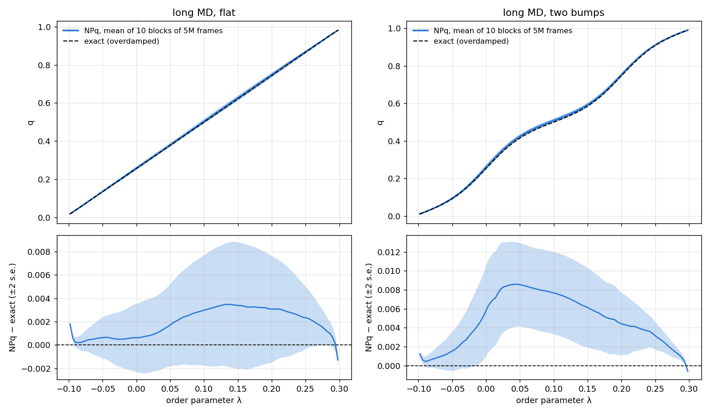
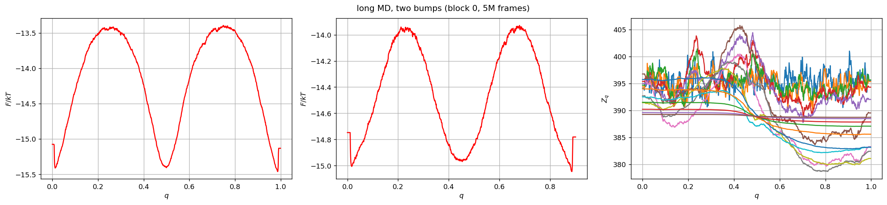
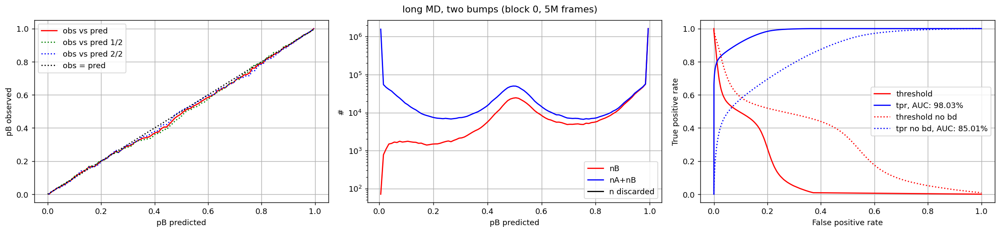

## Staple — NPNEq ✅ (`sim_istar0br10intf`, flat)

- Data: paths cut at their first crossing of M, rejection weights, 12000 paths per
  ensemble (7.6M frames). 3000 iterations.
- **`zqs_z` 1.97; RMS against exact 0.005.**
- **Key test:** the original Z_q swings by ±100–250 at lags 2–8, even though the fit is
  right. Path data need the stopped Z_q.

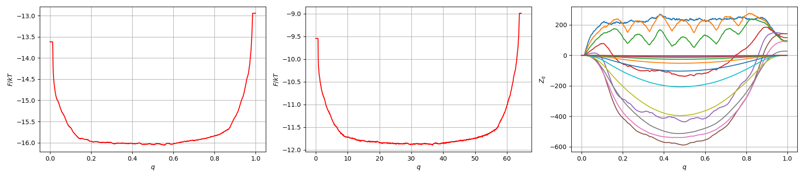
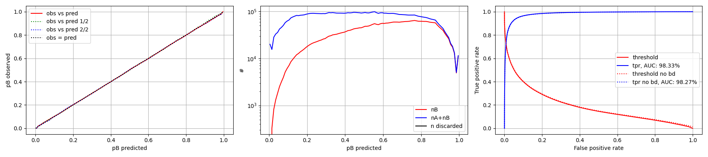
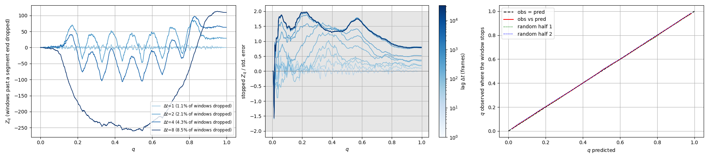
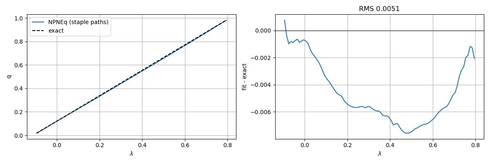

---

# 1D underdamped cosine well (γ = 1, kT = 1)

## MD — NPNEq on (x, v), lag 16 ✅

- Data: 6M frames, 5007 A→B transitions.
- **Error 0.011 after ~3000 iterations.** That equals the noise floor: the exact committor
  and the committor taken directly from the MD outcomes differ by 0.012.
- **Key test (why lag 16):**

  | Fit | RMS vs exact | Error on the E ≈ 0.15 band |
  |---|---|---|
  | (x, v), lag 1, 95000 it. | 0.022 | 0.064 |
  | **(x, v), lag 16, 12000 it.** | **0.011** | **0.027** |

- Why lag 1 stalls: over one step the energy changes by only ~γ·dt, so errors in q that
  depend only on energy are almost invisible to the lag-1 equations.
- Histories, `gamma` and the envelope do not fix this; a lag Δ with γ·Δ·dt ≈ 0.05–0.1 does.
- Judge a lag-Δ fit at lags ≥ Δ: Z_q is flat at N_AB there and wiggles at lags 1–8.
- Lag 1 can also work, but depends on the random start: RMS 0.019–0.052 per frame over
  seeds; a warm-up along v only gives 0.020–0.026 (notes §10.3).

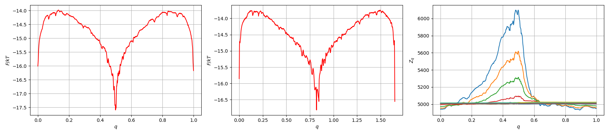
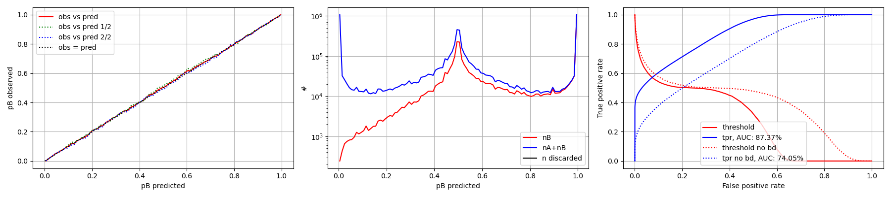
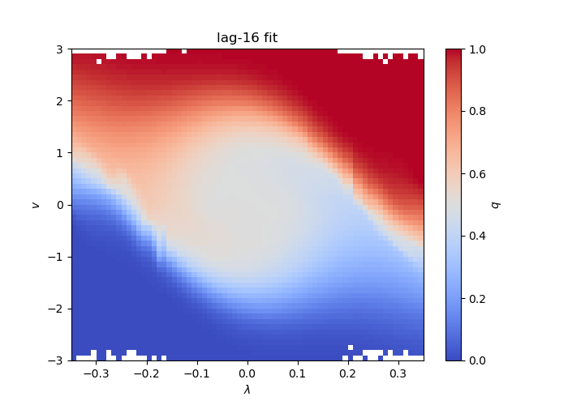
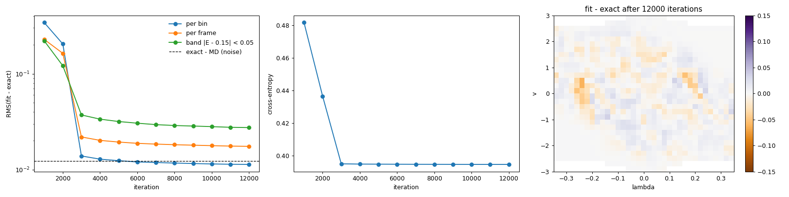

## Staple — NPNEq on (x, v), recorded v ⚠️ (`sim_istarwell2rv`)

- Data: 2000 paths per ensemble, lag 1.
- **RMS 0.019–0.031, `zqs_z` ≈ 3: not fully converged.**
- The error has the same energy-contour bands as the lag-1 MD fit.
- With the mirrored pieces (the fix for the 2D Brownian Z): lag 1 RMS 0.030, lag 4 RMS 0.017
  (forward only: 0.019 and 0.015). They do not help here; the data test with the exact
  committor shows no bias of the forward pieces to fix (notes §10).
- A lag-4 fit is the best so far (RMS 0.015). Notebook for further tests:
  `examples/base_documented_1d_langevin_staple.ipynb`.

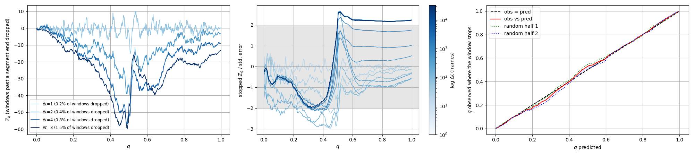
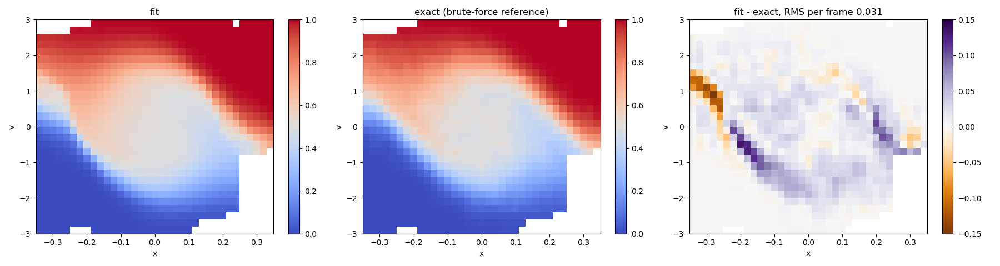

---

# 2D Brownian Z potential

- Potential: a 6 kT barrier along a 45° ridge, and a constant force along y.
- Dynamics: overdamped, γ = 10, kT = 0.05.
- The exact committor is ≈ 0 up to the ridge, jumps to ≈ 0.64 across it, then rises to 1
  over a flat "plateau".

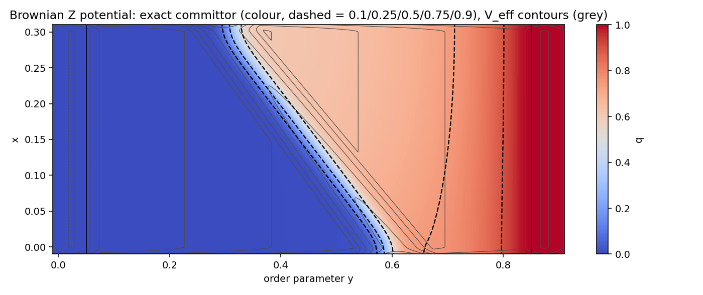

## MD — NPq ✅ (shape right, plateau +0.06 from the data)

- Data: 16 seeds, 4.6M rows, 37 A→B transitions. A: y ≤ 0.1, B: y ≥ 0.85.
- Z_q with A/B as traps converges to N_AB = 37 at every lag. AUC 99.1%.
- **Plateau 0.06 too high (RMS 0.048).**
- **Key test (the overshoot comes from the data):**
  - 32768 independent GPU walkers give 4.30·10⁷ ± 4% steps per transition, so this MD
    should have had ~25 transitions, not 37 (+2.5σ).
  - Fits on the two halves of the seeds give +0.031 and +0.079, at every fit lag and
    envelope setting.
  - A second, independent MD run (16 transitions) comes out *below* the exact committor
    on the plateau (RMS 0.084): the sign of the error follows the sample.

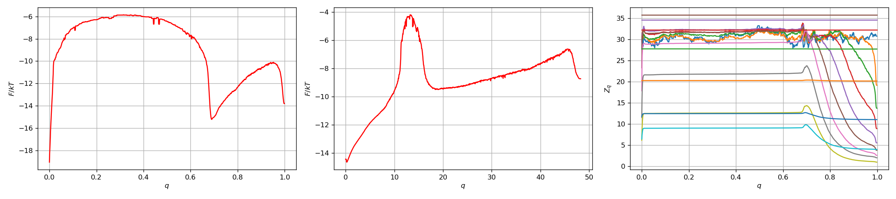
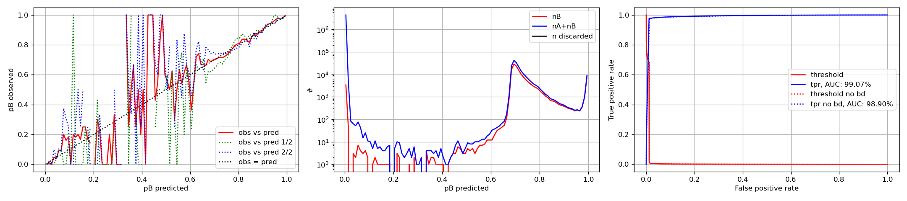
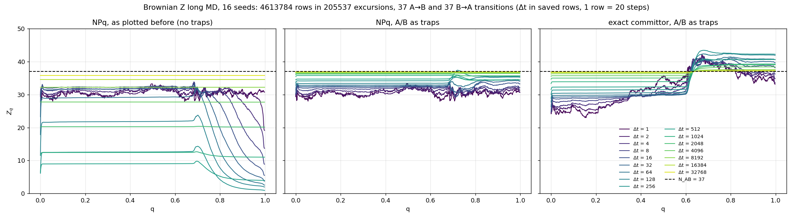
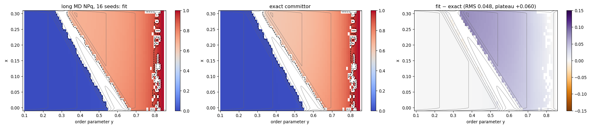

## Staple — NPNEq with forward + mirrored pieces ✅ (`sim_istarz_br_g10`, `--reversed`)

- Each path contributes its forward piece (cut at M) and its mirrored piece (the part
  before M, read backwards).
- Data: rejection weights, 1500 paths per ensemble (20.9M frames), 25000 iterations.
- **`zqs_z` 1.36, plateau +0.031, RMS 0.030.**

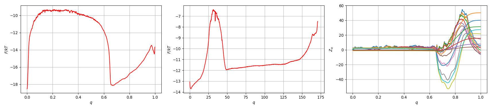
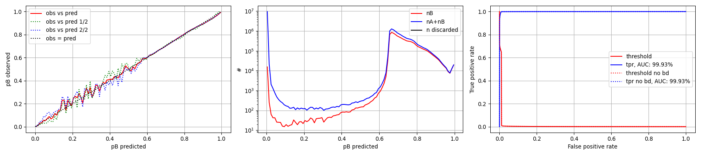
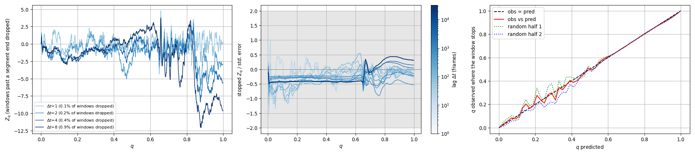
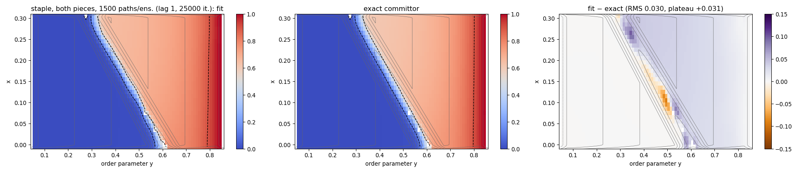

**Key test 1: are the data unbiased?** This test puts the *exact* committor into the
stopped Z_q of the data, with no fit. Worst z on the plateau at lags 1, 16, 256 and 4096:

| Data | Worst z |
|---|---|
| forward pieces only (the first fit: plateau +0.061) | +3.0 +2.8 +3.3 +2.6 ❌ |
| **forward + mirrored, rejection weights** | **+1.6 +1.2 +0.7 +1.4** ✅ |
| forward + mirrored, `staple` weights | −3.9 −4.1 −3.9 −1.9 ❌ |

**Key test 2: is the remaining +0.03 bias or noise?** The plot puts every fit on one axis;
fits of two disjoint halves of the same data are joined by a line.
- Synthetic walkers with a known committor, run until absorbed, give −0.007: the method
  is right.
- The same walkers cut at interfaces like path pieces already scatter by ±0.03 between
  halves.
- The staple fits scatter the same way, around +0.02.

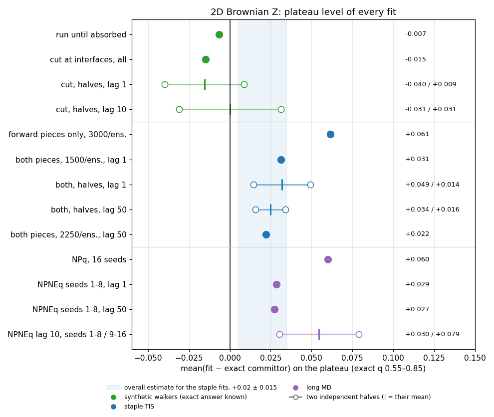

Why the cut pieces scatter:
- Only 3–19% of the pieces entering the plateau reach A or B; the rest end at an
  interface inside the plateau.
- A uniform shift of q there barely changes their increments, so the level is poorly
  pinned down.
- The martingale test (left) shows the data with rejection weights are unbiased. But the
  fitted q passes it too, so neither test can detect a plateau shift.

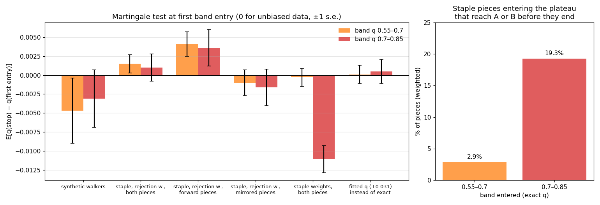

**Result: plateau +0.02 ± 0.015, mostly statistical.** It shrinks as 1/√N with more paths.
Estimate it from independent halves of the paths.

**Key test 3: which data preparation?** Same 1000 paths per ensemble, same fit, only the
preparation differs (notes §9.3):

| Preparation | `zqs_z` | RMS fit − exact |
|---|---|---|
| **both pieces, rejection weights** | 2.73 | **0.005** |
| forward pieces, rejection weights | 1.76 | 0.045 |
| both pieces, no weights / staple weights | 3.23 / 2.81 | 0.018 / 0.093 |
| no cut at M | 14.1 | 0.204 |
| both, pieces truncated at 200 frames (75% of the frames removed) | **0.70** | 0.075 |
| both, pieces longer than 200 frames discarded | 8.5 | 0.380 |

Both pieces with rejection weights is again the best. Truncation is only harmless when it
cuts a small tail (on the 1D flat run it removed 2% of the frames and changed nothing).
The `zqs_z` column ranks the preparations almost in reverse: it is computed on each
fit's own data.

---

# 2D underdamped Z potential, positions only ⚠️ (`sim_istarz_2603`, staple)

- Dynamics: γ = 2, kT = 0.05. No velocities recorded; 1000 paths per ensemble.
- Histories fail (`zqs_z` 30–37).
- **Best setup: CVs y, x, the finite-difference velocities Δy, Δx, the ridge-normal y + x
  and Δy + Δx, fit at lag 4.**
- `zqs_z` fell from 36 to 14 and was still falling. Lags 1–8 pass; the plateau still
  fails at long lags.
- There is no exact reference for this system.
- Not yet tested: this setup with the mirrored pieces, which fixed the 2D Brownian Z
  (`examples/base_documented_2d_langevin.ipynb`, now set up for it).
- Next step: record velocities and fit (y, x, v) at lag Δ.

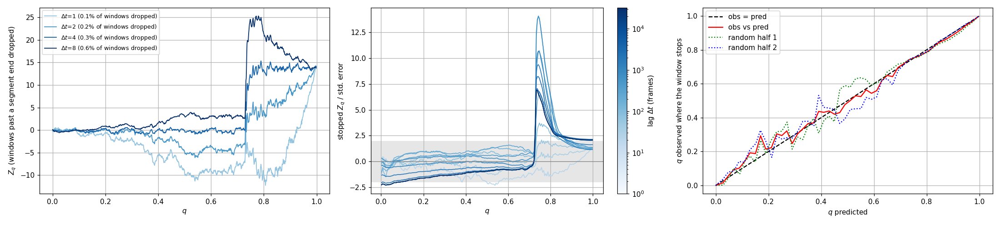
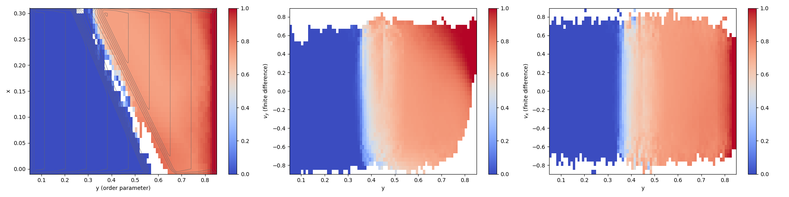
