# 1D underdamped cos well: which integrators let a position history replace the velocity?

> **Status (25 Nov):** all fits complete. Simplified version: `SIMPLE.md`. ASE maps (best seeds) are in
> `simple_best_ASE.png`; the ASE trajectory is `../langevin_md_ase_long/traj.npy` (50 runs, the fits use run 0).

## Question and answer

NPNEq is fitted on one long MD trajectory of the 1D cos well with two sets of inputs:

- **x, v**: the position and the recorded velocity, the full state of the dynamics, with no history.
- **x + history [0, 1]**: only the position, with the basis a polynomial in (x(t−1), x(t)). This pair contains
  the finite-difference velocity (x(t) − x(t−1))/dt.

The comparison runs over three Langevin integrators at the same physics: γ = 1, kT = 1, m = 1, dt = 0.005.

| | x, v | x + history [0, 1] |
|---|---|---|
| **EM** (Euler–Maruyama) | works | **works**, as well as x, v |
| **BBK** (toytis) | works | **fails**: Z_q is 20 % too high at short lags, nearly identical to ASE |
| **ASE** (Vanden-Eijnden–Ciccotti) | works | **fails**: Z_q is 20 % too high at short lags |

How well "works" holds depends on the seed for x, v (see the next section). The integrator difference is
in the history column.

**Why.** In EM the velocity stored with x(t) is the same velocity that moved x into x(t). Two positions
therefore give the full state, and (x(t−1), x(t)) is Markov. In BBK and ASE the stored velocity receives a
second kick after the position has moved. That kick only shows up in the next position step, mixed with new
noise. So positions alone are not Markov at lag 1, and a fit on (x(t−1), x(t)) cannot be a committor (its Z_q
is not flat). The theory section gives the details.

## Results

Fit settings for all three integrators, the same as `infretis_md_1d_langevin.ipynb`:
- Data: the first 2M frames. A: x ≤ −0.35, B: x ≥ 0.35.
- Iterations: a 1000-iteration warm-up at envelope 1, then 10000 iterations at envelope 0.01, γ_fit 0.1.
- Basis: ny 6, lazy basis, history type `'y(t-d),y(t)'`, shift `'r(t)'`.

RMS is fit − exact over the frames between A and B, per frame and per (x, v) bin. The exact committor is the grid
solve for each integrator's own step (`exact/q_exact_{EM,BBK,ASE}`). `max_sd_zq` is the library's largest
spread of the Z_q profiles across lags, in units of its error bar; lower is better.

| integrator | fit | seed | RMS per frame | RMS per bin | max_sd_zq | cross-entropy | AUC |
|---|---|---|---|---|---|---|---|
| EM | x, v | 1 | **0.0124** | 0.0104 | 6.2 | 0.3960 | 0.8726 |
| EM | x, v | 2 | 0.0362 | 0.0350 | 22.4 | 0.3976 | 0.8705 |
| EM | x, v | 3 | 0.0403 | 0.0395 | 31.2 | 0.3981 | 0.8697 |
| EM | x + history [0, 1] | 1 | **0.0136** | 0.0118 | 4.9 | 0.3960 | 0.8726 |
| EM | x + history [0, 1] | 2 | **0.0172** | 0.0155 | 6.8 | 0.3963 | 0.8722 |
| EM | x + history [0, 1] | 3 | **0.0122** | 0.0102 | 5.6 | 0.3960 | 0.8726 |
| BBK | x, v | 1 | **0.0071** | 0.0068 | 5.0 | 0.3869 | 0.8799 |
| BBK | x, v | 2 | 0.0400 | 0.0378 | 33.9 | 0.3895 | 0.8767 |
| BBK | x, v | 3 | 0.0405 | 0.0381 | 35.6 | 0.3895 | 0.8767 |
| BBK | x + history [0, 1] | 1 | 0.0302 | 0.0305 | **71.0** | 0.3894 | 0.8795 |
| BBK | x + history [0, 1] | 2 | 0.0329 | 0.0332 | **70.1** | 0.3898 | 0.8791 |
| BBK | x + history [0, 1] | 3 | 0.0308 | 0.0324 | **70.8** | 0.3893 | 0.8796 |
| ASE | x, v | 1 | **0.0179** | | ≈ 6.3 | | |
| ASE | x, v | 2 | 0.0437 | | ≈ 28 | | |
| ASE | x, v | 3 | 0.0457 | | | | |
| ASE | x + history [0, 1] | 0 | 0.0334 | | **≈ 64** | | |
| ASE | x + history [0, 1, 2, 4] | 1–3 | 0.0254–0.0268 | | ≈ 13 (seed 1) | | |

Notes on the ASE rows. They come from the notebook run (`infretis_langevin_md/langevin_md_ase_long/`). The RMS
values are from its printed output. The `max_sd_zq` values are read off its metrics plots, so they are
approximate. RMS recomputed from the copied q arrays: x, v seed 1 0.0179, history seed 0 0.0334, [0, 1, 2, 4] seed 1 0.0268.

The ASE fits sit about 0.01–0.02 below the reference in the middle of the well. This is sampling noise of
run 0, not a bias: in run 0 the MD outcome committor over free frames is 0.490, against 0.498 exact. Over
runs 0–9 the MD outcome and the exact committor agree per (x, v) bin: mean −0.0004, RMS 0.005.

### Reading the table

1. **x, v depends on the seed for every integrator.** Seed 1 reaches the reference noise level: 0.007–0.018 per
   frame. Seeds 2 and 3 stall at 0.036–0.046, with Z_q spread 22–36. Their error has the same shape in all three
   integrators: vertical edges near x ≈ ±0.27 (`fig_profiles.png`, `fig_maps.png`). This is the known stall of the
   lag-1 fit on (x, v) at a poor start (`docs/results_overview.md` §I.3). It has nothing to do with the
   integrator.
2. **EM history works.** All three seeds reach 0.012–0.017 per frame, with max_sd_zq 5–7, matching the best x, v
   seed. History is also *less* sensitive to the seed than x, v. A possible reason: the basis in (x(t−1), x(t))
   is better conditioned than the one in (x, v), but that has not been tested.
3. **BBK and ASE history fail, in the same way.**
   - **Z_q:** at short lags it rises to about 2060–2070 against N_AB ≈ 1720–1725, and only the long lags reach
     N_AB. The BBK and ASE panels in `fig_zq.png` are almost the same picture.
   - **max_sd_zq:** 70–71 for all three BBK seeds, against 5–7 for EM history.
   - **RMS:** 0.030–0.033 for BBK history, against 0.012–0.017 for EM history. The RMS hardly depends on the seed,
     so this is a systematic bias, not a convergence problem.
   - **Longer history helps partly.** For ASE, [0, 1, 2, 4] brings max_sd_zq from 64 to about 13 and RMS to 0.026,
     as the theory predicts.
4. **Cross-entropy and AUC barely see it.** BBK history and BBK x, v (seeds 2 and 3) both end at cross-entropy
   0.389–0.390. Only Z_q, or the comparison with the exact committor, separates "not Markov" from "converged".

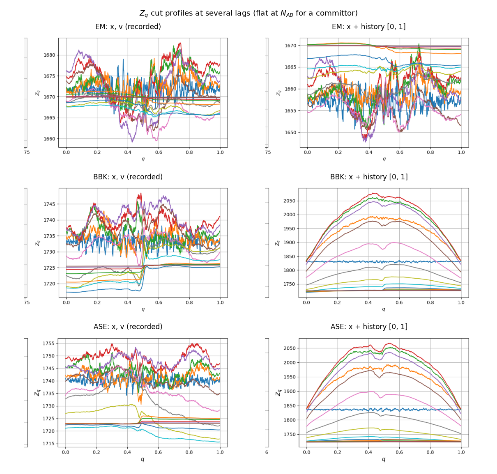

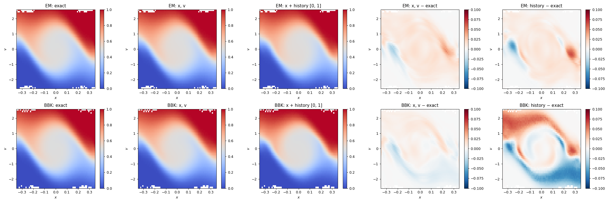

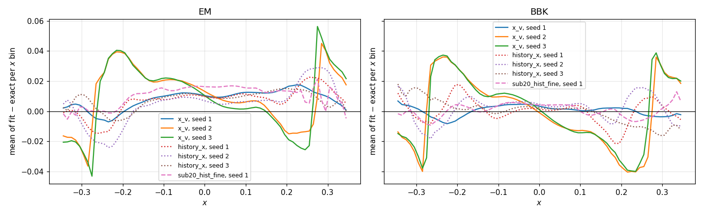

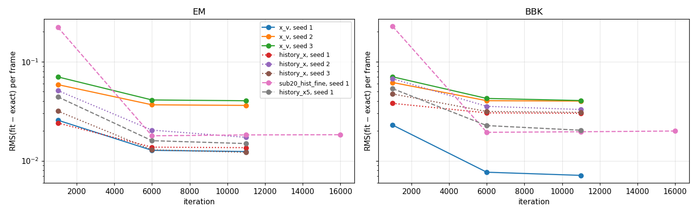

### q(x, v) for every fit and seed

The EM and BBK grids show q per (x, v) bin and fit − exact next to it, with the RMS per frame in the title. The
ASE grid shows the notebook's q(x, v) images. There is no error map for ASE because its trajectory is missing.

What the error maps show, comparing the failure modes:
- **x, v from a poor start (seeds 2 and 3, all integrators):** sharp vertical edges at x ≈ ±0.27, with errors up
  to ±0.1 in narrow bands. This is the lag-1 stall.
- **BBK x + history [0, 1] (all three seeds):** no edges. The error is a smooth, seed-independent pattern of about
  ±0.05: too high at large v > 0, too low at large v < 0, and rings along the energy contours. This is the
  signature of the non-Markov input: a systematic bias in how energy diffuses, not a convergence problem. The
  ASE history map (seed 0) has the same smooth shape.
- **EM x + history [0, 1]:** about ±0.02 everywhere. The largest errors are small lobes near the bumps at
  x ≈ ±0.27.

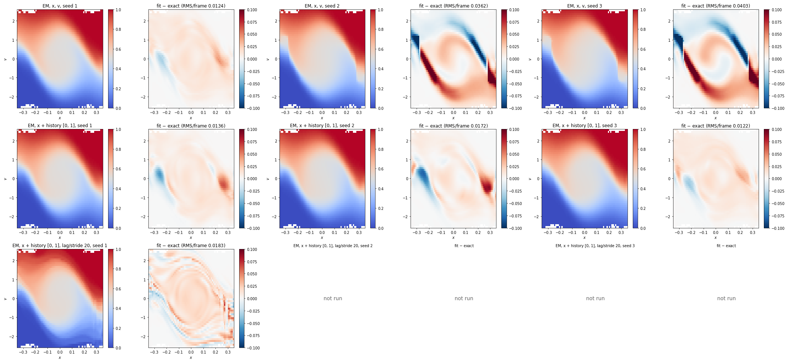

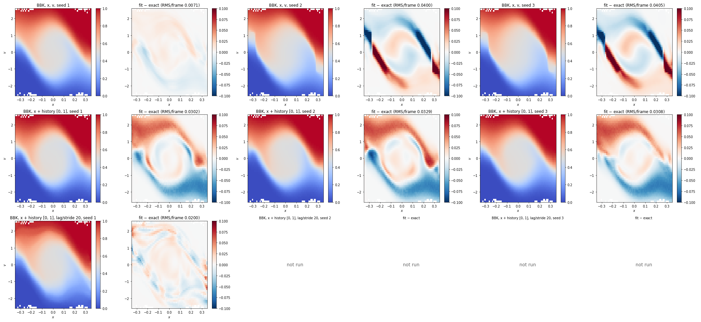

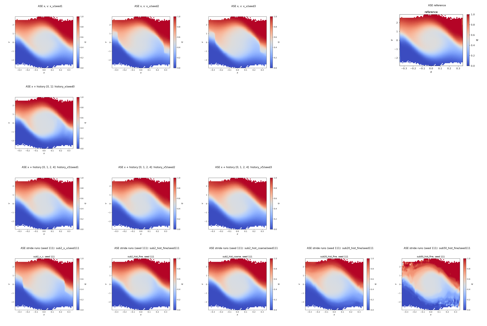

### Independent EM check at dt = 0.01 (`qq_-Copy1.ipynb`)

The EM integrator in this notebook is written out explicitly: v ← v + (F − γv)·dt + noise, then x ← x + v·dt.
It uses dt = 0.01 and 3M steps, and fits x + history [0, 1] with γ_fit 0 (2000 iterations at envelope 1e6, then
10000 at 0.01). It does the fit forward and on the time-reversed trajectory, and has no x, v fit and no exact
reference.

The forward fit's Z_q stays within about 5100–5165 at every lag, roughly a 1 % spread, against 20 % for ASE.
Obs-vs-pred lies on the diagonal. So the EM result holds at a second time step too.

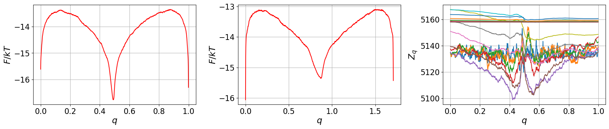
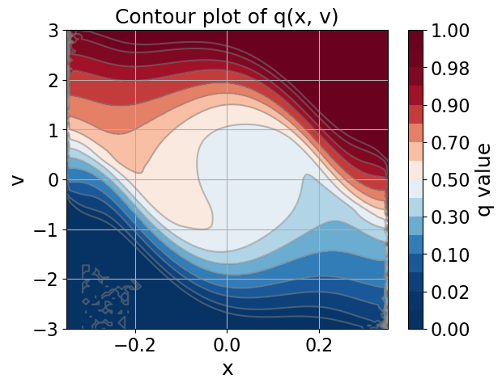

(In that notebook's combined figure, panel a is empty because its `ylim` of 1632–1658 does not cover the Z_q
values of about 5100–5165.)

## Why the integrator matters

Notation: γ is the friction, ξ(t) the random kick of step t, dt the time step, with γ·dt ≪ 1 (here 0.005);
v(t−½) and v(t+½) are the half-step velocities, η(t) is a random kick that moves only x (coefficient c₅). Forces
are left out because they do not change the argument.

**EM**

```
v(t) = (1 − γ·dt)·v(t−1) + ξ(t)
x(t) = x(t−1) + v(t)·dt
```

The velocity stored with x(t) is the one that moved it, so v(t) = [x(t) − x(t−1)]/dt exactly. The next
velocity is (1 − γ·dt)·v(t) + ξ(t+1), with ξ(t+1) fresh. Two positions give the full state, which is Markov.

**BBK and ASE** (kick, drift, kick)

```
v(t−½) = (1 − γ·dt/2)·v(t−1) + ξ(t)
x(t)   = x(t−1) + dt·v(t−½) + c₅·η(t)
v(t)   = (1 − γ·dt/2)·v(t−½) + ξ(t)      stored velocity: second half kick, same ξ(t) (ASE) or a correlated one (BBK)
```

Positions give only x(t) − x(t−1) = dt·v(t−½) + c₅·η(t): the half-step velocity plus a position-only kick, so even
v(t−½) cannot be read off them. (In ASE, η enters the velocity only at order γ·dt; BBK has the same structure with
correlated position and velocity kicks.) They show v(t−½) only through this sum, but the next step needs v(t):

```
v(t+½) = (1 − γ·dt/2)·v(t) + ξ(t+1) = (1 − γ·dt/2)²·v(t−½) + (1 − γ·dt/2)·ξ(t) + ξ(t+1)
```

The term (1 − γ·dt/2)·ξ(t) cannot be recovered from the past. In v(t−½) = (1 − γ·dt/2)·v(t−1) + ξ(t), ξ(t) is
added to v(t−1) in a single sum, and v(t−1) hides ξ(t−1) the same way, and so on. The residual
v(t+½) − (1 − γ·dt/2)²·v(t−½) = ξ(t+1) + (1 − γ·dt/2)·ξ(t) is therefore correlated from one step to the next, with
autocorrelation ≈ ½ (for γ·dt ≪ 1). That is memory, so v(t−½) is not Markov.

Predicting the position that has just been taken is possible for any integrator. What NPNEq needs is that the
current input also predicts the next velocity, and that fails here.

**Free particle with the same γ·dt, simulated with `exact_tools` steps.** "Velocity noise not visible in
positions" is Var(v(t) | positions) divided by the velocity noise added per step, 2γ·dt·kT/m:

| integrator | that ratio, given x(t), x(t−1) | given 8 past differences | autocorrelation of the residual when predicting x(t+1) from x(t), x(t−1) |
|---|---|---|---|
| EM | 0.000 | 0.000 | +0.002 |
| BBK | 0.333 | 0.288 | +0.249 |
| ASE | 0.333 | 0.289 (unchanged up to 400 differences) | +0.248 |

How long a history would have to be (ASE, same free particle). The same ratio, for K past frames of the exact
half-step velocity v(t−½) (not in the saved data) and of the velocity from position differences:

| K | 1 | 2 | 8 | 32 | 128 | 400 |
|---|---|---|---|---|---|---|
| exact v(t−½) | 0.249 | 0.125 | 0.031 | 0.007 | 0.001 | 0.000 |
| from positions | 0.333 | 0.292 | 0.289 | 0.289 | 0.289 | 0.288 |

The exact half-step velocity falls like 0.25/K. From positions the ratio stops at 0.29: the position-only kick
c₅η cannot be separated from the velocity, whatever the length of the history.

A Markov test of the velocity w itself: the autocorrelation of the residual when predicting w(t+1) from w(t).
It is zero for a Markov w.

| w | residual autocorrelation |
|---|---|
| EM: stored v (= the half-step velocity) | 0.00 |
| OBABO (Langevin, one drift per step, noise only between drifts): finite-difference velocity | −0.001 |
| BBK / ASE: finite-difference velocity | +0.25 |
| ASE: internal half-step velocity v(t−½) (`vh`) | **+0.50** (≈ ½, see above) |
| BBK / ASE: stored full-step v | 0.00 |

Consequences:
- **x, v works for every integrator,** because (x, v) at the full step is their Markov state.
- **x + history [0, 1] works for EM and OBABO-type schemes** and fails at lag 1 for BBK and ASE.
- **Longer histories of position differences help only partly.** The ratio stops at 0.29, because the position-only
  kick c₅η cannot be separated from the velocity. A history of several exact half-step velocities would work
  (about 0.25/K), but they are not in the saved data.
- **The error is small in thermal terms but large per step.** The missing velocity is only about 6 % of the
  thermal speed. But it is a third of the velocity noise added in each step, which is the scale the lag-1 equation
  works on. At low friction it biases the energy diffusion that sets q(x, v).

## Larger fit lag / stride (`delta_t`, `delta_t_stride`)

In these fits the update uses only every `SUB`-th frame (fit lag `SUB` = 2, 20, 50). The history is still taken
on the fine grid: [0, 1] means x(t−1) ("fine"). "Coarse" means [0, SUB]. A transition stops at the first frame in
A or B, also between the subsampled frames.

The point of a larger lag: the hidden part of the velocity has a fixed size per step, while the velocity noise
accumulated over Δ steps grows with Δ. For BBK and ASE the relative error should therefore shrink roughly as
1/Δ.

| integrator | fit | lag / stride | iterations | RMS per frame | max_sd_zq |
|---|---|---|---|---|---|
| EM | x + history [0, 1] (fine) | 20 | 16000 | 0.0183 | 68 |
| BBK | x + history [0, 1] (fine) | 20 | 16000 | **0.0200** (per bin 0.0101) | 76 |
| ASE | x, v | 2 | 16000 | n/a | ≈ 20 |
| ASE | x + history [0, 1] (fine) | 2 | 16000 | n/a | ≈ 41 |
| ASE | x + history [0, 2] (coarse) | 2 | 16000 | n/a | ≈ 70 |
| ASE | x + history [0, 1] (fine) | 20 | 16000 | n/a | ≈ 64 |
| ASE | x + history [0, 1] (fine) | 50 | 16000 | 0.0513 (0.0429 at 6000, rising) | ≈ 350, rising |

ASE stride runs: seed 111, from the notebook's figures. Only the sub50 run printed its RMS.

Reading:
- **`max_sd_zq` is not the right measure for these fits.** It includes the short lags, but a lag-Δ fit should be
  judged at lags ≥ Δ only. See the EM stride-20 fit: RMS 0.018 per frame, close to the lag-1 fits, but
  max_sd_zq 68, because of small wiggles at lags below 20. A proper comparison needs Z_q restricted to lags ≥ Δ.
  That is still to do, from the saved `q_traj.npy` files for EM and BBK. For ASE it is not possible, because the
  trajectory is missing.
- **At stride 2, fine history beats coarse** (41 vs 70 for ASE), as expected.
- **ASE stride 50 gets worse with more iterations** (RMS 0.043 → 0.051). The map has noisy speckle at high |v|.
  With 50× fewer transitions (27.6k) the polynomial fit seems to overfit its sparse corners.
- **EM at stride 20 stays accurate with 20× fewer transitions:** RMS 0.018, against 0.012–0.017 at lag 1.
- **BBK at stride 20 largely removes the history bias, as predicted.** RMS per bin goes from 0.031–0.033 (lag 1)
  to 0.010, as good as the best BBK x, v fit (0.007). RMS per frame is 0.020; it is higher than per bin because
  each frame carries the scatter of the unseen velocity noise. In `fig_stride_zq.png` the long lags (≥ 20) are
  flat at N_AB, and only the lags below the fit lag wiggle: EM's overshoot, BBK's undershoot. A fit at lag Δ makes
  the hidden part of the velocity small next to Δ steps of velocity noise, so the input behaves as nearly Markov.
- **What the stride runs settle:** for BBK and ASE, the history works once the fit lag is long enough. A position
  history needs a longer fit lag than the full (x, v) state does.

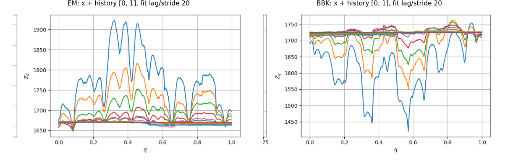

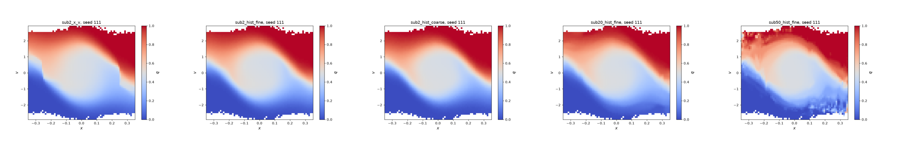

## Data and files

| integrator | trajectory (first 2M frames) | exact committor |
|---|---|---|
| EM | `../langevin_md/fits/euler_md_wel_lgv_3M.npy` | `../exact/q_exact_EM_on_md_frames.npy` |
| BBK | `PyRETIS3/toytis/simulations/md_istarwell2_100M/md_path.npy` | `../exact/q_exact_BBK_on_md_frames.npy` |
| ASE | `../langevin_md_ase_long/traj.npy` (run 0 of 50) | `../exact/q_exact_ASE.npz` |

- `run_fits.py`: the EM and BBK fits. It writes `results.json`, and per fit `<integrator>/<fit>/seed<s>/`
  (`q_traj.npy`, `metrics.json`, plots). It skips fits that are already in `results.json`.
- `make_figures.py`: all `fig_*.png`. Rerun it when `run_fits.py` has finished.
- `qq_em_dt0.01/`: the figures from `qq_-Copy1.ipynb`.
- ASE runs: `../infretis_langevin_md/langevin_md_ase_long/` (notebook `examples/infretis_md_1d_langevin.ipynb`).
