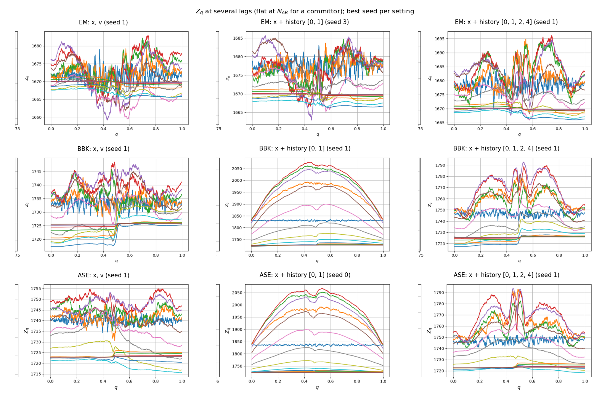
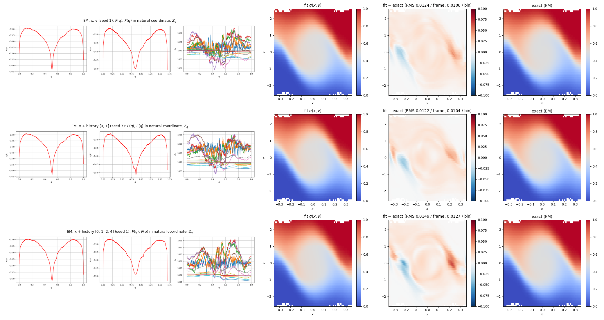
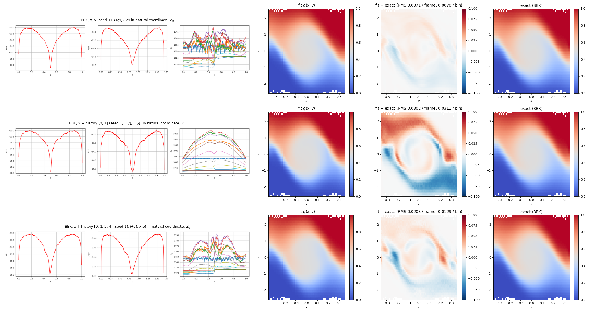
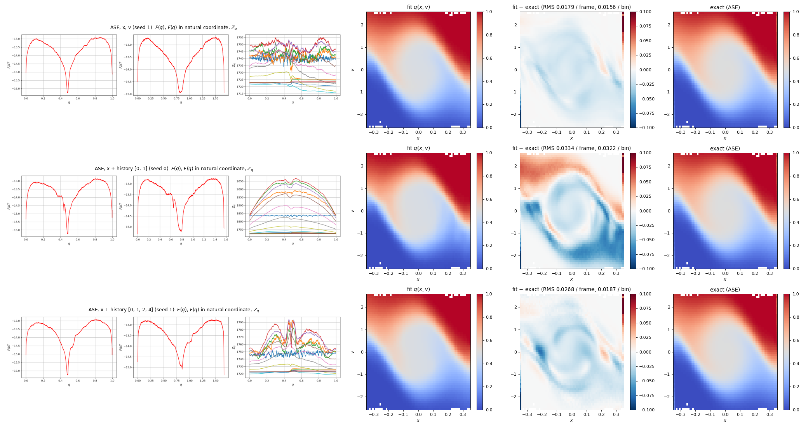
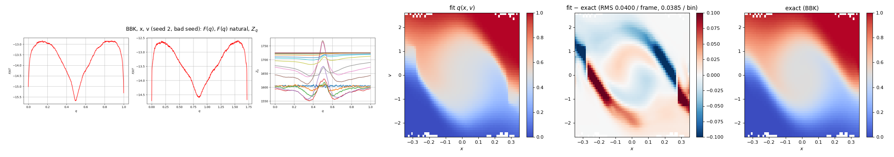
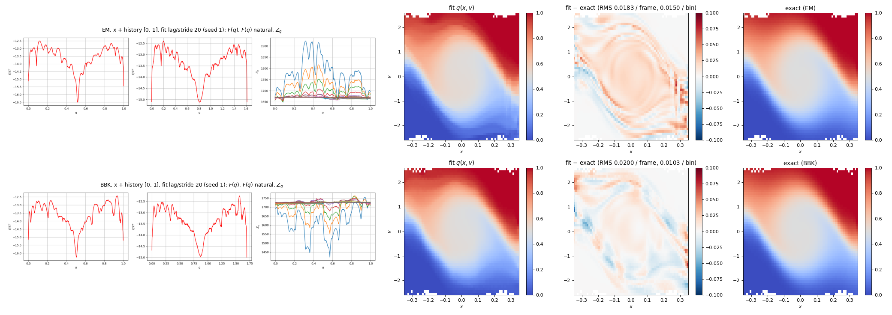
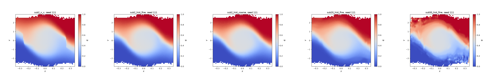
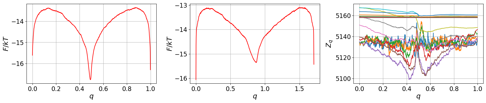
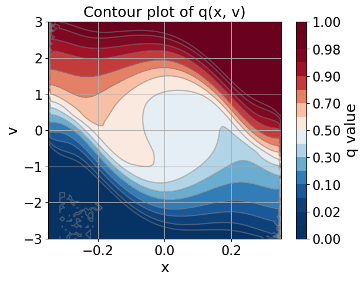

# Position histories vs integrator: 1D underdamped cos well

- **Fit:** NPNEq on one MD trajectory, 2M frames, γ = 1, kT = 1, dt = 0.005, A: x ≤ −0.35, B: x ≥ 0.35.
- **Fit settings:** warm-up 1000 iterations at envelope 1, then 10000 at envelope 0.01, γ_fit 0.1, ny 6.
- **Inputs:** **x, v** (recorded velocity, no history); **x + history [0, 1]** or **[0, 1, 2, 4]** (x only,
  basis in (x(t−d), x(t)), shift `'r(t)'`).
- **Integrators:** EM (Euler–Maruyama), BBK (toytis), ASE (Vanden-Eijnden–Ciccotti).
- **Exact committor:** grid solve for each integrator's own step.
- **Which seed:** the one with the lowest RMS. Full tables: `README.md`.

## Result

| integrator | x, v | x + history [0, 1] | x + history [0, 1, 2, 4] |
|---|---|---|---|
| EM | ✓ (RMS 0.012) | **✓ (0.012)** | ✓ (0.015) |
| BBK | ✓ (0.007) | **✗ (0.030)**: Z_q +20 % at short lags | partial (0.020): Z_q +4 % |
| ASE | ✓ (0.018) | **✗ (0.033)**: Z_q +20 % at short lags | partial (0.027): Z_q +4 % |

RMS is per frame, against the exact committor.

<!-- - **ASE offset (about −0.01 to −0.02 in every ASE fit):** sampling noise of the single run used (run 0 of 50,
  about 5500 transitions), not a bias of the method or the reference.
  - In run 0, the MD outcome committor over free frames is 0.490, against 0.498 for the exact one.
  - Over runs 0–9, the MD outcome and the exact committor agree per (x, v) bin: mean −0.0004, RMS 0.005. -->

- x, v works for every integrator, provided the seed is good. Poor seeds stall at RMS 0.036–0.046 for all three.
- History [0, 1] with the type `'y(t-d),y(t)'` matches x, v for EM only. For BBK and ASE it fails, with the same Z_q signature in both.
  The mixed type including `r(t-d)` fixes most of it (section "New history type").
- History [0, 1, 2, 4] reduces the failure but does not remove it. BBK and ASE again give the same Z_q pattern
  (EM and BBK at seed 1, one seed each; the ASE notebook seeds 1–3 give 0.025–0.027).
- Cross-entropy and AUC do not detect the failure. Z_q, or the comparison with the exact committor, does.



## Best seed per setting

Each row: F(q), F(q) in the natural coordinate, Z_q | q(x, v) | fit − exact | exact.







- **BBK and ASE with history [0, 1]:** a smooth error of about ±0.05, the same for every seed. q is too high at
  large positive v, too low at large negative v, with rings along the energy contours: the energy diffusion is
  biased. There are no edges, so this is not a convergence problem.
- **EM with history [0, 1]:** about ±0.02, as good as x, v.
- **[0, 1, 2, 4] for BBK and ASE:** the same shape at about half the size. Per bin, RMS drops from 0.031–0.032
  to 0.013 (BBK) and 0.019 (ASE).

## Example of a bad x, v seed (BBK, seed 2)



- **Same data and settings as the good seed 1 (RMS 0.007);** only the seed differs. RMS 0.040 per frame, max_sd_zq 34 against 5.
- **Z_q:** about 7 % too low at short lags (≈ 1600 against N_AB ≈ 1725), with a bump at q ≈ 0.5. This differs from the history failure, which is 20 % too high and smooth.
- **Same in all three integrators:** seeds 2 and 3 stall at 0.036–0.046 (EM 0.036 / 0.040, BBK 0.040 / 0.041, ASE 0.044 / 0.046), and seed 1 is good in all three.
- **Cause:** the lag-1 (x, v) fit depends on its start, i.e. on which CV and envelope centre the first iterations draw 

<!-- LARGER FIT LAG SECTION (EM/BBK lag-20 fits, ASE stride runs): commented out for now, delete this line and the closing marker below to include it

## Larger fit lag (`delta_t = delta_t_stride = SUB`)

- **Setup:** the update uses only every SUB-th frame. The history stays on the fine grid: [0, 1] is x(t−1)
  ("fine"); "coarse" is [0, SUB]. A transition stops at the first frame in A or B, also between the subsampled
  frames.
- **Prediction:** the hidden velocity noise has a fixed size per step, while the velocity noise over SUB steps
  grows with SUB. For BBK and ASE the history bias should shrink roughly as 1/SUB.

| integrator | fit | SUB | iterations | RMS / frame | RMS / bin | max_sd_zq |
|---|---|---|---|---|---|---|
| EM | x + history [0, 1] (fine), seed 1 | 20 | 16000 | 0.018 | 0.015 | 68 |
| BBK | x + history [0, 1] (fine), seed 1 | 20 | 16000 | **0.020** | **0.010** | 76 |
| ASE | x, v, seed 111 | 2 | 16000 | n/a | n/a | ≈ 20 |
| ASE | x + history [0, 1] (fine), seed 111 | 2 | 16000 | n/a | n/a | ≈ 41 |
| ASE | x + history [0, 2] (coarse), seed 111 | 2 | 16000 | n/a | n/a | ≈ 70 |
| ASE | x + history [0, 1] (fine), seed 111 | 20 | 16000 | n/a | n/a | ≈ 64 |
| ASE | x + history [0, 1] (fine), seed 111 | 50 | 16000 | 0.051 (0.043 at 6000) | n/a | ≈ 350 |

ASE stride runs: from the notebook's plots and printout; their q arrays are not here.

- **BBK, lag 20:** the history bias is gone. RMS per bin is 0.010 (lag 1: 0.031), close to BBK x, v (0.007), and
  the smooth v-dependent band in the error map has disappeared.
- **RMS per frame stays at 0.02:** each frame still carries the scatter of the velocity noise it cannot see. The
  per-bin average removes that scatter.
- **EM, lag 20:** accurate with 20× fewer transitions (0.018, against 0.012 at lag 1). There is nothing to gain,
  since EM history already works at lag 1.
- **Z_q:** flat at N_AB for lags ≥ 20. The lags below 20 wiggle: EM overshoots, BBK undershoots. That is why
  max_sd_zq (68, 76), which includes the short lags, is not the right measure here. A lag-Δ fit should be judged at
  lags ≥ Δ.
- **F(q) is wiggly:** q is only constrained over 20-frame steps, so it can vary on shorter scales.
- **ASE, SUB 2:** fine history beats coarse (max_sd_zq ≈ 41 vs ≈ 70).
- **ASE, SUB 50:** gets worse with more iterations, with speckle at high |v|. With 27.6k transitions the polynomial
  basis overfits its sparse corners.





END OF LARGER FIT LAG SECTION -->

## New history type (EM, BBK, ASE)

- **Setup:** x + history [0, 1], `history_type = ['y(t-d),y(t)', 'y(t-d),r(t-d)']` (one drawn at random each iteration;
  the second uses the earlier committor estimate r(t−d) and x(t−d)). Seed 2611, 1000 warm-up + 25000 main iterations.
  Same data, settings and exact references as above; one seed per integrator.

| integrator | old type [0, 1]: RMS / frame | new type: RMS / frame | new type: RMS / bin | Z_q (read from plot) |
|---|---|---|---|---|
| EM | 0.012 | 0.0138 | 0.0117 | flat within ±1 % |
| BBK | 0.030 | **0.0166** | **0.0073** | flat within about ±1 %, dip to −1.6 % at q ≈ 0.5 |
| ASE | 0.033 | **0.0238** | 0.0166 | flat within about ±1 % |

- **BBK and ASE:** the +20 % Z_q excess and the smooth v-dependent error band are gone. What remains is a localized
  error of about ±0.05 in two streaks near x ≈ ±0.22, v ≈ 0, the same place in all three integrators (EM included).
- **BBK per bin 0.0073** is close to BBK x, v (0.007). **EM** is unchanged (already worked with the old type).
- **ASE** also has the uniform offset of about −0.01 seen in every ASE fit (run-0 sampling noise).
- **One seed each:** the figure does not show the seed-to-seed spread.

![x + history [0, 1], new history type, seed 2611](simple_ry.png)

## Independent EM check (`qq_-Copy1.ipynb`, dt = 0.01, 3M steps, x + history [0, 1], γ_fit 0)

- Z_q stays within 5100–5165 at every lag, a 1 % spread (BBK and ASE history: 20 %).
- Obs-vs-pred lies on the diagonal.




## Why the integrator matters

Notation: γ is the friction, ξ(t) the random kick of step t, dt the time step, with γ·dt ≪ 1 (here 0.005).
v(t−½) and v(t+½) are the half-step velocities, η(t) is a random kick that moves only x (coefficient c₅).
Forces are left out.

**EM:** the stored velocity is the one that moved x, so positions give it exactly, and (x(t−1), x(t)) is Markov.

```
v(t) = (1 − γ·dt)·v(t−1) + ξ(t)
x(t) = x(t−1) + v(t)·dt
```

**BBK and ASE (kick, drift, kick):** the stored velocity gets a second kick after x has moved.

```
v(t−½) = (1 − γ·dt/2)·v(t−1) + ξ(t)
x(t)   = x(t−1) + dt·v(t−½) + c₅·η(t)
v(t)   = (1 − γ·dt/2)·v(t−½) + ξ(t)        stored velocity (the state): same ξ(t) again (ASE) or a correlated one (BBK)
v(t+½) = (1 − γ·dt/2)²·v(t−½) + (1 − γ·dt/2)·ξ(t) + ξ(t+1)
```

Positions give only x(t) − x(t−1) = dt·v(t−½) + c₅·η(t): the half-step velocity plus a position-only kick, so even
v(t−½) cannot be read off them. BBK has the same structure, with correlated position and velocity kicks.

- **Hidden noise:** the position step is one number, dt·v(t−½) + c₅η(t), so ξ(t) is mixed with v(t−1) and with η(t). It
  appears again in v(t) and v(t+½).
- **Memory:** the residual ξ(t+1) + (1 − γ·dt/2)·ξ(t) has autocorrelation ≈ ½ (for γ·dt ≪ 1). Measured: 0.50 for ASE's half-step
  velocity, 0.25 for the finite-difference velocity of BBK and ASE, 0.00 for EM.
- **Size** (free particle, ASE γ and dt; share of the velocity noise added per step that K past frames do not determine):
  - exact half-step velocities: 0.25, 0.13, 0.03 for K = 1, 2, 8 (about 0.25/K);
  - velocities from position differences: 0.33, 0.29, 0.29 for K = 1, 2, 8, and still 0.29 at K = 128.
  - The plateau is c₅η: this is why [0, 1, 2, 4] helps only partly.
- **Small in thermal terms, large per step:** about 6 % of the thermal speed, but the lag-1 equation works on the
  per-step scale.
- **Remedy:** fit at a larger lag. BBK with history [0, 1] at fit lag/stride 20 reaches RMS 0.010 per bin
  (lag 1: 0.031), and Z_q is flat at lags ≥ 20.
